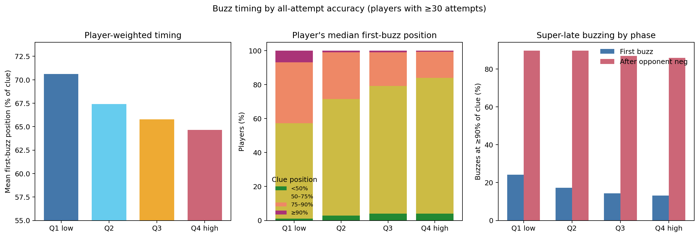
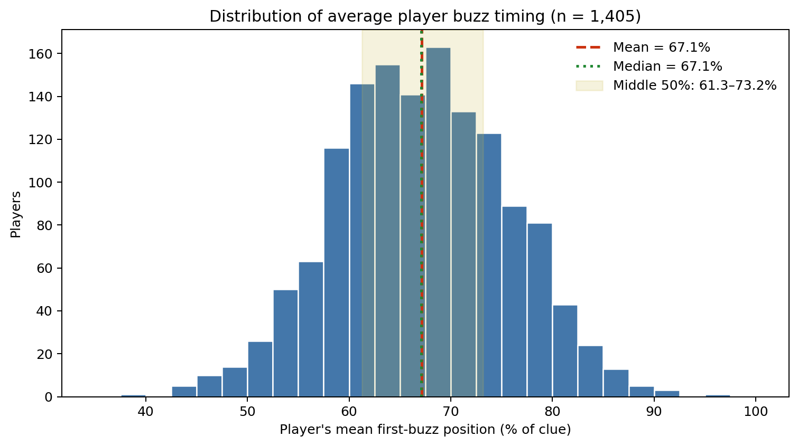
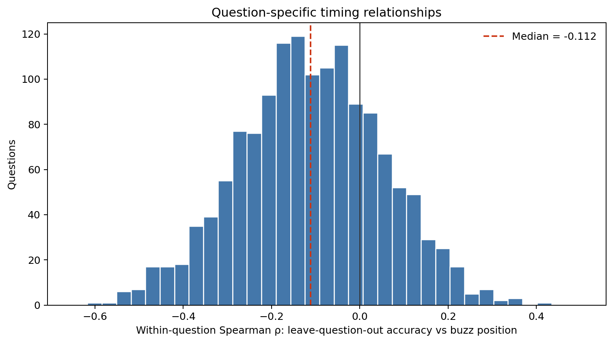

# Buzz accuracy and early/late buzzing

## Bottom line

Using the literal dataset definition—every recorded buzz is an attempt and any positive value is correct—higher-accuracy players buzz earlier on average. This is a smooth, overlapping gradient rather than two clean clusters of “early” and “late” players.

Among 1,405 players with at least 30 attempts, the low-accuracy quartile averaged its first buzz at 70.6% of the clue, versus 64.7% for the high-accuracy quartile. The player-bootstrap high-minus-low difference is -6.0% (95% CI -7.2% to -4.7%).

Defining “earlier-style” relatively as below the overall player median mean position (67.1%), 34.6% of Q1 and 60.5% of Q4 are earlier-style (difference 25.9%, 95% CI 18.8% to 33.0%). That separation is meaningful but far from perfect.

The proposed “high accuracy = early or super-late after an opponent misses” story is only half supported. Q4 players are super-late after an opponent neg on 86.0% of such buzzes, but Q1 players are at least as likely to be super-late (89.7%). Post-neg buzzing is overwhelmingly late for everyone, not a special high-accuracy subgroup.

## Distribution of average player timing

Each eligible player contributes once. The mean player buzz position is 67.1%, the median is 67.1%, and the middle 50% of players range from 61.3% to 73.2% of the clue.

## Primary bin results

Accuracy quartiles are player-weighted and cut at 70.7%, 78.1%, and 83.9%. Timing fractions below are pooled first-buzz events; mean position is first computed per player and then averaged so prolific players do not dominate.

| Accuracy bin | Players | Mean accuracy | Mean player position | First <50% | First 75–90% | First ≥90% | Post-neg ≥90% |
| --- | ---: | ---: | ---: | ---: | ---: | ---: | ---: |
| Q1 low | 353 | 62.2% | 70.6% | 19.0% | 22.4% | 24.2% | 89.7% |
| Q2 | 351 | 74.7% | 67.4% | 22.4% | 22.7% | 17.3% | 89.7% |
| Q3 | 352 | 80.9% | 65.8% | 24.0% | 22.0% | 14.4% | 87.0% |
| Q4 high | 349 | 88.3% | 64.7% | 24.9% | 21.4% | 13.1% | 86.0% |

At player level, accuracy and mean first-buzz position have Pearson r = -0.297 (p = 4.7e-30) and Spearman ρ = -0.256 (p = 1.9e-22).

The result is stable to the player sample-size floor: with minimums of 20, 30, 50, and 100 attempts, the Q4-minus-Q1 position differences are -5.8%, -6.0%, -6.9%, -5.5%, respectively.

## Question-controlled and specific-question checks

For each first-buzz row, player accuracy here is recomputed after excluding all of that player's attempts on the focal tossup. This prevents the question being analyzed from helping define the player's accuracy. Questions qualify with at least 30 eligible first buzzes, at least 3 accuracy bins, at least 10 distinct accuracy values, and at least a 15-point accuracy spread.

Across 1,430 qualifying tossups, 74.8% have a negative accuracy–position correlation and the median Spearman ρ is -0.112. The one-sided sign-test p-value against a 50/50 split is 9.6e-82. After Benjamini–Hochberg correction across questions, 21 are significantly negative and 0 significantly positive at FDR 5%.

A question fixed-effect regression gives a slope of -0.221; equivalently, +10 accuracy points is associated with buzzing 2.2 percentage points earlier within the same tossup.

Strong negative examples that survive the across-question FDR correction:

| Pattern | Answer | n | ρ | Q1 mean position | Q4 mean position | FDR q |
| --- | --- | ---: | ---: | ---: | ---: | ---: |
| `2024-acf-regionals::01272024::p6::q15` | Maya Angelou [or Marguerite Annie Johnson] (The first poem is “Weekend Glory.”) | 38 | -0.599 | 82.5% | 58.4% | 0.025 |
| `2025-acf-regionals::2025-02-01::p117::q4` | madrigal [or madrigaux; prompt on song] | 52 | -0.527 | 95.8% | 60.0% | 0.025 |
| `2025-acf-regionals::2025-02-01::p112::q19` | Ryūnosuke Akutagawa [or Akutagawa Ryūnosuke] | 53 | -0.509 | 96.7% | 62.0% | 0.025 |
| `2025-acf-regionals::2025-02-01::p117::q15` | written vernacular Chinese [or Classical Chinese; or Literary Chinese; accept Mandarin; accept Mode… | 58 | -0.488 | 80.8% | 57.1% | 0.025 |

The strongest contrary examples are shown below for completeness. None remains significant at FDR 5%, so they should be treated as question-level exceptions/noise rather than established reversals.

| Contrary | Answer | n | ρ | Q1 mean position | Q4 mean position | FDR q |
| --- | --- | ---: | ---: | ---: | ---: | ---: |
| `2024-acf-fall::fall::p39::q9` | Jibril [or Gabriel or Jibrā’īl or Rūḥ al-’Amīn or Rūḥ al-Quddus] | 52 | 0.413 | 56.5% | 72.3% | 0.095 |
| `2024-acf-fall::fall::p37::q2` | Nero [or Nero Claudius Caesar Augustus Germanicus or Lucius Domitius Ahenobarbus] | 59 | 0.341 | 65.6% | 83.9% | 0.138 |
| `2024-acf-fall::fall::p33::q8` | Spanish Civil War [or Guerra Civil Española] | 50 | 0.360 | 43.5% | 53.2% | 0.164 |

## Crucial sensitivity: what counts as an attempt?

There are 3,767 value-0 first attempts; 99.8% occur at or after 90% of the clue and their median position is 100.0%. These rows are both incorrect and extremely late, so they strongly couple low all-attempt accuracy to late timing.

When accuracy and timing are both restricted to ordinary scored attempts (−5/+10), the gradient does not replicate: Q1 averages 64.8% and Q4 averages 67.0%; the player-level Pearson r is 0.107, and the within-question slope is 0.081. Under that common alternative definition, higher scored-attempt accuracy is slightly associated with later, not earlier, buzzing.

So the safe conclusion is: **yes, the raw all-attempt data show a clear earlier-timing gradient with accuracy, including within many specific questions; no, they do not show two sharply separated player types, and the result is not robust to excluding value-0 end-of-question attempts.**

## Scope and files

This is descriptive and conditional on a recorded buzz. It does not include rostered players who never buzzed on a question, estimate a causal effect of accuracy, or resolve the dataset's intentionally unmerged numeric-suffix player IDs. Positions beyond the sanitized text length are clamped to 100% for summaries.

- [`player_summary.csv`](player_summary.csv): one row per eligible player.
- [`accuracy_bin_summary.csv`](accuracy_bin_summary.csv): primary player- and event-weighted bin results.
- [`average_player_timing_distribution.csv`](average_player_timing_distribution.csv): 5%-wide player timing histogram bins.
- [`sensitivity_summary.csv`](sensitivity_summary.csv): alternate attempt/timing definitions.
- [`minimum_attempts_robustness.csv`](minimum_attempts_robustness.csv): checks at 20/30/50/100 attempts.
- [`question_level.csv`](question_level.csv): one row per tossup with correlation, p-value, and FDR value.
- [`question_accuracy_bin_summary.csv`](question_accuracy_bin_summary.csv): bin summaries for every qualifying tossup.
- [`analyze.py`](analyze.py): reproducible analysis.
