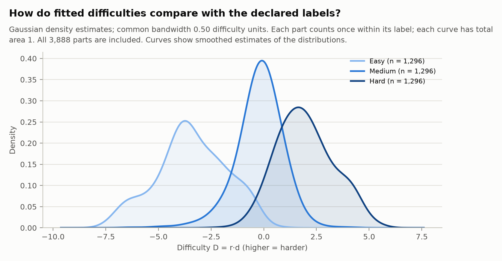
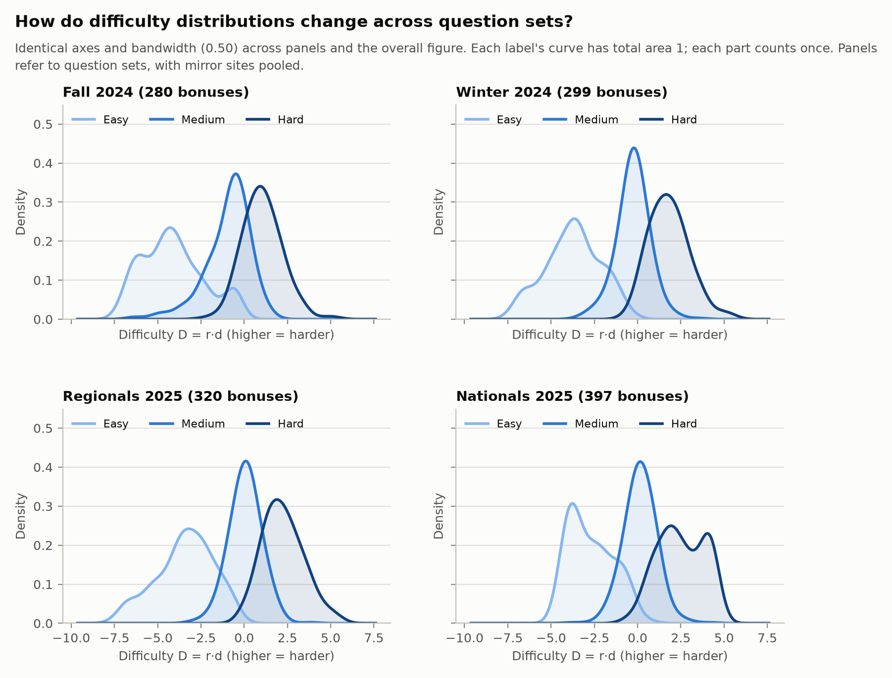
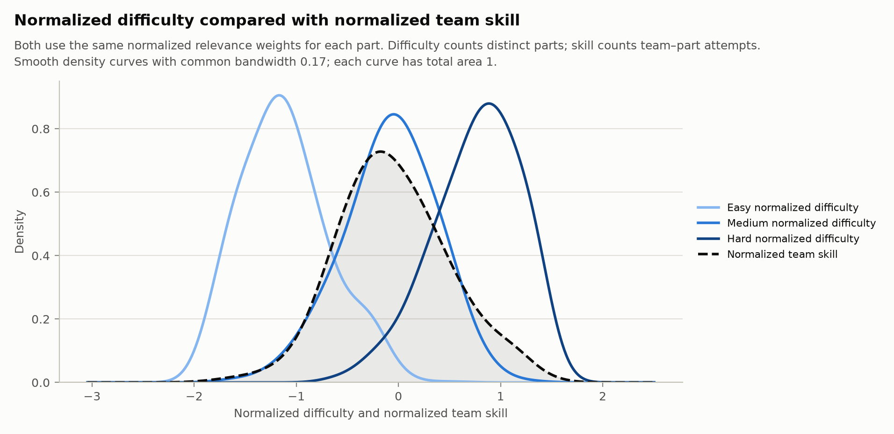
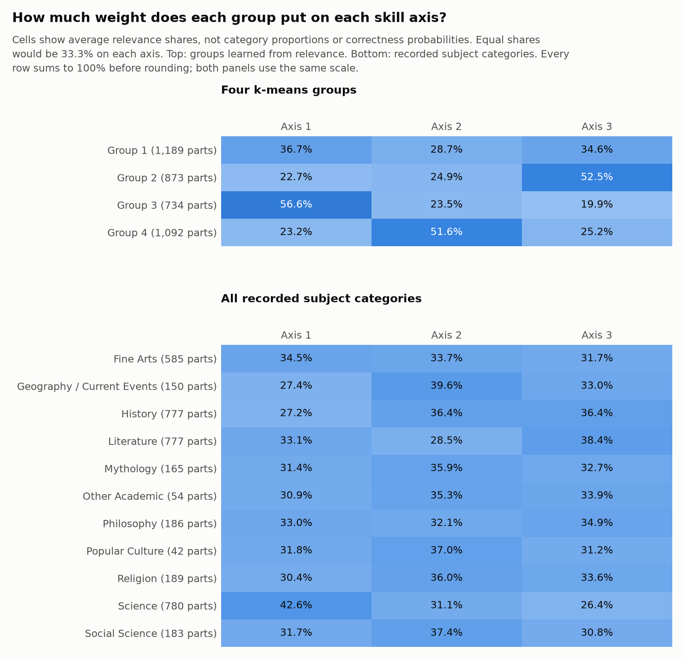

# Bonus model interpretation

The core questions are: **how fitted difficulty compares with the declared
labels, how parts are ordered within a bonus, where difficulty sits relative
to team skill, and what clustering reveals.** The four figures below follow
that order, with the overall and question-set distributions together.

This is the full-season 2024–25 DD-Bernstein fit with multidimensional bonus
difficulty and additive synergy: 3,888 distinct parts, 1,296 bonuses, and
147,126 team–part attempts, seed 42. These are in-sample parameter summaries.

## Reading the parameters

For roster R and part b:

```text
team skill ts_k(R) = tau * log sum_m exp(theta_mk / tau)    (tau = 0.557)
D_b = r_b · d_b
logit = r_b · ts(R) - D_b + synergy(R)
```

Pooling makes one team vector before applying the question's relevance.
The player skills are frozen from the tossup fit. Use these quantities:

| Quantity | Meaning | Use here |
| --- | --- | --- |
| Difficulty `D = r·d` | The part's subtractive logit offset; higher is harder holding the skill contribution fixed | Density curves and the easy < medium < hard ordering score |
| Direction `w = r / sum(r)` | Which skill axes the part rewards | Question clustering |
| Discrimination `sum(r)` | How sharply correctness changes with skill along that direction | Converts D to a comparable skill scale |
| Location `loc = D / sum(r)` | Difficulty on the pooled team-skill scale | Overlap with team skill `s = w·ts(R)` |

**Individual `d_k` values do not identify difficulty in separate subjects.**
Only `r·d` enters the likelihood: moving `d` orthogonally to `r` leaves every
prediction unchanged. Read D for the requested ranking and loc for the
skill comparison. They rank parts similarly (Spearman 0.99), but they are
different quantities. When relevance differs, D alone does not determine
which of two parts a particular team is more likely to answer.

## 1. Difficulty distributions and the declared labels



Easy, medium, and hard parts occupy different regions, with overlap.
Declared label explains 72% of the variance in D; subject explains 0.7%.
Each distinct part counts once, so frequently heard questions do not dominate.

**Smoothing.** These are Gaussian kernel density estimates: each fitted value
contributes a smooth bump, and the bumps are averaged. Each label's curve has
area 1, so height shows density rather than a count of parts. No histogram bins enter these curves.

We choose one bandwidth (the bump's standard deviation) using Scott's rule,
`h = SD(D) × n^(−1/5)`, over all 3,888 parts (h ≈ 0.50). That same bandwidth in difficulty
units is used for every label and every question set, so the smoothing is
consistent across panels. Larger bandwidths blur more detail; smaller ones
show more bumps. These curves estimate distribution shape; smoothing does
not change the fitted values or ordering scores. See the
[SciPy density-estimation reference](https://docs.scipy.org/doc/scipy/reference/generated/scipy.stats.gaussian_kde.html).



All four panels use the same bandwidth and axes. They show the spread within each
label and set, beyond a comparison of averages. These are **question sets**;
mirror sites such as Chicago can have different player fields while using the
same questions. Site and set means across models are in the
[season difficulty results](../../RESEARCH_LOG_2.md#full-season-bonus-difficulty-ordering).

## 2. Does each bonus follow easy < medium < hard?

Give each bonus **1 if D_easy < D_medium < D_hard, otherwise 0**, then count
bonuses once:

| Question set | Ordered bonuses / all bonuses | Ordering rate |
| --- | ---: | ---: |
| Fall 2024 | 243 / 280 | 86.8% |
| Winter 2024 | 281 / 299 | 94.0% |
| Regionals 2025 | 304 / 320 | 95.0% |
| Nationals 2025 | 346 / 397 | 87.2% |
| **All sets** | **1,174 / 1,296** | **90.6%** |

Median gaps are **3.21** for medium − easy and **2.09** for hard − medium.
A reversed point estimate can be nearly tied: of the 122 reversed bonuses,
only 9 have posterior probability ≤5% of the full expected order. Excluding
bonuses heard fewer than ten times raises the descriptive ordering rate to
93.0%; this uses the same fit.

- [Gap intervals, ordering probabilities, and attempt-count breakdown](../../RESEARCH_LOG_2.md#how-certain-are-the-individual-bonus-orderings)
- [Ten complete bonus examples: labels, fitted difficulty, conversion, and text](../../examples.md#reading-the-complete-bonuses-10-difficulty-ordering-cases)

## 3. Normalized difficulty and normalized team skill

**Both quantities use the same normalization.** We rescale each part's
relevance weights to sum to 1, then use those weights to average its difficulty
values and the team's skill values:

```text
Normalized difficulty = w·d
Normalized team skill = w·ts
```

Here `w` is the part's normalized relevance weights, `d` its difficulty
vector, and `ts` the team's pooled skill vector. The normalized difficulty
is the quantity called `loc` earlier; normalized team skill is `s`.



The colored curves show normalized difficulty for easy, medium, and hard
parts. The dashed curve shows normalized team skill on the parts teams
attempted. Each part counts once in the difficulty curves; each team–part
attempt counts once in the skill curve. The same team can have a different
normalized skill for parts with different relevance weights.

When normalized skill equals normalized difficulty for a particular attempt,
the predicted correctness is 50% before synergy. The percentages below compare
the two values **within each actual attempt**; they are not areas of overlap
between the curves.

The curves use Gaussian density estimates with a shared bandwidth of about
0.17, chosen by Scott's rule over all part locations. Each has total area 1.
All values are included, and the displayed range extends four bandwidths
beyond their minimum and maximum. The 600 points used to draw each curve
are rendering locations, not histogram bins.

| Declared label | Median normalized difficulty | Median normalized skill | Attempts with skill > difficulty |
| --- | ---: | ---: | ---: |
| Easy | −1.15 | −0.07 | 97% |
| Medium | −0.06 | −0.09 | 54% |
| Hard | 0.82 | −0.10 | 11% |

Medium parts sit close to the median team. Easy parts lie below most teams;
hard parts lie above most. Normalized difficulty and normalized team skill
both rise across question sets:

| Question set | Easy difficulty | Medium difficulty | Hard difficulty | Team skill |
| --- | ---: | ---: | ---: | ---: |
| Fall 2024 | −1.40 | −0.35 | 0.45 | −0.28 |
| Winter 2024 | −1.32 | −0.10 | 0.75 | −0.09 |
| Regionals 2025 | −1.13 | 0.04 | 0.91 | 0.00 |
| Nationals 2025 | −0.95 | 0.08 | 1.01 | 0.35 |

All entries are medians of the normalized quantities. Skill uses each part's weights,
so the field summary depends on both the teams and the parts they heard.

## 4. How to read the relevance groups

Each player has three fitted skill coordinates. For each bonus part, the
normalized relevance vector `w = r / sum(r)` specifies the relative weight
on those coordinates. The figure reports mean weights, with each part counted
once. Rows sum to 100% before rounding.



The upper panel groups parts by fitted relevance; the lower panel groups the
same parts by all 11 recorded subject categories. The category labels come
from the dataset and are used only to interpret the fitted weights afterward.
For example, **42.6%** in the Science row is the average axis-1 relevance of
Science parts. Separately, **45.0%** of Group 3's parts are Science. Relevance
weights and category proportions answer different questions.

The four-group solution uses standardized log-ratio coordinates of relevance,
20 initializations, and seed 0. Both three- and four-group solutions were
examined; four is a descriptive choice. Groups 2, 3, and 4 put their largest
mean weight on axes 3, 1, and 2, respectively.

### Subject associations of the learned skill axes

The full-season DD fit shows the clearest subject association on **axis 1
with Science**. **Axis 2 is associated with Geography/Current Events,
Social Science, and declared difficulty. Axis 3 is associated
with Literature and some History subcategories.** History uses axes 2 and 3
almost equally overall, so it does not distinguish those axes well.

These results use the multidimensional-difficulty bonus model with additive
synergy: 3,888 parts and the frozen three-dimensional player skills from the
season tossup fit, seed 42. We compared fitted relevance with the recorded
category and subcategory of each part, counting every distinct part once.
Category labels and question text were not inputs to the relevance clustering.

#### Quantities being compared

For part $b$, let $r_b$ be its three relevance weights, $d_b$ its difficulty
vector, and $t(R)$ the team skill vector obtained by pooling the lineup's
player skills. Normalize the relevance weights:

$$
w_{bk}=\frac{r_{bk}}{\sum_{j=1}^{3}r_{bj}}.
$$

Both difficulty and team skill then use these same weights:

$$
\begin{aligned}
\text{normalized difficulty} &= w_b^\top d_b, \\
\text{normalized team skill} &= w_b^\top t(R).
\end{aligned}
$$

The weights $w_b$ sum to one and specify how much each skill coordinate
contributes to these weighted averages. The table reports the mean $w_b$
within each category. Thus 42.6% in the Science row means that Science parts
allocate an average of 42.6% of their relevance to axis 1. It is not a
correctness probability or the fraction of an axis's questions that are Science.

| Recorded category | Parts | Axis 1 | Axis 2 | Axis 3 |
| --- | ---: | ---: | ---: | ---: |
| Science | 780 | 42.6% | 31.1% | 26.4% |
| Geography/Current Events | 150 | 27.4% | 39.6% | 33.0% |
| Social Science | 183 | 31.7% | 37.4% | 30.8% |
| History | 777 | 27.2% | 36.4% | 36.4% |
| Literature | 777 | 33.1% | 28.5% | 38.4% |
| Fine Arts | 585 | 34.5% | 33.7% | 31.7% |

#### Evidence for each interpretation

**Axis 1: Science.** Science has the largest mean axis-1 share among the 11
categories. Within Science, Chemistry and Physics have means of 46.4% and
44.3%. The pattern is also visible when grouping parts by relevance alone:
Group 3 puts 56.6% of its mean relevance on axis 1 and contains 45.0% Science
parts, compared with 20.1% in the full dataset. This supports a Science
association, although most parts in that group belong to other categories.

**Axis 2: Geography/Current Events, Social Science, and difficulty.**
Geography/Current Events has the largest category mean on axis 2 (39.6%),
followed by Social Science (37.4%). Popular Culture (37.0%) and Religion
(36.0%) also put their largest mean weight there. Group 4 averages 51.6% on
axis 2; it contains 25.2% History, 6.0% Geography/Current Events, and 7.1%
Social Science, versus 20.0%, 3.9%, and 4.7% overall. However, 50.1% of this
group's parts are declared hard, versus one-third overall. Across all parts,
the mean axis-2 share is 37.4% for hard parts, 31.6% for easy parts, and 30.9%
for medium parts. The association therefore includes difficulty as well as
subject. The short label “History/Geography” leaves out this pattern and
makes the subject interpretation too narrow.

**Axis 3: Literature and parts of History.** Literature has the largest
category mean on axis 3 (38.4%). Its subcategory means range from 36.1% for
World Literature to 42.6% for World/Other Literature. American and World
History also favor axis 3, with means of 38.2% and 37.6%; general and Other
History favor axis 2. Group 2 averages 52.5% on axis 3 and contains 30.4%
Literature and 27.8% History, compared with 20.0% each overall. “Literature
and some History subcategories” describes the evidence more accurately than
treating axis 3 as a general History skill.

#### Consistency with tossups and limits

The tossup hazard weights show corresponding associations: axis-1 means are
85.0% for Chemistry and 83.2% for Physics; axis-2 means are 67.4% for general
History and 50.9% for Geography/Current Events; axis-3 means are 54.0% for
American Literature and 50.7% for American History. Across subcategory means,
bonus relevance correlates with tossup hazard relevance at Spearman
0.93 / 0.91 / 0.88 on axes 1 / 2 / 3. This is consistency within the linked
model: the bonus stage uses the same frozen player skills, so it is not an
independent replication.

Subcategory accounts for 15.1% / 7.0% / 11.9% of the part-level variation in
bonus relevance on axes 1 / 2 / 3. Most variation remains within subjects.
Group 1's average weights, 36.7% / 28.7% / 34.6%, are closer to the equal
33.3% split than the other group means; this supports describing its mean as
relatively even, without defining a separate “balanced” question type.
The direction silhouette is 0.37 versus 0.31 for a single Gaussian reference.
Only 21% of parts retain their four-group assignment in at least 80% of
posterior draws. We therefore retain numeric axis and group labels and use
the subject associations as descriptions of this fit. These results do not
establish subject-specific player abilities or stable labels across refits.

Sources: [part values and category labels](data/parts.csv),
[bonus subcategory means](data/subcategory_directions.csv),
[tossup subcategory means](../tossup/data/subcategory_relevance.csv),
[variance and cluster checks](data/output.txt),
and [cross-model correlations](../shared/data/output.txt).
The [relevance figure](figures/direction_clusters.png)
shows all 11 categories alongside the four groups.

### Difficulty groups

A separate k-means fit uses only scalar difficulty D with **k = 3**. Its groups
are named easy-like, medium-like, and hard-like in order of their mean D;
declared labels are compared afterward. It mostly recovers those labels:

| Difficulty group | Parts | Declared easy / medium / hard |
| --- | ---: | --- |
| Easy-like | 1,041 | 94% / 6% / 0% |
| Medium-like | 1,771 | 18% / 63% / 19% |
| Hard-like | 1,076 | 0% / 12% / 88% |

## Scope and reproduction

This is one seed's in-sample fit. Subject associations describe this fit;
the axes are not identified player traits. Posterior uncertainty uses mean-field
SVI and is conditional on frozen player skills. Predictive comparisons and
TP/TN/FP/FN belong in the [bonus research log](../../RESEARCH_LOG_2.md).

The fit is
`results/compirt/in_sample/common/bonus-difficulty-season-2024-25/dd/multidim-difficulty-synergy/`.
[parts.csv](data/parts.csv) contains D, loc, directions, labels, and clusters;
[output.txt](data/output.txt) retains the original detailed analysis. Supporting
CSV tables remain available, including diagnostics outside this core report.
The ordering uncertainty is recorded in the linked research-log section.

Redraw the four figures from the saved analysis tables and the fit's
`bonus_part_predictions.csv`:

```bash
.venv/bin/python -B -m dd_model_interpretation.bonus.figures
```

To refresh the underlying tables from saved fits, run
`.venv/bin/python -B -m dd_model_interpretation.bonus.analyze` first.
This performs the broader supporting analysis without training models.
