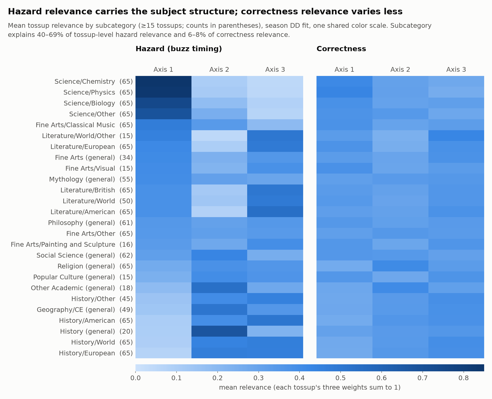

# Tossup: supporting interpretation of the skill axes

This study reads the full-season, in-sample DD-Bernstein tossup fit
(`dd/pyramidal`). The fit has 3D skills, degree-3 Bernstein curves, simplex
relevance, and seed 42, and covers 1,300 tossups and 1,372 players. Each tossup
has two relevance vectors over the shared player skills θ, each summing to 1:
correctness relevance `r` and hazard (buzz-timing) relevance `hazard_r`. It
trains nothing; every number below comes from
[`data/output.txt`](data/output.txt).

The axes are learned skill coordinates, labeled 1–3. The recorded
subcategories below are used to interpret their fitted weights afterward.
For example, Chemistry's mean hazard weight of 0.85 on axis 1 means that
Chemistry tossups place 85% of their hazard relevance there on average; it
does not mean 85% of axis-1 questions are Chemistry or that correctness is 85%.



| Question | Result |
| --- | --- |
| Which subjects put more hazard weight on each axis? | **Axis 1**: Chemistry 0.85, Physics 0.83, Biology 0.74. Classical Music (0.47) is the highest non-Science subcategory. **Axis 2**: History (general) 0.67, Other Academic 0.54, Geography/CE 0.51. **Axis 3**: Literature/American 0.54, History/American 0.51, other Literature 0.49–0.50. |
| How strong is the subject signal? | Subcategory explains 69% / 40% / 46% of tossup-level hazard relevance on axes 1 / 2 / 3 (permutation null 2%). It explains 8% / 6% / 6% of correctness relevance, whose subcategory means stay within 0.24–0.43. In this fit, subject shows up mainly in buzz timing. |
| Are the axes distinct? | Player skills are weakly correlated: θ1 with θ2 and θ3, −0.29; θ2 with θ3, 0.06. |

The bonus model uses these same player-skill axes. How its relevance lines up
with the tossup relevance here is covered in the [parent README](../README.md).

## Caveats

These are in-sample results from one seed, compared through subcategory means.
The subject associations describe this fit; the axes are not identified player traits.

## Reproduce

```bash
.venv/bin/python -B -m dd_model_interpretation.tossup.analyze
.venv/bin/python -B -m dd_model_interpretation.tossup.figures
```

`analyze.py` prints every number above and writes
`data/subcategory_relevance.csv`; `figures.py` draws `figures/` from it.
