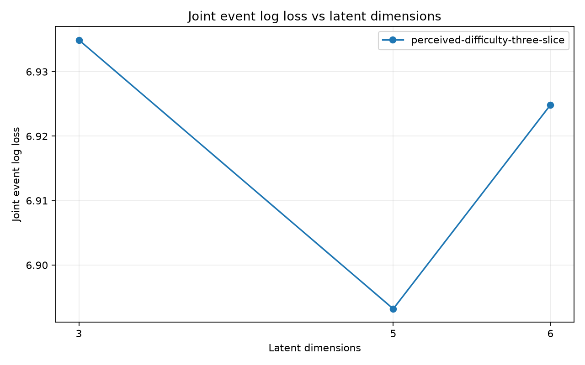
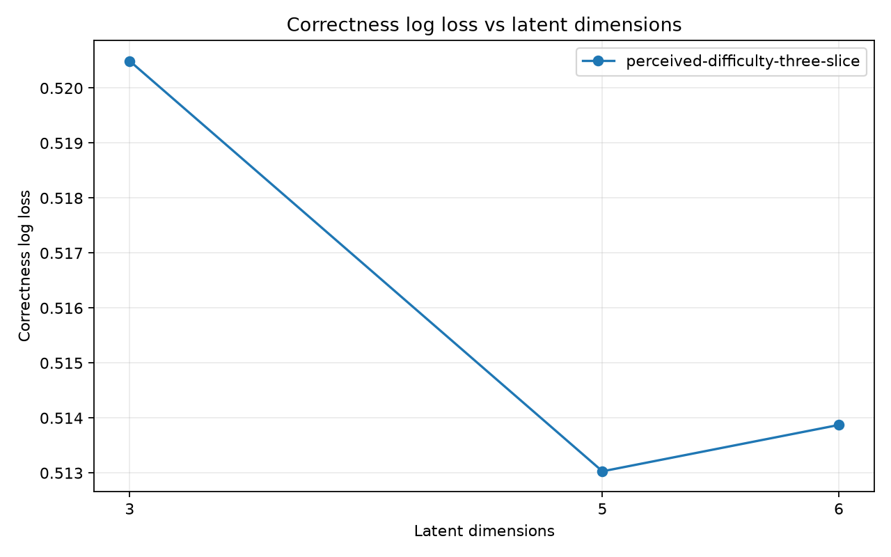
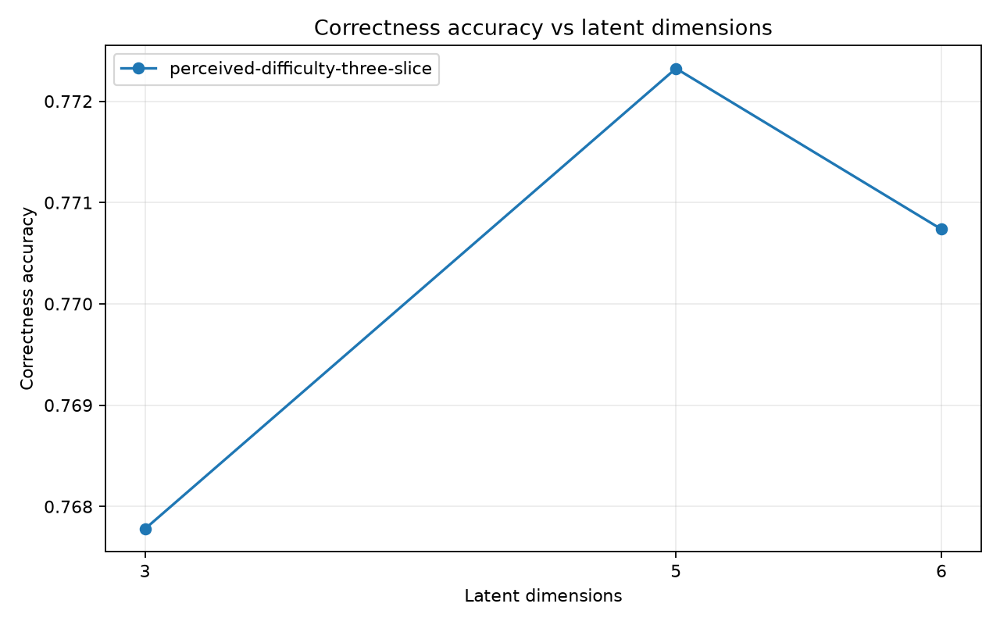
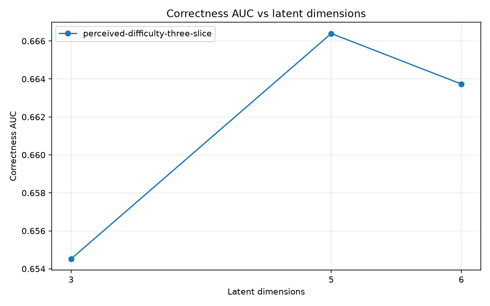
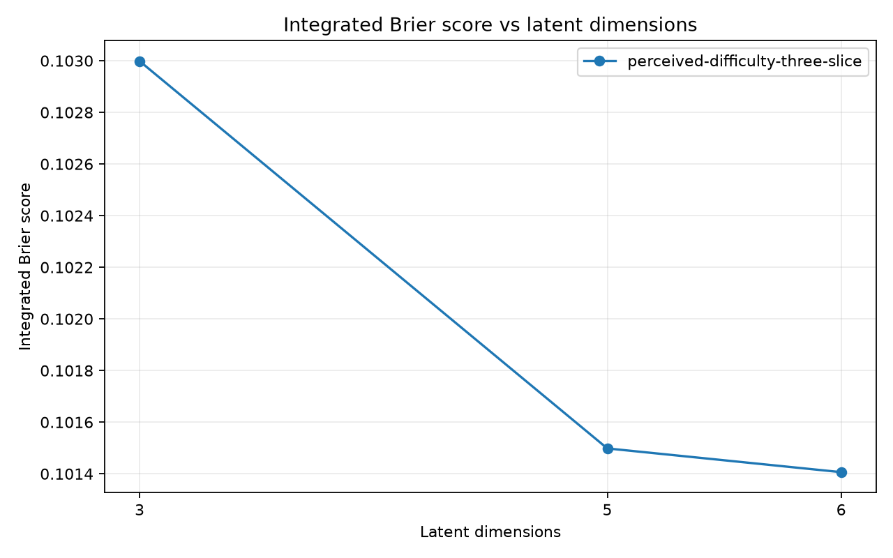
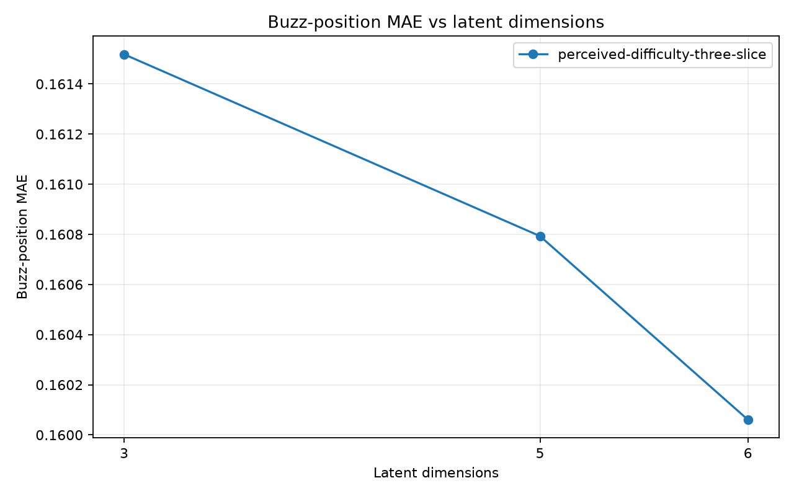

# Perceived difficulty and logit dimension ablation: 10,000 steps

**Coverage: 15/15 fits complete.** Dimensions tested: 3, 5, 6. Selection uses pooled held-out joint event log loss (lower is better).

## Selection and interpretation

For each model, select the smallest tested dimension with loss ≤ (1 + 0.01) × its best loss (a 1% relative tolerance). Only points with all requested folds and required scoring artifacts are eligible.

| Model | Selected K | Selected joint LL | Best K | Best joint LL | Selected − best | Relative gap |
| --- | --- | --- | --- | --- | --- | --- |
| perceived-difficulty-three-slice | 3 | 6.93492 | 5 | 6.8932 | 0.0417187 | 0.605% |

- **perceived-difficulty-three-slice:** cutoff 6.962137; selected K=3 with 48195 effective parameters (fold mean). The selection favors smaller capacity within the stated tolerance.

These are model-selection scores on the same folds used to choose K, not an unbiased final test estimate. The tolerance is a capacity rule, not a significance test or an absolute performance target. One optimizer seed cannot establish seed robustness; fold SD is descriptive, not a confidence interval, since training sets overlap.

### Full capacity grid

| Model | K | Complete folds | Joint LL (pooled) | Joint LL (fold mean ± SD) | Rank | Within tolerance | Selected | Effective parameters (fold mean) |
| --- | --- | --- | --- | --- | --- | --- | --- | --- |
| perceived-difficulty-three-slice | 3 | 5/5 | 6.93492 | 6.93453 ± 0.0560401 (n=5) | 3 | yes | yes | 48195 |
| perceived-difficulty-three-slice | 5 | 5/5 | 6.8932 | 6.89302 ± 0.035319 (n=5) | 1 | yes | no | 81165 |
| perceived-difficulty-three-slice | 6 | 5/5 | 6.92485 | 6.92437 ± 0.079968 (n=5) | 2 | yes | no | 97650 |

## Experimental protocol

| Setting | Value |
| --- | --- |
| Dataset | `year_2024` |
| Holdout | Five-fold whole-game matrix infill, stratified within tournament/round; coverage repair returns games with unseen entities to training |
| Scored fold IDs | 0, 1, 2, 3, 4 |
| Split seed / optimization seed | 42 / 42 |
| Fit and replay | SVI on training games; frozen player/item posterior-median predictions on held-out games |
| Steps / learning rate / device | 10000 / 0.005 / cuda |
| Bernstein degree | 3 |
| Relevance / drop Dirichlet concentration | 2.0 / 2.0 |
| Other priors | theta and start difficulty: Normal(0,1); total drop: LogNormal(0,0.5); simplex relevance |
| Terminal intercepts / bouncebacks | Disabled / excluded |
| Posterior draws requested | 0 |
| Survival row × dimension budget | 81920 |
| Data directory override | None (repository default) |

The evaluation estimates missing interactions among already observed players and questions. It does not test new-player or new-question generalization.

Both arms share correctness `zC = sum_k r_jk (theta_ik − d_jk(x))`. Scalar perceived-logit uses `zH = alpha_i zC + beta_i`. Three-slice perceived-difficulty uses `zH = sum_k r_jk (theta_ik − alpha_i,s,k d_jk(x) + beta_i,s,k)`, with slices x < 1/3, 1/3 ≤ x < 2/3, and x ≥ 2/3. K changes latent dimension; the logit transform remains scalar per player.

| Model | Alpha prior | Beta prior | Transform parameters per player |
| --- | --- | --- | --- |
| perceived-difficulty-three-slice | Normal(0, 1) | Normal(0, 1) | 6K |

Alpha is unconstrained in these sweeps. The two arms differ in transform placement, alpha prior, and parameter count; their comparison does not isolate slicing alone. With P players, Q items, degree p and K dimensions, effective item parameters per item are `(p+2)K−1`; total effective parameters are `P(K+2)+Q((p+2)K−1)` for logit and `7PK+Q((p+2)K−1)` for three-slice difficulty.

## How to read the scores

Pooled tables recompute scores from concatenated held-out rows. Correctness and neg detection condition on observed BUZZ rows, with a 0.5 classification threshold. Neg F1 is computed from precision and recall at the same aggregation level. Joint LL includes first-buzz identity, position, correctness and no-buzz outcomes. Position errors condition on observed buzzes and use relative question position.

All rates are fractions (0.01 = 1 percentage point). Positive position bias means predicted later; positive no-buzz error means overprediction. Loss, ECE, Brier and absolute errors are better when lower; accuracy, AUC, precision, recall, F1 and rank agreement are better when higher. Signed biases target zero. Final-decile mass is descriptive. Integrated Brier pools event-weighted Brier scores on the time grid. Downstream and identity tables show equally weighted fold mean ± sample SD and the number of available folds, rather than pooled nonlinear scores.

See the [metric contract](../../../../../../../../compirt_eval/METRICS.md) for definitions and denominators. A dash means unavailable, never zero. The appendix exposes every numeric fold metric, including denominator counts and diagnostics.

## Pooled correctness and neg detection

### perceived-difficulty-three-slice

| Metric | K=3 | K=5 | K=6 |
| --- | --- | --- | --- |
| `accuracy` | 0.767779 | 0.772323 | 0.770736 |
| `all_correct_accuracy` | 0.766996 | 0.766996 | 0.766996 |
| `accuracy_lift_over_all_correct` | 0.000782694 | 0.00532667 | 0.00373954 |
| `log_loss` | 0.520492 | 0.513029 | 0.513872 |
| `auc` | 0.65452 | 0.666396 | 0.663736 |
| `ece` | 0.0344791 | 0.0231646 | 0.0230395 |
| `brier` | 0.169676 | 0.166718 | 0.167083 |
| `neg_precision` | 0.506456 | 0.552734 | 0.540681 |
| `neg_recall` | 0.131753 | 0.11981 | 0.106653 |
| `neg_f1` | 0.209108 | 0.196933 | 0.178162 |
| `neg_average_precision` | 0.376856 | 0.395399 | 0.391145 |

## Pooled timing and no-buzz diagnostics

### perceived-difficulty-three-slice

| Metric | K=3 | K=5 | K=6 |
| --- | --- | --- | --- |
| `joint_tossup_event_log_loss` | 6.93492 | 6.8932 | 6.92485 |
| `integrated_brier_score` | 0.102999 | 0.101498 | 0.101406 |
| `buzz_position_mae` | 0.161518 | 0.160793 | 0.160061 |
| `buzz_position_median_absolute_error` | 0.145997 | 0.146805 | 0.145264 |
| `buzz_position_bias` | -0.0668361 | -0.0668207 | -0.0641655 |
| `no_buzz_observed_rate` | 0.0138293 | 0.0138293 | 0.0138293 |
| `no_buzz_predicted_rate` | 0.0887491 | 0.0898314 | 0.0933752 |
| `no_buzz_calibration_error` | 0.0749198 | 0.0760021 | 0.0795458 |
| `no_buzz_brier` | 0.0247602 | 0.025223 | 0.0262682 |
| `full_pmf_final_decile_mass` | 0.0564228 | 0.055564 | 0.0565894 |
| `full_pmf_max_mass_error` | 1.55431e-15 | 1.55431e-15 | 1.55431e-15 |

## First-buzzer and downstream outcomes: fold mean ± SD

### perceived-difficulty-three-slice

| Metric | K=3 | K=5 | K=6 |
| --- | --- | --- | --- |
| `first_buzzer_top1_accuracy` | 0.345511 ± 0.00634687 (n=5) | 0.347124 ± 0.00652653 (n=5) | 0.347278 ± 0.0023184 (n=5) |
| `first_buzzer_mean_reciprocal_rank` | 0.557654 ± 0.00501694 (n=5) | 0.559597 ± 0.00436501 (n=5) | 0.559196 ± 0.0018744 (n=5) |
| `first_buzzer_log_loss` | 1.70291 ± 0.0157238 (n=5) | 1.68936 ± 0.00716687 (n=5) | 1.69732 ± 0.0170553 (n=5) |
| `first_buzzer_team_top1_accuracy` | 0.64413 ± 0.0122069 (n=5) | 0.645383 ± 0.00725348 (n=5) | 0.645749 ± 0.00852084 (n=5) |
| `tossup_scorer_player_top1_accuracy` | 0.315784 ± 0.003893 (n=5) | 0.319632 ± 0.0028035 (n=5) | 0.318617 ± 0.00384415 (n=5) |
| `tossup_scorer_team_top1_accuracy` | 0.488664 ± 0.00993513 (n=5) | 0.498771 ± 0.00565328 (n=5) | 0.496877 ± 0.00774681 (n=5) |
| `tossup_game_winner_accuracy` | 0.778836 ± 0.0197581 (n=5) | 0.781588 ± 0.014663 (n=5) | 0.796146 ± 0.0194373 (n=5) |
| `tossup_game_margin_mae` | 35.6518 ± 0.933707 (n=5) | 35.5286 ± 0.95961 (n=5) | 35.0996 ± 1.2736 (n=5) |
| `tournament_player_ppg_spearman` | 0.688502 ± 0.013425 (n=5) | 0.686964 ± 0.0147969 (n=5) | 0.69496 ± 0.0135529 (n=5) |
| `tournament_player_ppg_mae` | 9.14674 ± 0.231818 (n=5) | 9.12071 ± 0.136989 (n=5) | 8.99574 ± 0.193103 (n=5) |
| `tournament_player_ppg_top10_overlap` | 0.655862 ± 0.0181485 (n=5) | 0.653103 ± 0.0166449 (n=5) | 0.666897 ± 0.00993439 (n=5) |

## Training and capacity: fold mean ± SD

### perceived-difficulty-three-slice

| Metric | K=3 | K=5 | K=6 |
| --- | --- | --- | --- |
| `effective_parameter_count` | 48195 ± 0 (n=5) | 81165 ± 0 (n=5) | 97650 ± 0 (n=5) |
| `train_effective_item_parameters` | 14 ± 0 (n=5) | 24 ± 0 (n=5) | 29 ± 0 (n=5) |
| `train_steps` | 10000 ± 0 (n=5) | 10000 ± 0 (n=5) | 10000 ± 0 (n=5) |
| `train_finite_losses` | 1 ± 0 (n=5) | 1 ± 0 (n=5) | 1 ± 0 (n=5) |
| `train_initial_loss` | 1.6818e+07 ± 25848.9 (n=5) | 1.6869e+07 ± 25323.6 (n=5) | 1.68676e+07 ± 27752.9 (n=5) |
| `final_loss` | 311692 ± 642.308 (n=5) | 316524 ± 809.612 (n=5) | 321330 ± 1325.83 (n=5) |
| `best_loss` | 311179 ± 622.009 (n=5) | 316124 ± 811.102 (n=5) | 320595 ± 1315.79 (n=5) |
| `last_100_loss_slope` | 0.12406 ± 0.30327 (n=5) | 0.804951 ± 0.109614 (n=5) | 1.1577 ± 0.259206 (n=5) |

## Fitted perception parameters: fold mean ± SD

### perceived-difficulty-three-slice

| Metric | K=3 | K=5 | K=6 |
| --- | --- | --- | --- |
| `fitted_alpha_first_mean` | -0.762822 ± 0.0268222 (n=5) | -0.471693 ± 0.0050838 (n=5) | -0.437484 ± 0.0210608 (n=5) |
| `fitted_alpha_first_negative_fraction` | 0.812646 ± 0.0091701 (n=5) | 0.740289 ± 0.00608284 (n=5) | 0.725934 ± 0.00934865 (n=5) |
| `fitted_alpha_middle_mean` | -0.469458 ± 0.0161722 (n=5) | -0.299599 ± 0.00414354 (n=5) | -0.284334 ± 0.0117238 (n=5) |
| `fitted_alpha_middle_negative_fraction` | 0.781077 ± 0.00676626 (n=5) | 0.721704 ± 0.00405277 (n=5) | 0.716289 ± 0.0090964 (n=5) |
| `fitted_alpha_last_mean` | -0.273687 ± 0.00986971 (n=5) | -0.198985 ± 0.00773565 (n=5) | -0.192592 ± 0.00656984 (n=5) |
| `fitted_alpha_last_negative_fraction` | 0.751157 ± 0.0077646 (n=5) | 0.725306 ± 0.00673371 (n=5) | 0.74252 ± 0.00591746 (n=5) |
| `fitted_beta_first_mean` | -0.409482 ± 0.0115848 (n=5) | -0.256759 ± 0.000905734 (n=5) | -0.236782 ± 0.00754287 (n=5) |
| `fitted_beta_first_negative_fraction` | 0.930447 ± 0.00894586 (n=5) | 0.896275 ± 0.00165976 (n=5) | 0.895029 ± 0.00321611 (n=5) |
| `fitted_beta_middle_mean` | -0.474406 ± 0.0142504 (n=5) | -0.298108 ± 0.000918873 (n=5) | -0.275024 ± 0.00865858 (n=5) |
| `fitted_beta_middle_negative_fraction` | 0.852188 ± 0.010228 (n=5) | 0.833182 ± 0.0034537 (n=5) | 0.842016 ± 0.00526258 (n=5) |
| `fitted_beta_last_mean` | -0.489268 ± 0.0141291 (n=5) | -0.313026 ± 0.000591468 (n=5) | -0.29025 ± 0.00996398 (n=5) |
| `fitted_beta_last_negative_fraction` | 0.863368 ± 0.00885001 (n=5) | 0.850722 ± 0.00407995 (n=5) | 0.851753 ± 0.00415967 (n=5) |

## Coverage and denominators: pooled counts

### perceived-difficulty-three-slice

| Metric | K=3 | K=5 | K=6 |
| --- | --- | --- | --- |
| `observations` | 45995 | 45995 | 45995 |
| `full_pmf_events` | 46640 | 46640 | 46640 |
| `survival_events` | 46640 | 46640 | 46640 |

Training losses are the saved SVI objective, not held-out log loss. Finite losses do not establish convergence; negative final-100-step slopes indicate the objective was still descending locally. Parameter summaries below describe fitted posterior medians across players and dimensions (with separate slices); they are not posterior uncertainty intervals or independent samples across folds.

## Matched-fold selected versus best dimension

Differences are selected minus best joint LL on the same fold; positive values favor the best-loss dimension. These pairs describe the cost of the capacity rule without making a significance claim.

| Model | Fold | Selected K | Best K | Selected LL | Best LL | Difference |
| --- | --- | --- | --- | --- | --- | --- |
| perceived-difficulty-three-slice | 0 | 3 | 5 | 7.00849 | 6.95409 | 0.0544072 |
| perceived-difficulty-three-slice | 1 | 3 | 5 | 6.91662 | 6.88409 | 0.0325356 |
| perceived-difficulty-three-slice | 2 | 3 | 5 | 6.94209 | 6.88173 | 0.0603671 |
| perceived-difficulty-three-slice | 3 | 3 | 5 | 6.8543 | 6.86213 | -0.00783293 |
| perceived-difficulty-three-slice | 4 | 3 | 5 | 6.95115 | 6.88307 | 0.0680804 |

## Figures













## Complete metric appendix: fold mean ± SD

Each cell includes n, the number of finite fold values used. Within-fit parameter SD and across-fold SD are different: an `fitted_*_std` row averages the within-fit dispersion, with ± showing variation of that dispersion across folds.

### perceived-difficulty-three-slice

| Metric | K=3 | K=5 | K=6 |
| --- | --- | --- | --- |
| `accuracy` | 0.767785 ± 0.00680575 (n=5) | 0.772329 ± 0.00449407 (n=5) | 0.770732 ± 0.00480914 (n=5) |
| `accuracy_lift_over_all_correct` | 0.000795022 ± 0.00294229 (n=5) | 0.00533839 ± 0.00143747 (n=5) | 0.00374191 ± 0.00134465 (n=5) |
| `all_correct_accuracy` | 0.76699 ± 0.00459462 (n=5) | 0.76699 ± 0.00459462 (n=5) | 0.76699 ± 0.00459462 (n=5) |
| `auc` | 0.654599 ± 0.00525694 (n=5) | 0.666455 ± 0.00335862 (n=5) | 0.663882 ± 0.00522547 (n=5) |
| `best_loss` | 311179 ± 622.009 (n=5) | 316124 ± 811.102 (n=5) | 320595 ± 1315.79 (n=5) |
| `brier` | 0.169677 ± 0.00294506 (n=5) | 0.16672 ± 0.00269647 (n=5) | 0.167088 ± 0.00243563 (n=5) |
| `buzz_position_bias` | -0.0668565 ± 0.00271552 (n=5) | -0.0668501 ± 0.00341472 (n=5) | -0.0641897 ± 0.00392833 (n=5) |
| `buzz_position_mae` | 0.161516 ± 0.00129347 (n=5) | 0.160799 ± 0.0011558 (n=5) | 0.160058 ± 0.00192365 (n=5) |
| `buzz_position_median_absolute_error` | 0.146045 ± 0.00224684 (n=5) | 0.146896 ± 0.0020394 (n=5) | 0.145228 ± 0.00246041 (n=5) |
| `ece` | 0.0352117 ± 0.00337714 (n=5) | 0.0257741 ± 0.00429787 (n=5) | 0.0233206 ± 0.00348814 (n=5) |
| `effective_parameter_count` | 48195 ± 0 (n=5) | 81165 ± 0 (n=5) | 97650 ± 0 (n=5) |
| `final_loss` | 311692 ± 642.308 (n=5) | 316524 ± 809.612 (n=5) | 321330 ± 1325.83 (n=5) |
| `first_buzzer_events` | 9199 ± 103.704 (n=5) | 9199 ± 103.704 (n=5) | 9199 ± 103.704 (n=5) |
| `first_buzzer_log_loss` | 1.70291 ± 0.0157238 (n=5) | 1.68936 ± 0.00716687 (n=5) | 1.69732 ± 0.0170553 (n=5) |
| `first_buzzer_mean_reciprocal_rank` | 0.557654 ± 0.00501694 (n=5) | 0.559597 ± 0.00436501 (n=5) | 0.559196 ± 0.0018744 (n=5) |
| `first_buzzer_team_top1_accuracy` | 0.64413 ± 0.0122069 (n=5) | 0.645383 ± 0.00725348 (n=5) | 0.645749 ± 0.00852084 (n=5) |
| `first_buzzer_team_top1_accuracy_events` | 9199 ± 103.704 (n=5) | 9199 ± 103.704 (n=5) | 9199 ± 103.704 (n=5) |
| `first_buzzer_top1_accuracy` | 0.345511 ± 0.00634687 (n=5) | 0.347124 ± 0.00652653 (n=5) | 0.347278 ± 0.0023184 (n=5) |
| `fitted_alpha_first_mean` | -0.762822 ± 0.0268222 (n=5) | -0.471693 ± 0.0050838 (n=5) | -0.437484 ± 0.0210608 (n=5) |
| `fitted_alpha_first_negative_fraction` | 0.812646 ± 0.0091701 (n=5) | 0.740289 ± 0.00608284 (n=5) | 0.725934 ± 0.00934865 (n=5) |
| `fitted_alpha_first_std` | 0.963647 ± 0.00172637 (n=5) | 0.891126 ± 0.00201095 (n=5) | 0.872947 ± 0.0066731 (n=5) |
| `fitted_alpha_last_mean` | -0.273687 ± 0.00986971 (n=5) | -0.198985 ± 0.00773565 (n=5) | -0.192592 ± 0.00656984 (n=5) |
| `fitted_alpha_last_negative_fraction` | 0.751157 ± 0.0077646 (n=5) | 0.725306 ± 0.00673371 (n=5) | 0.74252 ± 0.00591746 (n=5) |
| `fitted_alpha_last_std` | 0.491242 ± 0.0141886 (n=5) | 0.434314 ± 0.0103333 (n=5) | 0.407774 ± 0.0125128 (n=5) |
| `fitted_alpha_middle_mean` | -0.469458 ± 0.0161722 (n=5) | -0.299599 ± 0.00414354 (n=5) | -0.284334 ± 0.0117238 (n=5) |
| `fitted_alpha_middle_negative_fraction` | 0.781077 ± 0.00676626 (n=5) | 0.721704 ± 0.00405277 (n=5) | 0.716289 ± 0.0090964 (n=5) |
| `fitted_alpha_middle_std` | 0.696862 ± 0.0139458 (n=5) | 0.646157 ± 0.0101869 (n=5) | 0.620166 ± 0.00535717 (n=5) |
| `fitted_beta_first_mean` | -0.409482 ± 0.0115848 (n=5) | -0.256759 ± 0.000905734 (n=5) | -0.236782 ± 0.00754287 (n=5) |
| `fitted_beta_first_negative_fraction` | 0.930447 ± 0.00894586 (n=5) | 0.896275 ± 0.00165976 (n=5) | 0.895029 ± 0.00321611 (n=5) |
| `fitted_beta_first_std` | 0.422177 ± 0.00526721 (n=5) | 0.349353 ± 0.00308133 (n=5) | 0.329568 ± 0.00169512 (n=5) |
| `fitted_beta_last_mean` | -0.489268 ± 0.0141291 (n=5) | -0.313026 ± 0.000591468 (n=5) | -0.29025 ± 0.00996398 (n=5) |
| `fitted_beta_last_negative_fraction` | 0.863368 ± 0.00885001 (n=5) | 0.850722 ± 0.00407995 (n=5) | 0.851753 ± 0.00415967 (n=5) |
| `fitted_beta_last_std` | 0.602061 ± 0.00882113 (n=5) | 0.48688 ± 0.00742253 (n=5) | 0.456942 ± 0.00584315 (n=5) |
| `fitted_beta_middle_mean` | -0.474406 ± 0.0142504 (n=5) | -0.298108 ± 0.000918873 (n=5) | -0.275024 ± 0.00865858 (n=5) |
| `fitted_beta_middle_negative_fraction` | 0.852188 ± 0.010228 (n=5) | 0.833182 ± 0.0034537 (n=5) | 0.842016 ± 0.00526258 (n=5) |
| `fitted_beta_middle_std` | 0.595036 ± 0.0117378 (n=5) | 0.484153 ± 0.00828572 (n=5) | 0.44254 ± 0.00598294 (n=5) |
| `full_pmf_events` | 9328 ± 91.214 (n=5) | 9328 ± 91.214 (n=5) | 9328 ± 91.214 (n=5) |
| `full_pmf_final_decile_mass` | 0.0564188 ± 0.00111897 (n=5) | 0.0555603 ± 0.000817687 (n=5) | 0.0565862 ± 0.000998568 (n=5) |
| `full_pmf_max_mass_error` | 1.33227e-15 ± 1.57009e-16 (n=5) | 1.31006e-15 ± 1.64673e-16 (n=5) | 1.33227e-15 ± 1.57009e-16 (n=5) |
| `integrated_brier_score` | 0.102989 ± 0.00156995 (n=5) | 0.101496 ± 0.000875205 (n=5) | 0.101397 ± 0.00175742 (n=5) |
| `joint_tossup_event_log_loss` | 6.93453 ± 0.0560401 (n=5) | 6.89302 ± 0.035319 (n=5) | 6.92437 ± 0.079968 (n=5) |
| `joint_tossup_event_log_loss_events` | 9328 ± 91.214 (n=5) | 9328 ± 91.214 (n=5) | 9328 ± 91.214 (n=5) |
| `last_100_loss_slope` | 0.12406 ± 0.30327 (n=5) | 0.804951 ± 0.109614 (n=5) | 1.1577 ± 0.259206 (n=5) |
| `log_loss` | 0.520501 ± 0.00729716 (n=5) | 0.513043 ± 0.00639098 (n=5) | 0.513891 ± 0.0059411 (n=5) |
| `mean_predictive_variance` | 0.167325 ± 0.000788646 (n=5) | 0.16769 ± 0.000562632 (n=5) | 0.166141 ± 0.00172682 (n=5) |
| `neg_auroc` | 0.654599 ± 0.00525694 (n=5) | 0.666455 ± 0.00335862 (n=5) | 0.663882 ± 0.00522547 (n=5) |
| `neg_average_precision` | 0.377524 ± 0.00940073 (n=5) | 0.395986 ± 0.00676948 (n=5) | 0.391684 ± 0.00835927 (n=5) |
| `neg_f1` | 0.209145 ± 0.0195134 (n=5) | 0.196893 ± 0.0116277 (n=5) | 0.178126 ± 0.0130369 (n=5) |
| `neg_precision` | 0.506174 ± 0.0239024 (n=5) | 0.553315 ± 0.0160977 (n=5) | 0.540203 ± 0.0122787 (n=5) |
| `neg_recall` | 0.131941 ± 0.0140688 (n=5) | 0.11987 ± 0.00877563 (n=5) | 0.106704 ± 0.00892569 (n=5) |
| `no_buzz_brier` | 0.0247634 ± 0.00106694 (n=5) | 0.0252261 ± 0.00110764 (n=5) | 0.0262698 ± 0.00102077 (n=5) |
| `no_buzz_calibration_error` | 0.074902 ± 0.00260981 (n=5) | 0.0759851 ± 0.00239402 (n=5) | 0.0795269 ± 0.00306887 (n=5) |
| `no_buzz_observed_rate` | 0.0138406 ± 0.0016887 (n=5) | 0.0138406 ± 0.0016887 (n=5) | 0.0138406 ± 0.0016887 (n=5) |
| `no_buzz_predicted_rate` | 0.0887427 ± 0.00205069 (n=5) | 0.0898258 ± 0.00201873 (n=5) | 0.0933676 ± 0.00241674 (n=5) |
| `probability_p10` | 0.552127 ± 0.00561133 (n=5) | 0.568826 ± 0.00655457 (n=5) | 0.574719 ± 0.00596933 (n=5) |
| `probability_p50` | 0.776155 ± 0.00198207 (n=5) | 0.777463 ± 0.00141622 (n=5) | 0.780737 ± 0.00347846 (n=5) |
| `probability_p90` | 0.910598 ± 0.00220266 (n=5) | 0.904916 ± 0.00165693 (n=5) | 0.90688 ± 0.00288767 (n=5) |
| `probability_std` | 0.140294 ± 0.0024029 (n=5) | 0.132498 ± 0.00201974 (n=5) | 0.130975 ± 0.00172845 (n=5) |
| `survival_events` | 9328 ± 91.214 (n=5) | 9328 ± 91.214 (n=5) | 9328 ± 91.214 (n=5) |
| `survival_events_skipped` | 0 ± 0 (n=5) | 0 ± 0 (n=5) | 0 ± 0 (n=5) |
| `tossup_game_margin_mae` | 35.6518 ± 0.933707 (n=5) | 35.5286 ± 0.95961 (n=5) | 35.0996 ± 1.2736 (n=5) |
| `tossup_game_margin_mae_games` | 466.4 ± 4.5607 (n=5) | 466.4 ± 4.5607 (n=5) | 466.4 ± 4.5607 (n=5) |
| `tossup_game_winner_accuracy` | 0.778836 ± 0.0197581 (n=5) | 0.781588 ± 0.014663 (n=5) | 0.796146 ± 0.0194373 (n=5) |
| `tossup_game_winner_accuracy_games` | 453.4 ± 6.0663 (n=5) | 453.4 ± 6.0663 (n=5) | 453.4 ± 6.0663 (n=5) |
| `tossup_outcome_events` | 9328 ± 91.214 (n=5) | 9328 ± 91.214 (n=5) | 9328 ± 91.214 (n=5) |
| `tossup_scorer_player_top1_accuracy` | 0.315784 ± 0.003893 (n=5) | 0.319632 ± 0.0028035 (n=5) | 0.318617 ± 0.00384415 (n=5) |
| `tossup_scorer_player_top1_accuracy_events` | 9328 ± 91.214 (n=5) | 9328 ± 91.214 (n=5) | 9328 ± 91.214 (n=5) |
| `tossup_scorer_team_top1_accuracy` | 0.488664 ± 0.00993513 (n=5) | 0.498771 ± 0.00565328 (n=5) | 0.496877 ± 0.00774681 (n=5) |
| `tossup_scorer_team_top1_accuracy_events` | 9328 ± 91.214 (n=5) | 9328 ± 91.214 (n=5) | 9328 ± 91.214 (n=5) |
| `tournament_player_ppg_mae` | 9.14674 ± 0.231818 (n=5) | 9.12071 ± 0.136989 (n=5) | 8.99574 ± 0.193103 (n=5) |
| `tournament_player_ppg_spearman` | 0.688502 ± 0.013425 (n=5) | 0.686964 ± 0.0147969 (n=5) | 0.69496 ± 0.0135529 (n=5) |
| `tournament_player_ppg_top10_overlap` | 0.655862 ± 0.0181485 (n=5) | 0.653103 ± 0.0166449 (n=5) | 0.666897 ± 0.00993439 (n=5) |
| `tournament_player_ppg_tournaments` | 29 ± 0 (n=5) | 29 ± 0 (n=5) | 29 ± 0 (n=5) |
| `train_effective_item_parameters` | 14 ± 0 (n=5) | 24 ± 0 (n=5) | 29 ± 0 (n=5) |
| `train_events` | 39284 ± 91.214 (n=5) | 39284 ± 91.214 (n=5) | 39284 ± 91.214 (n=5) |
| `train_finite_losses` | 1 ± 0 (n=5) | 1 ± 0 (n=5) | 1 ± 0 (n=5) |
| `train_initial_loss` | 1.6818e+07 ± 25848.9 (n=5) | 1.6869e+07 ± 25323.6 (n=5) | 1.68676e+07 ± 27752.9 (n=5) |
| `train_observations_BUZZ` | 38715 ± 103.704 (n=5) | 38715 ± 103.704 (n=5) | 38715 ± 103.704 (n=5) |
| `train_observations_CENSORED` | 238779 ± 672.819 (n=5) | 238779 ± 672.819 (n=5) | 238779 ± 672.819 (n=5) |
| `train_observations_NO-BUZZ` | 4010 ± 86.5823 (n=5) | 4010 ± 86.5823 (n=5) | 4010 ± 86.5823 (n=5) |
| `train_players` | 1455 ± 0 (n=5) | 1455 ± 0 (n=5) | 1455 ± 0 (n=5) |
| `train_steps` | 10000 ± 0 (n=5) | 10000 ± 0 (n=5) | 10000 ± 0 (n=5) |
| `train_tossups` | 1260 ± 0 (n=5) | 1260 ± 0 (n=5) | 1260 ± 0 (n=5) |

## Artifact index and reproducibility

[Saved configuration](../configuration.json) · [Per-fold values](per_fold.csv) · [Fold mean/SD](fold_mean_std.csv) · [Pooled values](pooled.csv)

Each fit links to its saved commands, training summary, and evaluator report. Training posterior quantiles and player parameters are beside the training summary. Training-set predictive metrics, optimizer-seed replication, posterior-predictive intervals, and a separate final test estimate are not supplied by this sweep.

| Model | K | Fold | Status | Commands | Training | Evaluation | Missing required artifacts |
| --- | --- | --- | --- | --- | --- | --- | --- |
| perceived-difficulty-three-slice | 3 | 0 | complete | [commands](../perceived-difficulty-three-slice/dim_3/fold_0/command.json) | [training](../perceived-difficulty-three-slice/dim_3/fold_0/train/pyramidal/summary.json) | [evaluation](../perceived-difficulty-three-slice/dim_3/fold_0/evaluation/experiment_report.md) | — |
| perceived-difficulty-three-slice | 3 | 1 | complete | [commands](../perceived-difficulty-three-slice/dim_3/fold_1/command.json) | [training](../perceived-difficulty-three-slice/dim_3/fold_1/train/pyramidal/summary.json) | [evaluation](../perceived-difficulty-three-slice/dim_3/fold_1/evaluation/experiment_report.md) | — |
| perceived-difficulty-three-slice | 3 | 2 | complete | [commands](../perceived-difficulty-three-slice/dim_3/fold_2/command.json) | [training](../perceived-difficulty-three-slice/dim_3/fold_2/train/pyramidal/summary.json) | [evaluation](../perceived-difficulty-three-slice/dim_3/fold_2/evaluation/experiment_report.md) | — |
| perceived-difficulty-three-slice | 3 | 3 | complete | [commands](../perceived-difficulty-three-slice/dim_3/fold_3/command.json) | [training](../perceived-difficulty-three-slice/dim_3/fold_3/train/pyramidal/summary.json) | [evaluation](../perceived-difficulty-three-slice/dim_3/fold_3/evaluation/experiment_report.md) | — |
| perceived-difficulty-three-slice | 3 | 4 | complete | [commands](../perceived-difficulty-three-slice/dim_3/fold_4/command.json) | [training](../perceived-difficulty-three-slice/dim_3/fold_4/train/pyramidal/summary.json) | [evaluation](../perceived-difficulty-three-slice/dim_3/fold_4/evaluation/experiment_report.md) | — |
| perceived-difficulty-three-slice | 5 | 0 | complete | [commands](../perceived-difficulty-three-slice/dim_5/fold_0/command.json) | [training](../perceived-difficulty-three-slice/dim_5/fold_0/train/pyramidal/summary.json) | [evaluation](../perceived-difficulty-three-slice/dim_5/fold_0/evaluation/experiment_report.md) | — |
| perceived-difficulty-three-slice | 5 | 1 | complete | [commands](../perceived-difficulty-three-slice/dim_5/fold_1/command.json) | [training](../perceived-difficulty-three-slice/dim_5/fold_1/train/pyramidal/summary.json) | [evaluation](../perceived-difficulty-three-slice/dim_5/fold_1/evaluation/experiment_report.md) | — |
| perceived-difficulty-three-slice | 5 | 2 | complete | [commands](../perceived-difficulty-three-slice/dim_5/fold_2/command.json) | [training](../perceived-difficulty-three-slice/dim_5/fold_2/train/pyramidal/summary.json) | [evaluation](../perceived-difficulty-three-slice/dim_5/fold_2/evaluation/experiment_report.md) | — |
| perceived-difficulty-three-slice | 5 | 3 | complete | [commands](../perceived-difficulty-three-slice/dim_5/fold_3/command.json) | [training](../perceived-difficulty-three-slice/dim_5/fold_3/train/pyramidal/summary.json) | [evaluation](../perceived-difficulty-three-slice/dim_5/fold_3/evaluation/experiment_report.md) | — |
| perceived-difficulty-three-slice | 5 | 4 | complete | [commands](../perceived-difficulty-three-slice/dim_5/fold_4/command.json) | [training](../perceived-difficulty-three-slice/dim_5/fold_4/train/pyramidal/summary.json) | [evaluation](../perceived-difficulty-three-slice/dim_5/fold_4/evaluation/experiment_report.md) | — |
| perceived-difficulty-three-slice | 6 | 0 | complete | [commands](../perceived-difficulty-three-slice/dim_6/fold_0/command.json) | [training](../perceived-difficulty-three-slice/dim_6/fold_0/train/pyramidal/summary.json) | [evaluation](../perceived-difficulty-three-slice/dim_6/fold_0/evaluation/experiment_report.md) | — |
| perceived-difficulty-three-slice | 6 | 1 | complete | [commands](../perceived-difficulty-three-slice/dim_6/fold_1/command.json) | [training](../perceived-difficulty-three-slice/dim_6/fold_1/train/pyramidal/summary.json) | [evaluation](../perceived-difficulty-three-slice/dim_6/fold_1/evaluation/experiment_report.md) | — |
| perceived-difficulty-three-slice | 6 | 2 | complete | [commands](../perceived-difficulty-three-slice/dim_6/fold_2/command.json) | [training](../perceived-difficulty-three-slice/dim_6/fold_2/train/pyramidal/summary.json) | [evaluation](../perceived-difficulty-three-slice/dim_6/fold_2/evaluation/experiment_report.md) | — |
| perceived-difficulty-three-slice | 6 | 3 | complete | [commands](../perceived-difficulty-three-slice/dim_6/fold_3/command.json) | [training](../perceived-difficulty-three-slice/dim_6/fold_3/train/pyramidal/summary.json) | [evaluation](../perceived-difficulty-three-slice/dim_6/fold_3/evaluation/experiment_report.md) | — |
| perceived-difficulty-three-slice | 6 | 4 | complete | [commands](../perceived-difficulty-three-slice/dim_6/fold_4/command.json) | [training](../perceived-difficulty-three-slice/dim_6/fold_4/train/pyramidal/summary.json) | [evaluation](../perceived-difficulty-three-slice/dim_6/fold_4/evaluation/experiment_report.md) | — |

Regenerate from the saved configuration without refitting:

```python
import json
from pathlib import Path
from run_scripts.bernstein.run_perception_dimension_ablation import Configuration, aggregate
root = Path('results/compirt/holdout/double-difficulty/ablations/perception-dimensions-unconstrained-10000-steps/three-slice-grid')
saved = json.loads((root / 'configuration.json').read_text())
saved['root'] = str(root.resolve())
aggregate(Configuration(**saved))
```
