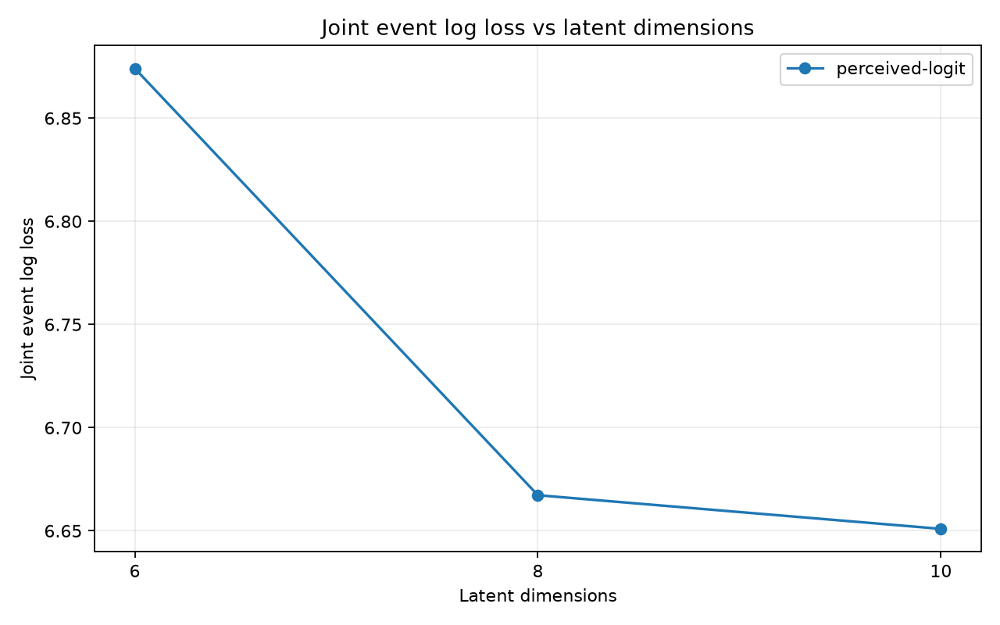
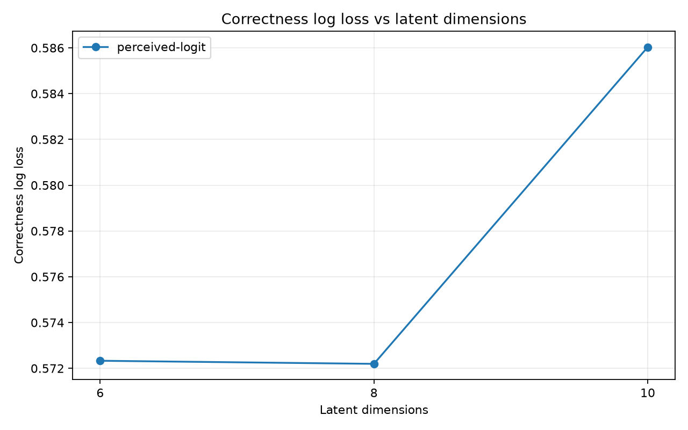
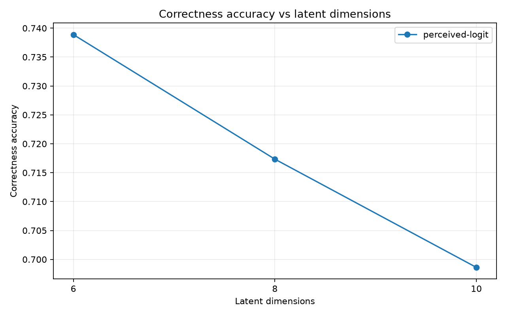
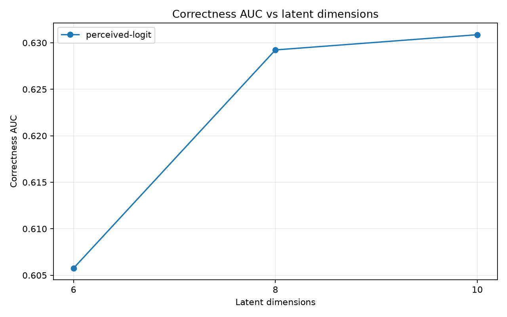
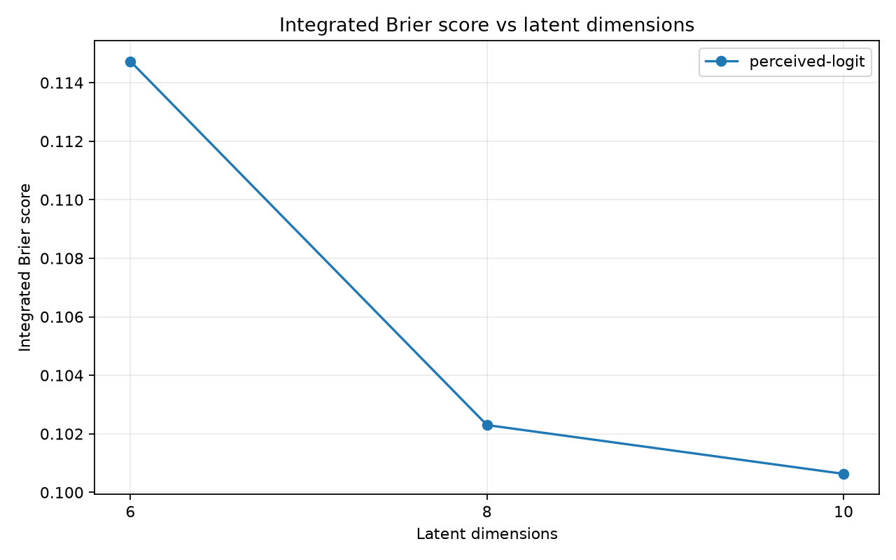
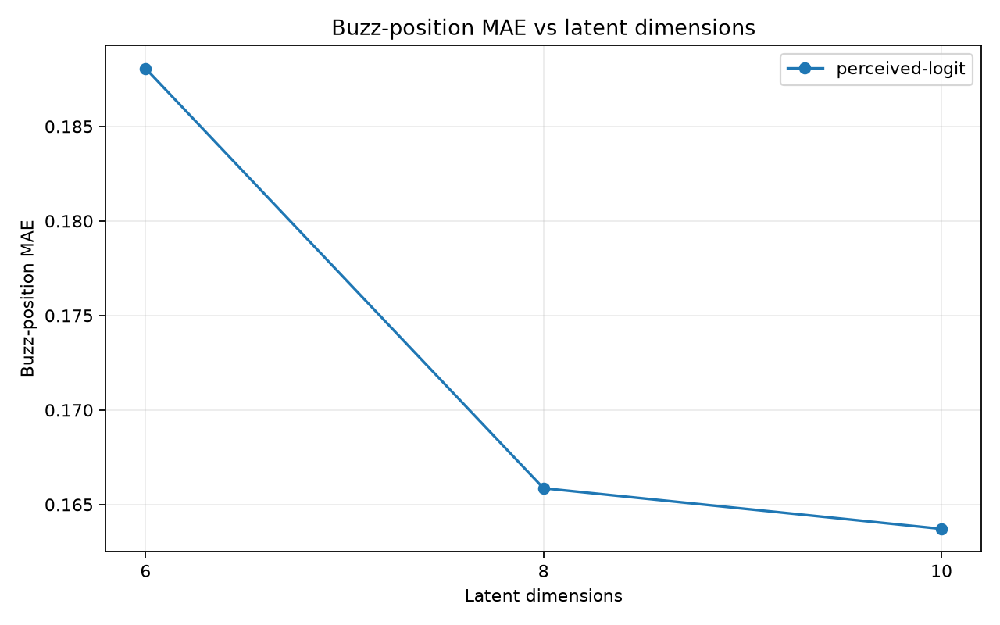

# Perceived difficulty and logit dimension ablation: 10,000 steps

**Coverage: 15/15 fits complete.** Dimensions tested: 6, 8, 10. Selection uses pooled held-out joint event log loss (lower is better).

## Selection and interpretation

For each model, select the smallest tested dimension with loss ≤ (1 + 0.01) × its best loss (a 1% relative tolerance). Only points with all requested folds and required scoring artifacts are eligible.

| Model | Selected K | Selected joint LL | Best K | Best joint LL | Selected − best | Relative gap |
| --- | --- | --- | --- | --- | --- | --- |
| perceived-logit | 8 | 6.66725 | 10 | 6.65095 | 0.0163055 | 0.245% |

- **perceived-logit:** cutoff 6.717456; selected K=8 with 63690 effective parameters (fold mean). The best loss is at the largest tested dimension, so the search does not establish an optimum beyond this grid.

These are model-selection scores on the same folds used to choose K, not an unbiased final test estimate. The tolerance is a capacity rule, not a significance test or an absolute performance target. One optimizer seed cannot establish seed robustness; fold SD is descriptive, not a confidence interval, since training sets overlap.

### Full capacity grid

| Model | K | Complete folds | Joint LL (pooled) | Joint LL (fold mean ± SD) | Rank | Within tolerance | Selected | Effective parameters (fold mean) |
| --- | --- | --- | --- | --- | --- | --- | --- | --- |
| perceived-logit | 6 | 5/5 | 6.87408 | 6.87387 ± 0.028825 (n=5) | 3 | no | no | 48180 |
| perceived-logit | 8 | 5/5 | 6.66725 | 6.6671 ± 0.0269436 (n=5) | 2 | yes | yes | 63690 |
| perceived-logit | 10 | 5/5 | 6.65095 | 6.6508 ± 0.02319 (n=5) | 1 | yes | no | 79200 |

## Experimental protocol

| Setting | Value |
| --- | --- |
| Dataset | `year_2024` |
| Holdout | Five-fold whole-game matrix infill, stratified within tournament/round; coverage repair returns games with unseen entities to training |
| Scored fold IDs | 0, 1, 2, 3, 4 |
| Split seed / optimization seed | 42 / 42 |
| Fit and replay | SVI on training games; frozen player/item posterior-median predictions on held-out games |
| Steps / learning rate / device | 10000 / 0.005 / cuda |
| Bernstein degree | 3 |
| Relevance / drop Dirichlet concentration | 2.0 / 2.0 |
| Other priors | theta and start difficulty: Normal(0,1); total drop: LogNormal(0,0.5); simplex relevance |
| Terminal intercepts / bouncebacks | Disabled / excluded |
| Posterior draws requested | 0 |
| Survival row × dimension budget | 81920 |
| Data directory override | None (repository default) |

The evaluation estimates missing interactions among already observed players and questions. It does not test new-player or new-question generalization.

Both arms share correctness `zC = sum_k r_jk (theta_ik − d_jk(x))`. Scalar perceived-logit uses `zH = alpha_i zC + beta_i`. Three-slice perceived-difficulty uses `zH = sum_k r_jk (theta_ik − alpha_i,s,k d_jk(x) + beta_i,s,k)`, with slices x < 1/3, 1/3 ≤ x < 2/3, and x ≥ 2/3. K changes latent dimension; the logit transform remains scalar per player.

| Model | Alpha prior | Beta prior | Transform parameters per player |
| --- | --- | --- | --- |
| perceived-logit | Normal(1, 1) | Normal(0, 1) | 2 |

Alpha is unconstrained in these sweeps. The two arms differ in transform placement, alpha prior, and parameter count; their comparison does not isolate slicing alone. With P players, Q items, degree p and K dimensions, effective item parameters per item are `(p+2)K−1`; total effective parameters are `P(K+2)+Q((p+2)K−1)` for logit and `7PK+Q((p+2)K−1)` for three-slice difficulty.

## How to read the scores

Pooled tables recompute scores from concatenated held-out rows. Correctness and neg detection condition on observed BUZZ rows, with a 0.5 classification threshold. Neg F1 is computed from precision and recall at the same aggregation level. Joint LL includes first-buzz identity, position, correctness and no-buzz outcomes. Position errors condition on observed buzzes and use relative question position.

All rates are fractions (0.01 = 1 percentage point). Positive position bias means predicted later; positive no-buzz error means overprediction. Loss, ECE, Brier and absolute errors are better when lower; accuracy, AUC, precision, recall, F1 and rank agreement are better when higher. Signed biases target zero. Final-decile mass is descriptive. Integrated Brier pools event-weighted Brier scores on the time grid. Downstream and identity tables show equally weighted fold mean ± sample SD and the number of available folds, rather than pooled nonlinear scores.

See the [metric contract](../../../../../../../../../../compirt_eval/METRICS.md) for definitions and denominators. A dash means unavailable, never zero. The appendix exposes every numeric fold metric, including denominator counts and diagnostics.

## Pooled correctness and neg detection

### perceived-logit

| Metric | K=6 | K=8 | K=10 |
| --- | --- | --- | --- |
| `accuracy` | 0.738885 | 0.717339 | 0.698619 |
| `all_correct_accuracy` | 0.766996 | 0.766996 | 0.766996 |
| `accuracy_lift_over_all_correct` | -0.0281118 | -0.0496576 | -0.068377 |
| `log_loss` | 0.572331 | 0.572196 | 0.586034 |
| `auc` | 0.605758 | 0.62923 | 0.630866 |
| `ece` | 0.104392 | 0.128249 | 0.153182 |
| `brier` | 0.188124 | 0.192707 | 0.19973 |
| `neg_precision` | 0.39198 | 0.370109 | 0.353735 |
| `neg_recall` | 0.218905 | 0.30363 | 0.354857 |
| `neg_f1` | 0.280924 | 0.33359 | 0.354295 |
| `neg_average_precision` | 0.326639 | 0.337415 | 0.336727 |

## Pooled timing and no-buzz diagnostics

### perceived-logit

| Metric | K=6 | K=8 | K=10 |
| --- | --- | --- | --- |
| `joint_tossup_event_log_loss` | 6.87408 | 6.66725 | 6.65095 |
| `integrated_brier_score` | 0.114729 | 0.1023 | 0.100633 |
| `buzz_position_mae` | 0.188066 | 0.165863 | 0.163714 |
| `buzz_position_median_absolute_error` | 0.164707 | 0.14747 | 0.144752 |
| `buzz_position_bias` | -0.12396 | -0.0845121 | -0.0786972 |
| `no_buzz_observed_rate` | 0.0138293 | 0.0138293 | 0.0138293 |
| `no_buzz_predicted_rate` | 0.0933855 | 0.0762138 | 0.0820408 |
| `no_buzz_calibration_error` | 0.0795561 | 0.0623844 | 0.0682115 |
| `no_buzz_brier` | 0.028102 | 0.0249382 | 0.0265859 |
| `full_pmf_final_decile_mass` | 0.100038 | 0.100777 | 0.0997342 |
| `full_pmf_max_mass_error` | 1.22125e-15 | 1.22125e-15 | 1.22125e-15 |

## First-buzzer and downstream outcomes: fold mean ± SD

### perceived-logit

| Metric | K=6 | K=8 | K=10 |
| --- | --- | --- | --- |
| `first_buzzer_top1_accuracy` | 0.390298 ± 0.00193123 (n=5) | 0.399856 ± 0.00664775 (n=5) | 0.396903 ± 0.00324335 (n=5) |
| `first_buzzer_mean_reciprocal_rank` | 0.59434 ± 0.00258725 (n=5) | 0.602151 ± 0.00479145 (n=5) | 0.600796 ± 0.0032482 (n=5) |
| `first_buzzer_log_loss` | 1.60731 ± 0.00855572 (n=5) | 1.58958 ± 0.0127251 (n=5) | 1.58687 ± 0.0101025 (n=5) |
| `first_buzzer_team_top1_accuracy` | 0.652927 ± 0.0051394 (n=5) | 0.661376 ± 0.00635115 (n=5) | 0.658785 ± 0.00687253 (n=5) |
| `tossup_scorer_player_top1_accuracy` | 0.30338 ± 0.00542439 (n=5) | 0.294868 ± 0.00663264 (n=5) | 0.285414 ± 0.0067964 (n=5) |
| `tossup_scorer_team_top1_accuracy` | 0.45515 ± 0.00346312 (n=5) | 0.422819 ± 0.0048876 (n=5) | 0.384428 ± 0.00665911 (n=5) |
| `tossup_game_winner_accuracy` | 0.77591 ± 0.00223019 (n=5) | 0.785714 ± 0.0145982 (n=5) | 0.785154 ± 0.0190205 (n=5) |
| `tossup_game_margin_mae` | 39.7489 ± 1.89372 (n=5) | 39.225 ± 1.73879 (n=5) | 39.92 ± 1.77794 (n=5) |
| `tournament_player_ppg_spearman` | 0.585361 ± 0.0175291 (n=5) | 0.633774 ± 0.0149198 (n=5) | 0.646165 ± 0.0135105 (n=5) |
| `tournament_player_ppg_mae` | 10.7429 ± 0.207864 (n=5) | 11.1152 ± 0.306077 (n=5) | 11.5822 ± 0.332374 (n=5) |
| `tournament_player_ppg_top10_overlap` | 0.618621 ± 0.0259882 (n=5) | 0.654483 ± 0.0145074 (n=5) | 0.651724 ± 0.014007 (n=5) |

## Training and capacity: fold mean ± SD

### perceived-logit

| Metric | K=6 | K=8 | K=10 |
| --- | --- | --- | --- |
| `effective_parameter_count` | 48180 ± 0 (n=5) | 63690 ± 0 (n=5) | 79200 ± 0 (n=5) |
| `train_effective_item_parameters` | 29 ± 0 (n=5) | 39 ± 0 (n=5) | 49 ± 0 (n=5) |
| `train_steps` | 10000 ± 0 (n=5) | 10000 ± 0 (n=5) | 10000 ± 0 (n=5) |
| `train_finite_losses` | 1 ± 0 (n=5) | 1 ± 0 (n=5) | 1 ± 0 (n=5) |
| `train_initial_loss` | 1.6858e+07 ± 26231.7 (n=5) | 1.68847e+07 ± 26195.2 (n=5) | 1.69102e+07 ± 26183.1 (n=5) |
| `final_loss` | 324301 ± 712.998 (n=5) | 322151 ± 808.811 (n=5) | 321069 ± 800.556 (n=5) |
| `best_loss` | 323505 ± 750.931 (n=5) | 320889 ± 818.513 (n=5) | 320358 ± 722.835 (n=5) |
| `last_100_loss_slope` | 0.816794 ± 0.6187 (n=5) | -0.629988 ± 0.29257 (n=5) | -1.24303 ± 0.287192 (n=5) |

## Fitted perception parameters: fold mean ± SD

### perceived-logit

| Metric | K=6 | K=8 | K=10 |
| --- | --- | --- | --- |
| `fitted_alpha_scalar_mean` | 0.334281 ± 0.0293165 (n=5) | 0.895388 ± 0.0260247 (n=5) | 1.17695 ± 0.00887628 (n=5) |
| `fitted_alpha_scalar_negative_fraction` | 0.437251 ± 0.0123845 (n=5) | 0.220481 ± 0.00939094 (n=5) | 0.144192 ± 0.00258989 (n=5) |
| `fitted_beta_scalar_mean` | -5.26984 ± 0.0401248 (n=5) | -5.76179 ± 0.0191956 (n=5) | -5.81084 ± 0.00648271 (n=5) |
| `fitted_beta_scalar_negative_fraction` | 1 ± 0 (n=5) | 1 ± 0 (n=5) | 1 ± 0 (n=5) |

## Coverage and denominators: pooled counts

### perceived-logit

| Metric | K=6 | K=8 | K=10 |
| --- | --- | --- | --- |
| `observations` | 45995 | 45995 | 45995 |
| `full_pmf_events` | 46640 | 46640 | 46640 |
| `survival_events` | 46640 | 46640 | 46640 |

Training losses are the saved SVI objective, not held-out log loss. Finite losses do not establish convergence; negative final-100-step slopes indicate the objective was still descending locally. Parameter summaries below describe fitted posterior medians across players and dimensions (with separate slices); they are not posterior uncertainty intervals or independent samples across folds.

## Matched-fold selected versus best dimension

Differences are selected minus best joint LL on the same fold; positive values favor the best-loss dimension. These pairs describe the cost of the capacity rule without making a significance claim.

| Model | Fold | Selected K | Best K | Selected LL | Best LL | Difference |
| --- | --- | --- | --- | --- | --- | --- |
| perceived-logit | 0 | 8 | 10 | 6.67296 | 6.67161 | 0.00134888 |
| perceived-logit | 1 | 8 | 10 | 6.6674 | 6.65305 | 0.0143451 |
| perceived-logit | 2 | 8 | 10 | 6.66922 | 6.65293 | 0.016288 |
| perceived-logit | 3 | 8 | 10 | 6.62535 | 6.61183 | 0.0135192 |
| perceived-logit | 4 | 8 | 10 | 6.7006 | 6.66458 | 0.0360135 |

## Figures













## Complete metric appendix: fold mean ± SD

Each cell includes n, the number of finite fold values used. Within-fit parameter SD and across-fold SD are different: an `fitted_*_std` row averages the within-fit dispersion, with ± showing variation of that dispersion across folds.

### perceived-logit

| Metric | K=6 | K=8 | K=10 |
| --- | --- | --- | --- |
| `accuracy` | 0.738885 ± 0.00406877 (n=5) | 0.717355 ± 0.00531242 (n=5) | 0.698632 ± 0.00323724 (n=5) |
| `accuracy_lift_over_all_correct` | -0.0281055 ± 0.00346729 (n=5) | -0.0496354 ± 0.00380146 (n=5) | -0.0683583 ± 0.00506094 (n=5) |
| `all_correct_accuracy` | 0.76699 ± 0.00459462 (n=5) | 0.76699 ± 0.00459462 (n=5) | 0.76699 ± 0.00459462 (n=5) |
| `auc` | 0.605859 ± 0.00501217 (n=5) | 0.629308 ± 0.00390814 (n=5) | 0.630979 ± 0.00251491 (n=5) |
| `best_loss` | 323505 ± 750.931 (n=5) | 320889 ± 818.513 (n=5) | 320358 ± 722.835 (n=5) |
| `brier` | 0.188115 ± 0.00167908 (n=5) | 0.192694 ± 0.00168793 (n=5) | 0.19972 ± 0.00148397 (n=5) |
| `buzz_position_bias` | -0.123971 ± 0.00243005 (n=5) | -0.084536 ± 0.00290988 (n=5) | -0.0787168 ± 0.00243762 (n=5) |
| `buzz_position_mae` | 0.188072 ± 0.00173201 (n=5) | 0.165868 ± 0.000783116 (n=5) | 0.163716 ± 0.00102666 (n=5) |
| `buzz_position_median_absolute_error` | 0.164569 ± 0.00256629 (n=5) | 0.147417 ± 0.00166562 (n=5) | 0.144902 ± 0.0018234 (n=5) |
| `ece` | 0.104461 ± 0.00655677 (n=5) | 0.128199 ± 0.00756523 (n=5) | 0.153148 ± 0.00629168 (n=5) |
| `effective_parameter_count` | 48180 ± 0 (n=5) | 63690 ± 0 (n=5) | 79200 ± 0 (n=5) |
| `final_loss` | 324301 ± 712.998 (n=5) | 322151 ± 808.811 (n=5) | 321069 ± 800.556 (n=5) |
| `first_buzzer_events` | 9199 ± 103.704 (n=5) | 9199 ± 103.704 (n=5) | 9199 ± 103.704 (n=5) |
| `first_buzzer_log_loss` | 1.60731 ± 0.00855572 (n=5) | 1.58958 ± 0.0127251 (n=5) | 1.58687 ± 0.0101025 (n=5) |
| `first_buzzer_mean_reciprocal_rank` | 0.59434 ± 0.00258725 (n=5) | 0.602151 ± 0.00479145 (n=5) | 0.600796 ± 0.0032482 (n=5) |
| `first_buzzer_team_top1_accuracy` | 0.652927 ± 0.0051394 (n=5) | 0.661376 ± 0.00635115 (n=5) | 0.658785 ± 0.00687253 (n=5) |
| `first_buzzer_team_top1_accuracy_events` | 9199 ± 103.704 (n=5) | 9199 ± 103.704 (n=5) | 9199 ± 103.704 (n=5) |
| `first_buzzer_top1_accuracy` | 0.390298 ± 0.00193123 (n=5) | 0.399856 ± 0.00664775 (n=5) | 0.396903 ± 0.00324335 (n=5) |
| `fitted_alpha_scalar_mean` | 0.334281 ± 0.0293165 (n=5) | 0.895388 ± 0.0260247 (n=5) | 1.17695 ± 0.00887628 (n=5) |
| `fitted_alpha_scalar_negative_fraction` | 0.437251 ± 0.0123845 (n=5) | 0.220481 ± 0.00939094 (n=5) | 0.144192 ± 0.00258989 (n=5) |
| `fitted_alpha_scalar_std` | 1.56744 ± 0.00961405 (n=5) | 1.378 ± 0.0126627 (n=5) | 1.24344 ± 0.0106566 (n=5) |
| `fitted_beta_scalar_mean` | -5.26984 ± 0.0401248 (n=5) | -5.76179 ± 0.0191956 (n=5) | -5.81084 ± 0.00648271 (n=5) |
| `fitted_beta_scalar_negative_fraction` | 1 ± 0 (n=5) | 1 ± 0 (n=5) | 1 ± 0 (n=5) |
| `fitted_beta_scalar_std` | 1.39492 ± 0.0196985 (n=5) | 0.934536 ± 0.0124864 (n=5) | 0.714242 ± 0.00874942 (n=5) |
| `full_pmf_events` | 9328 ± 91.214 (n=5) | 9328 ± 91.214 (n=5) | 9328 ± 91.214 (n=5) |
| `full_pmf_final_decile_mass` | 0.100032 ± 0.00205085 (n=5) | 0.100774 ± 0.00183351 (n=5) | 0.099729 ± 0.00187514 (n=5) |
| `full_pmf_max_mass_error` | 1.31006e-15 ± 4.96507e-17 (n=5) | 1.33227e-15 ± 0 (n=5) | 1.33227e-15 ± 0 (n=5) |
| `integrated_brier_score` | 0.114729 ± 0.000477948 (n=5) | 0.102299 ± 0.00054972 (n=5) | 0.100631 ± 0.000264192 (n=5) |
| `joint_tossup_event_log_loss` | 6.87387 ± 0.028825 (n=5) | 6.6671 ± 0.0269436 (n=5) | 6.6508 ± 0.02319 (n=5) |
| `joint_tossup_event_log_loss_events` | 9328 ± 91.214 (n=5) | 9328 ± 91.214 (n=5) | 9328 ± 91.214 (n=5) |
| `last_100_loss_slope` | 0.816794 ± 0.6187 (n=5) | -0.629988 ± 0.29257 (n=5) | -1.24303 ± 0.287192 (n=5) |
| `log_loss` | 0.57229 ± 0.00554175 (n=5) | 0.57216 ± 0.00443836 (n=5) | 0.586008 ± 0.00379067 (n=5) |
| `mean_predictive_variance` | 0.183426 ± 0.000961978 (n=5) | 0.203191 ± 0.00118748 (n=5) | 0.213025 ± 0.000852984 (n=5) |
| `neg_auroc` | 0.605859 ± 0.00501217 (n=5) | 0.629308 ± 0.00390814 (n=5) | 0.630979 ± 0.00251491 (n=5) |
| `neg_average_precision` | 0.327412 ± 0.00880677 (n=5) | 0.338213 ± 0.00965578 (n=5) | 0.337226 ± 0.0081293 (n=5) |
| `neg_f1` | 0.280784 ± 0.00806045 (n=5) | 0.333498 ± 0.00691408 (n=5) | 0.354215 ± 0.00691421 (n=5) |
| `neg_precision` | 0.392161 ± 0.00994098 (n=5) | 0.370193 ± 0.00761759 (n=5) | 0.353793 ± 0.00926563 (n=5) |
| `neg_recall` | 0.218878 ± 0.00990369 (n=5) | 0.303571 ± 0.00976851 (n=5) | 0.3548 ± 0.00888647 (n=5) |
| `no_buzz_brier` | 0.0280993 ± 0.00115217 (n=5) | 0.0249393 ± 0.00157573 (n=5) | 0.0265889 ± 0.00201602 (n=5) |
| `no_buzz_calibration_error` | 0.0795261 ± 0.00423801 (n=5) | 0.0623663 ± 0.0025946 (n=5) | 0.0681964 ± 0.00271415 (n=5) |
| `no_buzz_observed_rate` | 0.0138406 ± 0.0016887 (n=5) | 0.0138406 ± 0.0016887 (n=5) | 0.0138406 ± 0.0016887 (n=5) |
| `no_buzz_predicted_rate` | 0.0933667 ± 0.00317838 (n=5) | 0.076207 ± 0.00194812 (n=5) | 0.082037 ± 0.00271759 (n=5) |
| `probability_p10` | 0.471202 ± 0.0052901 (n=5) | 0.427582 ± 0.00442881 (n=5) | 0.407099 ± 0.00370025 (n=5) |
| `probability_p50` | 0.71022 ± 0.00399127 (n=5) | 0.658759 ± 0.00474216 (n=5) | 0.623411 ± 0.00347708 (n=5) |
| `probability_p90` | 0.911827 ± 0.00273664 (n=5) | 0.845325 ± 0.00438085 (n=5) | 0.812256 ± 0.00391341 (n=5) |
| `probability_std` | 0.166096 ± 0.00105487 (n=5) | 0.159763 ± 0.0010009 (n=5) | 0.153649 ± 0.00103553 (n=5) |
| `survival_events` | 9328 ± 91.214 (n=5) | 9328 ± 91.214 (n=5) | 9328 ± 91.214 (n=5) |
| `survival_events_skipped` | 0 ± 0 (n=5) | 0 ± 0 (n=5) | 0 ± 0 (n=5) |
| `tossup_game_margin_mae` | 39.7489 ± 1.89372 (n=5) | 39.225 ± 1.73879 (n=5) | 39.92 ± 1.77794 (n=5) |
| `tossup_game_margin_mae_games` | 466.4 ± 4.5607 (n=5) | 466.4 ± 4.5607 (n=5) | 466.4 ± 4.5607 (n=5) |
| `tossup_game_winner_accuracy` | 0.77591 ± 0.00223019 (n=5) | 0.785714 ± 0.0145982 (n=5) | 0.785154 ± 0.0190205 (n=5) |
| `tossup_game_winner_accuracy_games` | 453.4 ± 6.0663 (n=5) | 453.4 ± 6.0663 (n=5) | 453.4 ± 6.0663 (n=5) |
| `tossup_outcome_events` | 9328 ± 91.214 (n=5) | 9328 ± 91.214 (n=5) | 9328 ± 91.214 (n=5) |
| `tossup_scorer_player_top1_accuracy` | 0.30338 ± 0.00542439 (n=5) | 0.294868 ± 0.00663264 (n=5) | 0.285414 ± 0.0067964 (n=5) |
| `tossup_scorer_player_top1_accuracy_events` | 9328 ± 91.214 (n=5) | 9328 ± 91.214 (n=5) | 9328 ± 91.214 (n=5) |
| `tossup_scorer_team_top1_accuracy` | 0.45515 ± 0.00346312 (n=5) | 0.422819 ± 0.0048876 (n=5) | 0.384428 ± 0.00665911 (n=5) |
| `tossup_scorer_team_top1_accuracy_events` | 9328 ± 91.214 (n=5) | 9328 ± 91.214 (n=5) | 9328 ± 91.214 (n=5) |
| `tournament_player_ppg_mae` | 10.7429 ± 0.207864 (n=5) | 11.1152 ± 0.306077 (n=5) | 11.5822 ± 0.332374 (n=5) |
| `tournament_player_ppg_spearman` | 0.585361 ± 0.0175291 (n=5) | 0.633774 ± 0.0149198 (n=5) | 0.646165 ± 0.0135105 (n=5) |
| `tournament_player_ppg_top10_overlap` | 0.618621 ± 0.0259882 (n=5) | 0.654483 ± 0.0145074 (n=5) | 0.651724 ± 0.014007 (n=5) |
| `tournament_player_ppg_tournaments` | 29 ± 0 (n=5) | 29 ± 0 (n=5) | 29 ± 0 (n=5) |
| `train_effective_item_parameters` | 29 ± 0 (n=5) | 39 ± 0 (n=5) | 49 ± 0 (n=5) |
| `train_events` | 39284 ± 91.214 (n=5) | 39284 ± 91.214 (n=5) | 39284 ± 91.214 (n=5) |
| `train_finite_losses` | 1 ± 0 (n=5) | 1 ± 0 (n=5) | 1 ± 0 (n=5) |
| `train_initial_loss` | 1.6858e+07 ± 26231.7 (n=5) | 1.68847e+07 ± 26195.2 (n=5) | 1.69102e+07 ± 26183.1 (n=5) |
| `train_observations_BUZZ` | 38715 ± 103.704 (n=5) | 38715 ± 103.704 (n=5) | 38715 ± 103.704 (n=5) |
| `train_observations_CENSORED` | 238779 ± 672.819 (n=5) | 238779 ± 672.819 (n=5) | 238779 ± 672.819 (n=5) |
| `train_observations_NO-BUZZ` | 4010 ± 86.5823 (n=5) | 4010 ± 86.5823 (n=5) | 4010 ± 86.5823 (n=5) |
| `train_players` | 1455 ± 0 (n=5) | 1455 ± 0 (n=5) | 1455 ± 0 (n=5) |
| `train_steps` | 10000 ± 0 (n=5) | 10000 ± 0 (n=5) | 10000 ± 0 (n=5) |
| `train_tossups` | 1260 ± 0 (n=5) | 1260 ± 0 (n=5) | 1260 ± 0 (n=5) |

## Artifact index and reproducibility

[Saved configuration](../configuration.json) · [Per-fold values](per_fold.csv) · [Fold mean/SD](fold_mean_std.csv) · [Pooled values](pooled.csv)

Each fit links to its saved commands, training summary, and evaluator report. Training posterior quantiles and player parameters are beside the training summary. Training-set predictive metrics, optimizer-seed replication, posterior-predictive intervals, and a separate final test estimate are not supplied by this sweep.

| Model | K | Fold | Status | Commands | Training | Evaluation | Missing required artifacts |
| --- | --- | --- | --- | --- | --- | --- | --- |
| perceived-logit | 6 | 0 | complete | [commands](../perceived-logit/dim_6/fold_0/command.json) | [training](../perceived-logit/dim_6/fold_0/train/pyramidal/summary.json) | [evaluation](../perceived-logit/dim_6/fold_0/evaluation/experiment_report.md) | — |
| perceived-logit | 6 | 1 | complete | [commands](../perceived-logit/dim_6/fold_1/command.json) | [training](../perceived-logit/dim_6/fold_1/train/pyramidal/summary.json) | [evaluation](../perceived-logit/dim_6/fold_1/evaluation/experiment_report.md) | — |
| perceived-logit | 6 | 2 | complete | [commands](../perceived-logit/dim_6/fold_2/command.json) | [training](../perceived-logit/dim_6/fold_2/train/pyramidal/summary.json) | [evaluation](../perceived-logit/dim_6/fold_2/evaluation/experiment_report.md) | — |
| perceived-logit | 6 | 3 | complete | [commands](../perceived-logit/dim_6/fold_3/command.json) | [training](../perceived-logit/dim_6/fold_3/train/pyramidal/summary.json) | [evaluation](../perceived-logit/dim_6/fold_3/evaluation/experiment_report.md) | — |
| perceived-logit | 6 | 4 | complete | [commands](../perceived-logit/dim_6/fold_4/command.json) | [training](../perceived-logit/dim_6/fold_4/train/pyramidal/summary.json) | [evaluation](../perceived-logit/dim_6/fold_4/evaluation/experiment_report.md) | — |
| perceived-logit | 8 | 0 | complete | [commands](../perceived-logit/dim_8/fold_0/command.json) | [training](../perceived-logit/dim_8/fold_0/train/pyramidal/summary.json) | [evaluation](../perceived-logit/dim_8/fold_0/evaluation/experiment_report.md) | — |
| perceived-logit | 8 | 1 | complete | [commands](../perceived-logit/dim_8/fold_1/command.json) | [training](../perceived-logit/dim_8/fold_1/train/pyramidal/summary.json) | [evaluation](../perceived-logit/dim_8/fold_1/evaluation/experiment_report.md) | — |
| perceived-logit | 8 | 2 | complete | [commands](../perceived-logit/dim_8/fold_2/command.json) | [training](../perceived-logit/dim_8/fold_2/train/pyramidal/summary.json) | [evaluation](../perceived-logit/dim_8/fold_2/evaluation/experiment_report.md) | — |
| perceived-logit | 8 | 3 | complete | [commands](../perceived-logit/dim_8/fold_3/command.json) | [training](../perceived-logit/dim_8/fold_3/train/pyramidal/summary.json) | [evaluation](../perceived-logit/dim_8/fold_3/evaluation/experiment_report.md) | — |
| perceived-logit | 8 | 4 | complete | [commands](../perceived-logit/dim_8/fold_4/command.json) | [training](../perceived-logit/dim_8/fold_4/train/pyramidal/summary.json) | [evaluation](../perceived-logit/dim_8/fold_4/evaluation/experiment_report.md) | — |
| perceived-logit | 10 | 0 | complete | [commands](../perceived-logit/dim_10/fold_0/command.json) | [training](../perceived-logit/dim_10/fold_0/train/pyramidal/summary.json) | [evaluation](../perceived-logit/dim_10/fold_0/evaluation/experiment_report.md) | — |
| perceived-logit | 10 | 1 | complete | [commands](../perceived-logit/dim_10/fold_1/command.json) | [training](../perceived-logit/dim_10/fold_1/train/pyramidal/summary.json) | [evaluation](../perceived-logit/dim_10/fold_1/evaluation/experiment_report.md) | — |
| perceived-logit | 10 | 2 | complete | [commands](../perceived-logit/dim_10/fold_2/command.json) | [training](../perceived-logit/dim_10/fold_2/train/pyramidal/summary.json) | [evaluation](../perceived-logit/dim_10/fold_2/evaluation/experiment_report.md) | — |
| perceived-logit | 10 | 3 | complete | [commands](../perceived-logit/dim_10/fold_3/command.json) | [training](../perceived-logit/dim_10/fold_3/train/pyramidal/summary.json) | [evaluation](../perceived-logit/dim_10/fold_3/evaluation/experiment_report.md) | — |
| perceived-logit | 10 | 4 | complete | [commands](../perceived-logit/dim_10/fold_4/command.json) | [training](../perceived-logit/dim_10/fold_4/train/pyramidal/summary.json) | [evaluation](../perceived-logit/dim_10/fold_4/evaluation/experiment_report.md) | — |

Regenerate from the saved configuration without refitting:

```python
import json
from pathlib import Path
from run_scripts.bernstein.run_perception_dimension_ablation import Configuration, aggregate
root = Path('results/compirt/holdout/double-difficulty/variants/perception/dimension-sweeps/normal-alpha-10000steps/perceived-logit-grid')
saved = json.loads((root / 'configuration.json').read_text())
saved['root'] = str(root.resolve())
aggregate(Configuration(**saved))
```
