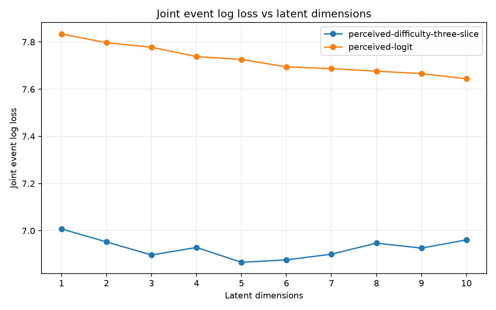
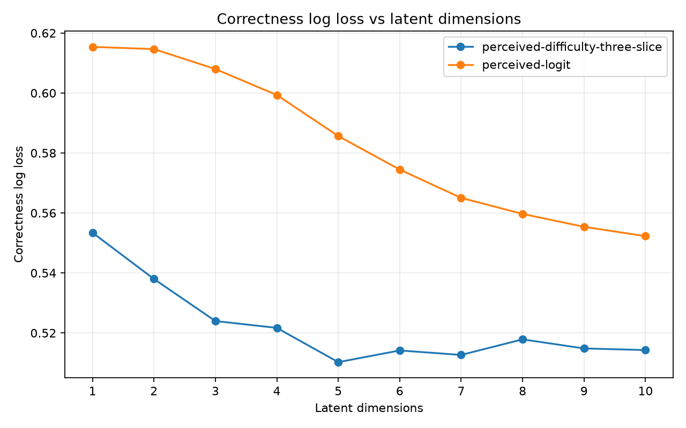
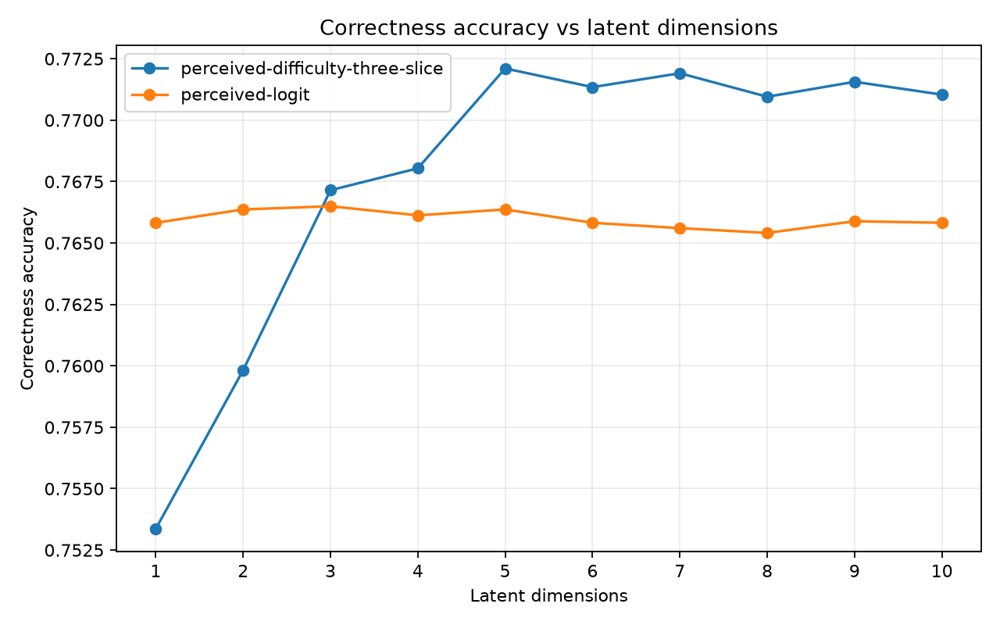
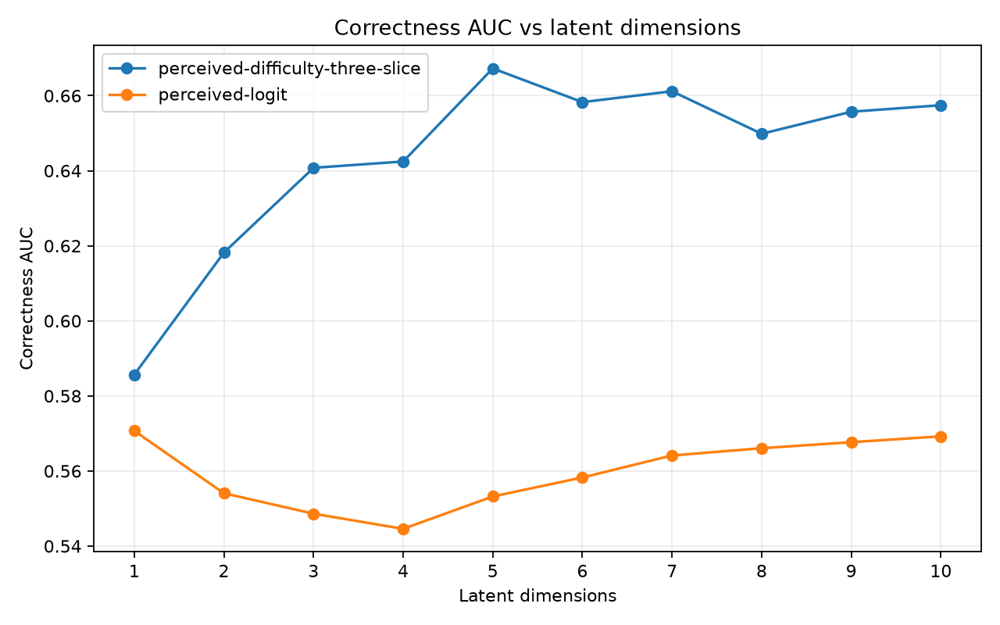
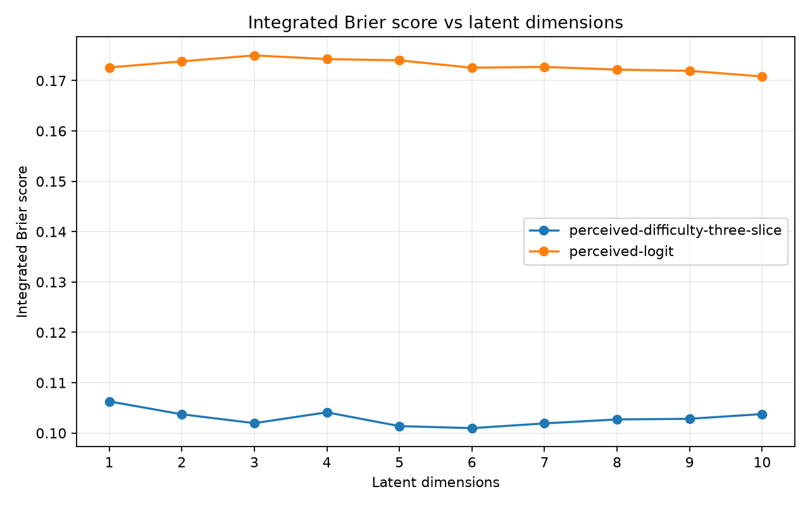
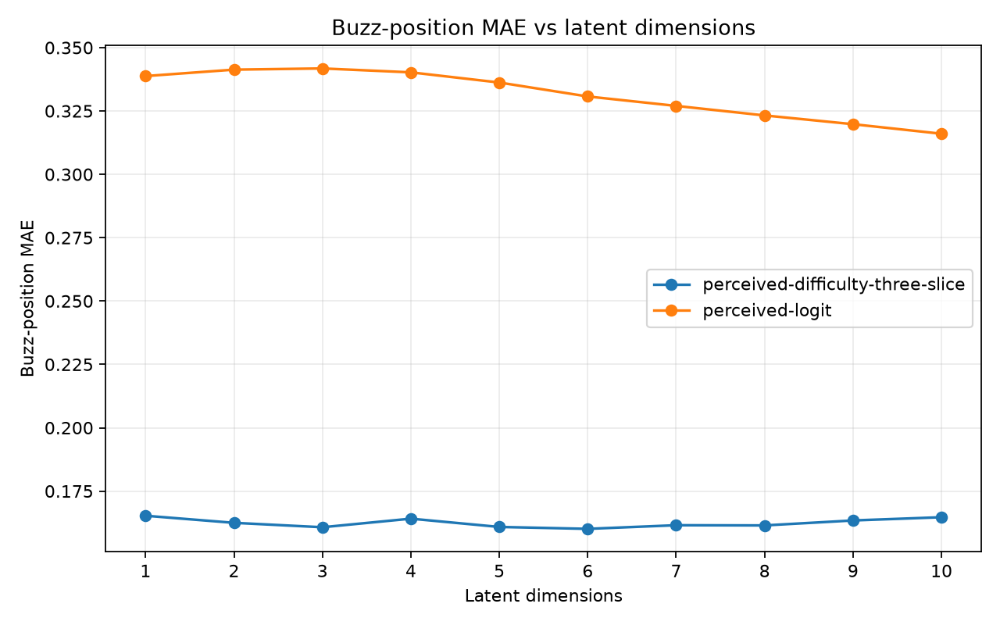

# Perceived difficulty and logit dimension ablation: 3,000 steps

**Coverage: 100/100 fits complete.** Dimensions tested: 1, 2, 3, 4, 5, 6, 7, 8, 9, 10. Selection uses pooled held-out joint event log loss (lower is better).

## Selection and interpretation

For each model, select the smallest tested dimension with loss ≤ (1 + 0.01) × its best loss (a 1% relative tolerance). Only points with all requested folds and required scoring artifacts are eligible.

| Model | Selected K | Selected joint LL | Best K | Best joint LL | Selected − best | Relative gap |
| --- | --- | --- | --- | --- | --- | --- |
| perceived-logit | 6 | 7.69439 | 10 | 7.644 | 0.0503874 | 0.659% |
| perceived-difficulty-three-slice | 3 | 6.89727 | 5 | 6.86612 | 0.0311545 | 0.454% |

- **perceived-logit:** cutoff 7.720443; selected K=6 with 48180 effective parameters (fold mean). The best loss is at the largest tested dimension, so the search does not establish an optimum beyond this grid.
- **perceived-difficulty-three-slice:** cutoff 6.934780; selected K=3 with 48195 effective parameters (fold mean). The selection favors smaller capacity within the stated tolerance.

These are model-selection scores on the same folds used to choose K, not an unbiased final test estimate. The tolerance is a capacity rule, not a significance test or an absolute performance target. One optimizer seed cannot establish seed robustness; fold SD is descriptive, not a confidence interval, since training sets overlap.

### Full capacity grid

| Model | K | Complete folds | Joint LL (pooled) | Joint LL (fold mean ± SD) | Rank | Within tolerance | Selected | Effective parameters (fold mean) |
| --- | --- | --- | --- | --- | --- | --- | --- | --- |
| perceived-difficulty-three-slice | 1 | 5/5 | 7.00762 | 7.00753 ± 0.0169621 (n=5) | 10 | no | no | 15225 |
| perceived-difficulty-three-slice | 2 | 5/5 | 6.95234 | 6.95221 ± 0.0195838 (n=5) | 8 | no | no | 31710 |
| perceived-difficulty-three-slice | 3 | 5/5 | 6.89727 | 6.89715 ± 0.0254463 (n=5) | 3 | yes | yes | 48195 |
| perceived-difficulty-three-slice | 4 | 5/5 | 6.92902 | 6.92857 ± 0.0728395 (n=5) | 6 | yes | no | 64680 |
| perceived-difficulty-three-slice | 5 | 5/5 | 6.86612 | 6.86602 ± 0.0195843 (n=5) | 1 | yes | no | 81165 |
| perceived-difficulty-three-slice | 6 | 5/5 | 6.87648 | 6.87627 ± 0.0319752 (n=5) | 2 | yes | no | 97650 |
| perceived-difficulty-three-slice | 7 | 5/5 | 6.90063 | 6.90029 ± 0.0581601 (n=5) | 4 | yes | no | 114135 |
| perceived-difficulty-three-slice | 8 | 5/5 | 6.94737 | 6.94685 ± 0.0927379 (n=5) | 7 | no | no | 130620 |
| perceived-difficulty-three-slice | 9 | 5/5 | 6.92636 | 6.92582 ± 0.0932175 (n=5) | 5 | yes | no | 147105 |
| perceived-difficulty-three-slice | 10 | 5/5 | 6.96108 | 6.9604 ± 0.109174 (n=5) | 9 | no | no | 163590 |
| perceived-logit | 1 | 5/5 | 7.83409 | 7.83406 ± 0.0104825 (n=5) | 10 | no | no | 9405 |
| perceived-logit | 2 | 5/5 | 7.7969 | 7.79689 ± 0.00956723 (n=5) | 9 | no | no | 17160 |
| perceived-logit | 3 | 5/5 | 7.77765 | 7.77762 ± 0.00947939 (n=5) | 8 | no | no | 24915 |
| perceived-logit | 4 | 5/5 | 7.73813 | 7.73813 ± 0.0106326 (n=5) | 7 | no | no | 32670 |
| perceived-logit | 5 | 5/5 | 7.72581 | 7.72581 ± 0.0090864 (n=5) | 6 | no | no | 40425 |
| perceived-logit | 6 | 5/5 | 7.69439 | 7.69442 ± 0.00884907 (n=5) | 5 | yes | yes | 48180 |
| perceived-logit | 7 | 5/5 | 7.68719 | 7.68722 ± 0.00653229 (n=5) | 4 | yes | no | 55935 |
| perceived-logit | 8 | 5/5 | 7.67617 | 7.67615 ± 0.00810758 (n=5) | 3 | yes | no | 63690 |
| perceived-logit | 9 | 5/5 | 7.66614 | 7.66613 ± 0.00631865 (n=5) | 2 | yes | no | 71445 |
| perceived-logit | 10 | 5/5 | 7.644 | 7.64398 ± 0.00686986 (n=5) | 1 | yes | no | 79200 |

## Experimental protocol

| Setting | Value |
| --- | --- |
| Dataset | `year_2024` |
| Holdout | Five-fold whole-game matrix infill, stratified within tournament/round; coverage repair returns games with unseen entities to training |
| Scored fold IDs | 0, 1, 2, 3, 4 |
| Split seed / optimization seed | 42 / 42 |
| Fit and replay | SVI on training games; frozen player/item posterior-median predictions on held-out games |
| Steps / learning rate / device | 3000 / 0.005 / cuda |
| Bernstein degree | 3 |
| Relevance / drop Dirichlet concentration | 2.0 / 2.0 |
| Other priors | theta and start difficulty: Normal(0,1); total drop: LogNormal(0,0.5); simplex relevance |
| Terminal intercepts / bouncebacks | Disabled / excluded |
| Posterior draws requested | 0 |
| Survival row × dimension budget | 81920 |
| Data directory override | None (repository default) |

The evaluation estimates missing interactions among already observed players and questions. It does not test new-player or new-question generalization.

Both arms share correctness `zC = sum_k r_jk (theta_ik − d_jk(x))`. Scalar perceived-logit uses `zH = alpha_i zC + beta_i`. Three-slice perceived-difficulty uses `zH = sum_k r_jk (theta_ik − alpha_i,s,k d_jk(x) + beta_i,s,k)`, with slices x < 1/3, 1/3 ≤ x < 2/3, and x ≥ 2/3. K changes latent dimension; the logit transform remains scalar per player.

| Model | Alpha prior | Beta prior | Transform parameters per player |
| --- | --- | --- | --- |
| perceived-logit | Normal(1, 1) | Normal(0, 1) | 2 |
| perceived-difficulty-three-slice | Normal(0, 1) | Normal(0, 1) | 6K |

Alpha is unconstrained in these sweeps. The two arms differ in transform placement, alpha prior, and parameter count; their comparison does not isolate slicing alone. With P players, Q items, degree p and K dimensions, effective item parameters per item are `(p+2)K−1`; total effective parameters are `P(K+2)+Q((p+2)K−1)` for logit and `7PK+Q((p+2)K−1)` for three-slice difficulty.

## How to read the scores

Pooled tables recompute scores from concatenated held-out rows. Correctness and neg detection condition on observed BUZZ rows, with a 0.5 classification threshold. Neg F1 is computed from precision and recall at the same aggregation level. Joint LL includes first-buzz identity, position, correctness and no-buzz outcomes. Position errors condition on observed buzzes and use relative question position.

All rates are fractions (0.01 = 1 percentage point). Positive position bias means predicted later; positive no-buzz error means overprediction. Loss, ECE, Brier and absolute errors are better when lower; accuracy, AUC, precision, recall, F1 and rank agreement are better when higher. Signed biases target zero. Final-decile mass is descriptive. Integrated Brier pools event-weighted Brier scores on the time grid. Downstream and identity tables show equally weighted fold mean ± sample SD and the number of available folds, rather than pooled nonlinear scores.

See the [metric contract](../../../../../../../../../compirt_eval/METRICS.md) for definitions and denominators. A dash means unavailable, never zero. The appendix exposes every numeric fold metric, including denominator counts and diagnostics.

## Pooled correctness and neg detection

### perceived-logit

| Metric | K=1 | K=2 | K=3 | K=4 | K=5 | K=6 | K=7 | K=8 | K=9 | K=10 |
| --- | --- | --- | --- | --- | --- | --- | --- | --- | --- | --- |
| `accuracy` | 0.765822 | 0.766366 | 0.766496 | 0.766127 | 0.766366 | 0.765822 | 0.765605 | 0.765409 | 0.765888 | 0.765822 |
| `all_correct_accuracy` | 0.766996 | 0.766996 | 0.766996 | 0.766996 | 0.766996 | 0.766996 | 0.766996 | 0.766996 | 0.766996 | 0.766996 |
| `accuracy_lift_over_all_correct` | -0.00117404 | -0.000630503 | -0.000500054 | -0.00086966 | -0.000630503 | -0.00117404 | -0.00139146 | -0.00158713 | -0.00110882 | -0.00117404 |
| `log_loss` | 0.615391 | 0.614646 | 0.608005 | 0.599343 | 0.58566 | 0.574474 | 0.565042 | 0.559688 | 0.555388 | 0.552273 |
| `auc` | 0.570703 | 0.554074 | 0.54863 | 0.544593 | 0.553222 | 0.558278 | 0.564144 | 0.566074 | 0.567684 | 0.569239 |
| `ece` | 0.121534 | 0.11325 | 0.104868 | 0.0965867 | 0.0873773 | 0.0830958 | 0.0769399 | 0.073986 | 0.0707629 | 0.0662043 |
| `brier` | 0.192037 | 0.191732 | 0.190557 | 0.189161 | 0.186773 | 0.1848 | 0.18307 | 0.182207 | 0.181457 | 0.180959 |
| `neg_precision` | 0.304348 | 0.401361 | 0.443902 | 0.431507 | 0.468547 | 0.455298 | 0.457333 | 0.456805 | 0.468635 | 0.468531 |
| `neg_recall` | 0.00391901 | 0.00550527 | 0.00849118 | 0.011757 | 0.0201549 | 0.0256602 | 0.0320052 | 0.0360175 | 0.035551 | 0.0375105 |
| `neg_f1` | 0.00773837 | 0.0108616 | 0.0166636 | 0.0228904 | 0.0386473 | 0.0485823 | 0.0598238 | 0.0667705 | 0.0660885 | 0.06946 |
| `neg_average_precision` | 0.280827 | 0.273863 | 0.274499 | 0.274907 | 0.282911 | 0.288524 | 0.294273 | 0.296591 | 0.298349 | 0.299683 |

### perceived-difficulty-three-slice

| Metric | K=1 | K=2 | K=3 | K=4 | K=5 | K=6 | K=7 | K=8 | K=9 | K=10 |
| --- | --- | --- | --- | --- | --- | --- | --- | --- | --- | --- |
| `accuracy` | 0.753364 | 0.759822 | 0.767149 | 0.76804 | 0.772106 | 0.771345 | 0.77191 | 0.770953 | 0.771562 | 0.77104 |
| `all_correct_accuracy` | 0.766996 | 0.766996 | 0.766996 | 0.766996 | 0.766996 | 0.766996 | 0.766996 | 0.766996 | 0.766996 | 0.766996 |
| `accuracy_lift_over_all_correct` | -0.0136319 | -0.00717469 | 0.00015219 | 0.00104359 | 0.00510925 | 0.0043483 | 0.00491358 | 0.00395695 | 0.00456571 | 0.00404392 |
| `log_loss` | 0.553426 | 0.538 | 0.523971 | 0.521694 | 0.510263 | 0.514164 | 0.512667 | 0.517864 | 0.514837 | 0.514298 |
| `auc` | 0.585674 | 0.618196 | 0.640779 | 0.642459 | 0.667254 | 0.65828 | 0.661168 | 0.649844 | 0.655726 | 0.657454 |
| `ece` | 0.0609409 | 0.0478256 | 0.0334885 | 0.0245499 | 0.0124468 | 0.0155849 | 0.0152203 | 0.0157102 | 0.0128117 | 0.0134015 |
| `brier` | 0.182103 | 0.176096 | 0.171011 | 0.170369 | 0.166258 | 0.167469 | 0.166913 | 0.168832 | 0.167791 | 0.167569 |
| `neg_precision` | 0.36256 | 0.43125 | 0.501655 | 0.516151 | 0.571169 | 0.571839 | 0.579354 | 0.591182 | 0.61242 | 0.610451 |
| `neg_recall` | 0.0771671 | 0.0965755 | 0.0990016 | 0.0715685 | 0.087991 | 0.0742745 | 0.0769805 | 0.0550527 | 0.0533731 | 0.0479612 |
| `neg_f1` | 0.12725 | 0.15781 | 0.165368 | 0.125707 | 0.15249 | 0.131472 | 0.135903 | 0.100726 | 0.098189 | 0.088935 |
| `neg_average_precision` | 0.295764 | 0.330457 | 0.36238 | 0.361115 | 0.3924 | 0.384321 | 0.389111 | 0.372544 | 0.381218 | 0.383472 |

## Pooled timing and no-buzz diagnostics

### perceived-logit

| Metric | K=1 | K=2 | K=3 | K=4 | K=5 | K=6 | K=7 | K=8 | K=9 | K=10 |
| --- | --- | --- | --- | --- | --- | --- | --- | --- | --- | --- |
| `joint_tossup_event_log_loss` | 7.83409 | 7.7969 | 7.77765 | 7.73813 | 7.72581 | 7.69439 | 7.68719 | 7.67617 | 7.66614 | 7.644 |
| `integrated_brier_score` | 0.172604 | 0.173825 | 0.175003 | 0.174275 | 0.174023 | 0.172555 | 0.172718 | 0.172186 | 0.171938 | 0.17082 |
| `buzz_position_mae` | 0.338767 | 0.341305 | 0.341779 | 0.340237 | 0.336221 | 0.330719 | 0.326997 | 0.323236 | 0.31978 | 0.316013 |
| `buzz_position_median_absolute_error` | 0.342367 | 0.34487 | 0.345235 | 0.343249 | 0.337899 | 0.331162 | 0.326171 | 0.321363 | 0.316904 | 0.312375 |
| `buzz_position_bias` | -0.326102 | -0.328928 | -0.329187 | -0.327509 | -0.322762 | -0.316198 | -0.311459 | -0.306772 | -0.302394 | -0.297726 |
| `no_buzz_observed_rate` | 0.0138293 | 0.0138293 | 0.0138293 | 0.0138293 | 0.0138293 | 0.0138293 | 0.0138293 | 0.0138293 | 0.0138293 | 0.0138293 |
| `no_buzz_predicted_rate` | 0.228214 | 0.234672 | 0.236689 | 0.23593 | 0.226981 | 0.219098 | 0.211287 | 0.206132 | 0.200429 | 0.197366 |
| `no_buzz_calibration_error` | 0.214385 | 0.220843 | 0.22286 | 0.222101 | 0.213151 | 0.205269 | 0.197457 | 0.192303 | 0.1866 | 0.183537 |
| `no_buzz_brier` | 0.0676981 | 0.0715981 | 0.0726925 | 0.0722528 | 0.0676369 | 0.0638786 | 0.06011 | 0.0577667 | 0.0553664 | 0.0541847 |
| `full_pmf_final_decile_mass` | 0.0292366 | 0.028558 | 0.0286324 | 0.029275 | 0.031029 | 0.0330945 | 0.0346751 | 0.0361122 | 0.0374256 | 0.0387258 |
| `full_pmf_max_mass_error` | 1.22125e-15 | 1.55431e-15 | 1.22125e-15 | 1.44329e-15 | 1.22125e-15 | 1.22125e-15 | 1.22125e-15 | 1.22125e-15 | 1.22125e-15 | 1.77636e-15 |

### perceived-difficulty-three-slice

| Metric | K=1 | K=2 | K=3 | K=4 | K=5 | K=6 | K=7 | K=8 | K=9 | K=10 |
| --- | --- | --- | --- | --- | --- | --- | --- | --- | --- | --- |
| `joint_tossup_event_log_loss` | 7.00762 | 6.95234 | 6.89727 | 6.92902 | 6.86612 | 6.87648 | 6.90063 | 6.94737 | 6.92636 | 6.96108 |
| `integrated_brier_score` | 0.106292 | 0.103727 | 0.101969 | 0.104118 | 0.101382 | 0.100974 | 0.101922 | 0.102703 | 0.102836 | 0.103775 |
| `buzz_position_mae` | 0.165276 | 0.16248 | 0.160739 | 0.164122 | 0.160856 | 0.160104 | 0.161536 | 0.161459 | 0.163414 | 0.164691 |
| `buzz_position_median_absolute_error` | 0.150927 | 0.14772 | 0.145897 | 0.148539 | 0.146438 | 0.145502 | 0.146979 | 0.146353 | 0.148994 | 0.150071 |
| `buzz_position_bias` | -0.0677228 | -0.0677851 | -0.0678955 | -0.0716178 | -0.0678588 | -0.0664296 | -0.0689198 | -0.0672529 | -0.0725292 | -0.0722612 |
| `no_buzz_observed_rate` | 0.0138293 | 0.0138293 | 0.0138293 | 0.0138293 | 0.0138293 | 0.0138293 | 0.0138293 | 0.0138293 | 0.0138293 | 0.0138293 |
| `no_buzz_predicted_rate` | 0.0884261 | 0.0894707 | 0.0909846 | 0.0903165 | 0.0921851 | 0.0948511 | 0.0927612 | 0.0985717 | 0.0916483 | 0.0913853 |
| `no_buzz_calibration_error` | 0.0745968 | 0.0756414 | 0.0771552 | 0.0764871 | 0.0783558 | 0.0810218 | 0.0789318 | 0.0847423 | 0.077819 | 0.077556 |
| `no_buzz_brier` | 0.0238003 | 0.0247633 | 0.0253809 | 0.0251481 | 0.0259526 | 0.02677 | 0.0261882 | 0.0282771 | 0.0260134 | 0.0258299 |
| `full_pmf_final_decile_mass` | 0.0576627 | 0.0567271 | 0.055973 | 0.0554128 | 0.0553084 | 0.0560316 | 0.0550571 | 0.0562858 | 0.0541628 | 0.0543427 |
| `full_pmf_max_mass_error` | 1.22125e-15 | 1.44329e-15 | 1.22125e-15 | 1.55431e-15 | 1.44329e-15 | 1.22125e-15 | 1.55431e-15 | 1.22125e-15 | 1.55431e-15 | 1.22125e-15 |

## First-buzzer and downstream outcomes: fold mean ± SD

### perceived-logit

| Metric | K=1 | K=2 | K=3 | K=4 | K=5 | K=6 | K=7 | K=8 | K=9 | K=10 |
| --- | --- | --- | --- | --- | --- | --- | --- | --- | --- | --- |
| `first_buzzer_top1_accuracy` | 0.305719 ± 0.00405413 (n=5) | 0.336676 ± 0.00476277 (n=5) | 0.351546 ± 0.0039991 (n=5) | 0.363776 ± 0.00409126 (n=5) | 0.347701 ± 0.00581246 (n=5) | 0.333852 ± 0.00827003 (n=5) | 0.318213 ± 0.0060883 (n=5) | 0.308312 ± 0.00810729 (n=5) | 0.297666 ± 0.00646081 (n=5) | 0.29416 ± 0.00705967 (n=5) |
| `first_buzzer_mean_reciprocal_rank` | 0.525594 ± 0.00357606 (n=5) | 0.554103 ± 0.00308869 (n=5) | 0.565892 ± 0.00345339 (n=5) | 0.575437 ± 0.00423194 (n=5) | 0.560636 ± 0.00471936 (n=5) | 0.549384 ± 0.00671192 (n=5) | 0.535358 ± 0.00420713 (n=5) | 0.525779 ± 0.00503901 (n=5) | 0.516415 ± 0.00295456 (n=5) | 0.513926 ± 0.00413502 (n=5) |
| `first_buzzer_log_loss` | 1.75255 ± 0.0076621 (n=5) | 1.68897 ± 0.00976556 (n=5) | 1.66726 ± 0.01127 (n=5) | 1.64417 ± 0.0121345 (n=5) | 1.6807 ± 0.00966443 (n=5) | 1.70099 ± 0.0138893 (n=5) | 1.73245 ± 0.0134132 (n=5) | 1.7528 ± 0.0101505 (n=5) | 1.7716 ± 0.0085596 (n=5) | 1.77493 ± 0.00841891 (n=5) |
| `first_buzzer_team_top1_accuracy` | 0.623667 ± 0.0103215 (n=5) | 0.627135 ± 0.0105047 (n=5) | 0.62441 ± 0.00556847 (n=5) | 0.628973 ± 0.00666418 (n=5) | 0.627572 ± 0.00576009 (n=5) | 0.625063 ± 0.00689915 (n=5) | 0.620022 ± 0.00719515 (n=5) | 0.616688 ± 0.00777907 (n=5) | 0.612978 ± 0.00581219 (n=5) | 0.613846 ± 0.00477521 (n=5) |
| `tossup_scorer_player_top1_accuracy` | 0.255589 ± 0.00448877 (n=5) | 0.262759 ± 0.00410753 (n=5) | 0.266436 ± 0.00594951 (n=5) | 0.268157 ± 0.00475275 (n=5) | 0.264214 ± 0.0043731 (n=5) | 0.263553 ± 0.00621962 (n=5) | 0.258984 ± 0.00674479 (n=5) | 0.256498 ± 0.00589818 (n=5) | 0.25405 ± 0.00609561 (n=5) | 0.253857 ± 0.00591797 (n=5) |
| `tossup_scorer_team_top1_accuracy` | 0.426313 ± 0.0083269 (n=5) | 0.416634 ± 0.0108585 (n=5) | 0.406993 ± 0.00940644 (n=5) | 0.405208 ± 0.00973434 (n=5) | 0.401093 ± 0.00927633 (n=5) | 0.39384 ± 0.00996976 (n=5) | 0.385728 ± 0.0107771 (n=5) | 0.380411 ± 0.0118089 (n=5) | 0.374356 ± 0.00979597 (n=5) | 0.368795 ± 0.0110249 (n=5) |
| `tossup_game_winner_accuracy` | 0.744182 ± 0.0125364 (n=5) | 0.732355 ± 0.0121906 (n=5) | 0.715964 ± 0.0112884 (n=5) | 0.706694 ± 0.00873753 (n=5) | 0.704564 ± 0.0133376 (n=5) | 0.702426 ± 0.0187443 (n=5) | 0.690896 ± 0.0144618 (n=5) | 0.699725 ± 0.0122199 (n=5) | 0.699317 ± 0.0166902 (n=5) | 0.697143 ± 0.021673 (n=5) |
| `tossup_game_margin_mae` | 42.6043 ± 1.67061 (n=5) | 43.6089 ± 1.8348 (n=5) | 44.4159 ± 1.8198 (n=5) | 45.054 ± 1.82626 (n=5) | 45.2422 ± 1.97425 (n=5) | 45.6191 ± 1.99267 (n=5) | 46.1072 ± 1.91128 (n=5) | 46.3996 ± 1.95272 (n=5) | 46.4992 ± 1.94865 (n=5) | 46.5934 ± 2.04608 (n=5) |
| `tournament_player_ppg_spearman` | 0.634275 ± 0.0111639 (n=5) | 0.623576 ± 0.0115856 (n=5) | 0.60687 ± 0.0129603 (n=5) | 0.600373 ± 0.0125092 (n=5) | 0.587355 ± 0.0111706 (n=5) | 0.565482 ± 0.005081 (n=5) | 0.547951 ± 0.0068472 (n=5) | 0.530501 ± 0.00987579 (n=5) | 0.526458 ± 0.0119454 (n=5) | 0.522893 ± 0.0124295 (n=5) |
| `tournament_player_ppg_mae` | 9.94593 ± 0.20219 (n=5) | 10.0871 ± 0.233305 (n=5) | 10.2745 ± 0.2148 (n=5) | 10.3233 ± 0.224904 (n=5) | 10.5272 ± 0.198959 (n=5) | 10.7006 ± 0.248522 (n=5) | 10.9138 ± 0.227809 (n=5) | 11.0824 ± 0.196404 (n=5) | 11.1826 ± 0.203744 (n=5) | 11.2814 ± 0.204715 (n=5) |
| `tournament_player_ppg_top10_overlap` | 0.612414 ± 0.0139218 (n=5) | 0.604828 ± 0.0107948 (n=5) | 0.595172 ± 0.0151489 (n=5) | 0.60069 ± 0.0056661 (n=5) | 0.593793 ± 0.0122886 (n=5) | 0.578621 ± 0.0275215 (n=5) | 0.564828 ± 0.0198688 (n=5) | 0.546897 ± 0.0263291 (n=5) | 0.54 ± 0.024818 (n=5) | 0.537931 ± 0.0212566 (n=5) |

### perceived-difficulty-three-slice

| Metric | K=1 | K=2 | K=3 | K=4 | K=5 | K=6 | K=7 | K=8 | K=9 | K=10 |
| --- | --- | --- | --- | --- | --- | --- | --- | --- | --- | --- |
| `first_buzzer_top1_accuracy` | 0.310191 ± 0.00660889 (n=5) | 0.336229 ± 0.00387712 (n=5) | 0.354622 ± 0.00907946 (n=5) | 0.361115 ± 0.00844023 (n=5) | 0.361578 ± 0.00809101 (n=5) | 0.362031 ± 0.00341031 (n=5) | 0.357727 ± 0.00282048 (n=5) | 0.357417 ± 0.00838549 (n=5) | 0.355275 ± 0.00982784 (n=5) | 0.346064 ± 0.00429839 (n=5) |
| `first_buzzer_mean_reciprocal_rank` | 0.528745 ± 0.00506442 (n=5) | 0.550902 ± 0.00228475 (n=5) | 0.566014 ± 0.00581802 (n=5) | 0.571155 ± 0.00632402 (n=5) | 0.57145 ± 0.00576532 (n=5) | 0.572314 ± 0.00321999 (n=5) | 0.568023 ± 0.00235934 (n=5) | 0.568834 ± 0.00584479 (n=5) | 0.566369 ± 0.00610587 (n=5) | 0.559778 ± 0.00263793 (n=5) |
| `first_buzzer_log_loss` | 1.74816 ± 0.00859692 (n=5) | 1.70359 ± 0.00708704 (n=5) | 1.67214 ± 0.0102888 (n=5) | 1.67434 ± 0.0264067 (n=5) | 1.66118 ± 0.00668612 (n=5) | 1.65782 ± 0.0102158 (n=5) | 1.67697 ± 0.0147623 (n=5) | 1.67728 ± 0.0251579 (n=5) | 1.68136 ± 0.023463 (n=5) | 1.69952 ± 0.0236007 (n=5) |
| `first_buzzer_team_top1_accuracy` | 0.62727 ± 0.00720423 (n=5) | 0.64056 ± 0.00824139 (n=5) | 0.648914 ± 0.0109694 (n=5) | 0.646544 ± 0.00807224 (n=5) | 0.651553 ± 0.00700816 (n=5) | 0.650393 ± 0.00930443 (n=5) | 0.649159 ± 0.00563679 (n=5) | 0.650761 ± 0.00965023 (n=5) | 0.645382 ± 0.0116753 (n=5) | 0.646926 ± 0.0092675 (n=5) |
| `tossup_scorer_player_top1_accuracy` | 0.278588 ± 0.00350248 (n=5) | 0.303814 ± 0.00318266 (n=5) | 0.31713 ± 0.00441729 (n=5) | 0.321551 ± 0.00413345 (n=5) | 0.325294 ± 0.00384312 (n=5) | 0.326421 ± 0.00548223 (n=5) | 0.323213 ± 0.00275 (n=5) | 0.323892 ± 0.00329244 (n=5) | 0.323607 ± 0.00529581 (n=5) | 0.318603 ± 0.00201295 (n=5) |
| `tossup_scorer_team_top1_accuracy` | 0.456039 ± 0.00767401 (n=5) | 0.474756 ± 0.00684945 (n=5) | 0.488504 ± 0.0102282 (n=5) | 0.491733 ± 0.00737363 (n=5) | 0.500779 ± 0.00883425 (n=5) | 0.498093 ± 0.00775583 (n=5) | 0.500833 ± 0.00765312 (n=5) | 0.498238 ± 0.00864756 (n=5) | 0.498764 ± 0.00862705 (n=5) | 0.503497 ± 0.00967421 (n=5) |
| `tossup_game_winner_accuracy` | 0.745439 ± 0.0118927 (n=5) | 0.775846 ± 0.0111698 (n=5) | 0.789887 ± 0.0182829 (n=5) | 0.786949 ± 0.0106335 (n=5) | 0.791227 ± 0.0187827 (n=5) | 0.792508 ± 0.0187762 (n=5) | 0.789102 ± 0.00940447 (n=5) | 0.792706 ± 0.0124755 (n=5) | 0.779383 ± 0.0103632 (n=5) | 0.799665 ± 0.0136087 (n=5) |
| `tossup_game_margin_mae` | 39.5323 ± 1.28967 (n=5) | 35.4254 ± 0.946803 (n=5) | 35.186 ± 1.25684 (n=5) | 35.957 ± 0.801977 (n=5) | 34.7561 ± 1.02688 (n=5) | 34.6969 ± 1.09012 (n=5) | 35.2314 ± 1.48346 (n=5) | 34.8143 ± 1.07753 (n=5) | 35.4975 ± 0.893833 (n=5) | 35.1683 ± 1.08942 (n=5) |
| `tournament_player_ppg_spearman` | 0.612273 ± 0.015065 (n=5) | 0.68443 ± 0.015355 (n=5) | 0.687855 ± 0.010218 (n=5) | 0.678902 ± 0.0273137 (n=5) | 0.695446 ± 0.0127505 (n=5) | 0.698171 ± 0.012653 (n=5) | 0.692199 ± 0.0155419 (n=5) | 0.694607 ± 0.00927351 (n=5) | 0.680426 ± 0.0170903 (n=5) | 0.689813 ± 0.0193095 (n=5) |
| `tournament_player_ppg_mae` | 10.192 ± 0.139443 (n=5) | 8.98746 ± 0.250951 (n=5) | 8.94228 ± 0.168889 (n=5) | 9.17172 ± 0.491148 (n=5) | 8.85725 ± 0.197912 (n=5) | 8.86316 ± 0.170439 (n=5) | 9.02368 ± 0.340028 (n=5) | 8.95233 ± 0.290569 (n=5) | 9.123 ± 0.286056 (n=5) | 9.07926 ± 0.457867 (n=5) |
| `tournament_player_ppg_top10_overlap` | 0.588966 ± 0.0178179 (n=5) | 0.657241 ± 0.0123369 (n=5) | 0.665517 ± 0.0126698 (n=5) | 0.651034 ± 0.0167871 (n=5) | 0.666897 ± 0.0137066 (n=5) | 0.671724 ± 0.0145074 (n=5) | 0.662759 ± 0.010171 (n=5) | 0.657241 ± 0.0071505 (n=5) | 0.657931 ± 0.013879 (n=5) | 0.657241 ± 0.0086551 (n=5) |

## Training and capacity: fold mean ± SD

### perceived-logit

| Metric | K=1 | K=2 | K=3 | K=4 | K=5 | K=6 | K=7 | K=8 | K=9 | K=10 |
| --- | --- | --- | --- | --- | --- | --- | --- | --- | --- | --- |
| `effective_parameter_count` | 9405 ± 0 (n=5) | 17160 ± 0 (n=5) | 24915 ± 0 (n=5) | 32670 ± 0 (n=5) | 40425 ± 0 (n=5) | 48180 ± 0 (n=5) | 55935 ± 0 (n=5) | 63690 ± 0 (n=5) | 71445 ± 0 (n=5) | 79200 ± 0 (n=5) |
| `train_effective_item_parameters` | 4 ± 0 (n=5) | 9 ± 0 (n=5) | 14 ± 0 (n=5) | 19 ± 0 (n=5) | 24 ± 0 (n=5) | 29 ± 0 (n=5) | 34 ± 0 (n=5) | 39 ± 0 (n=5) | 44 ± 0 (n=5) | 49 ± 0 (n=5) |
| `train_steps` | 3000 ± 0 (n=5) | 3000 ± 0 (n=5) | 3000 ± 0 (n=5) | 3000 ± 0 (n=5) | 3000 ± 0 (n=5) | 3000 ± 0 (n=5) | 3000 ± 0 (n=5) | 3000 ± 0 (n=5) | 3000 ± 0 (n=5) | 3000 ± 0 (n=5) |
| `train_finite_losses` | 1 ± 0 (n=5) | 1 ± 0 (n=5) | 1 ± 0 (n=5) | 1 ± 0 (n=5) | 1 ± 0 (n=5) | 1 ± 0 (n=5) | 1 ± 0 (n=5) | 1 ± 0 (n=5) | 1 ± 0 (n=5) | 1 ± 0 (n=5) |
| `train_initial_loss` | 1.67972e+07 ± 25674.9 (n=5) | 1.68116e+07 ± 26371.2 (n=5) | 1.68215e+07 ± 26217 (n=5) | 1.68346e+07 ± 26252.6 (n=5) | 1.68495e+07 ± 26187.9 (n=5) | 1.6858e+07 ± 26231.7 (n=5) | 1.68716e+07 ± 26295.6 (n=5) | 1.68847e+07 ± 26195.2 (n=5) | 1.6897e+07 ± 26274.3 (n=5) | 1.69102e+07 ± 26183.1 (n=5) |
| `final_loss` | 331478 ± 771.529 (n=5) | 333484 ± 808.69 (n=5) | 335394 ± 653.819 (n=5) | 335892 ± 694.542 (n=5) | 336364 ± 598.248 (n=5) | 335960 ± 753.478 (n=5) | 336129 ± 807.472 (n=5) | 335575 ± 730.642 (n=5) | 335068 ± 781.004 (n=5) | 334565 ± 773.1 (n=5) |
| `best_loss` | 331316 ± 778.64 (n=5) | 333469 ± 818.655 (n=5) | 335108 ± 628.538 (n=5) | 335705 ± 674.099 (n=5) | 336131 ± 595.272 (n=5) | 335675 ± 779.236 (n=5) | 335642 ± 800.698 (n=5) | 335362 ± 726.428 (n=5) | 334944 ± 785.015 (n=5) | 334381 ± 782.994 (n=5) |
| `last_100_loss_slope` | -0.834472 ± 0.0548671 (n=5) | -1.81143 ± 0.0787113 (n=5) | -2.48682 ± 0.291513 (n=5) | -3.09969 ± 0.257492 (n=5) | -4.68574 ± 0.249088 (n=5) | -5.92419 ± 0.114499 (n=5) | -6.56012 ± 0.134737 (n=5) | -7.12358 ± 0.310461 (n=5) | -6.95723 ± 0.0751407 (n=5) | -6.34402 ± 0.179283 (n=5) |

### perceived-difficulty-three-slice

| Metric | K=1 | K=2 | K=3 | K=4 | K=5 | K=6 | K=7 | K=8 | K=9 | K=10 |
| --- | --- | --- | --- | --- | --- | --- | --- | --- | --- | --- |
| `effective_parameter_count` | 15225 ± 0 (n=5) | 31710 ± 0 (n=5) | 48195 ± 0 (n=5) | 64680 ± 0 (n=5) | 81165 ± 0 (n=5) | 97650 ± 0 (n=5) | 114135 ± 0 (n=5) | 130620 ± 0 (n=5) | 147105 ± 0 (n=5) | 163590 ± 0 (n=5) |
| `train_effective_item_parameters` | 4 ± 0 (n=5) | 9 ± 0 (n=5) | 14 ± 0 (n=5) | 19 ± 0 (n=5) | 24 ± 0 (n=5) | 29 ± 0 (n=5) | 34 ± 0 (n=5) | 39 ± 0 (n=5) | 44 ± 0 (n=5) | 49 ± 0 (n=5) |
| `train_steps` | 3000 ± 0 (n=5) | 3000 ± 0 (n=5) | 3000 ± 0 (n=5) | 3000 ± 0 (n=5) | 3000 ± 0 (n=5) | 3000 ± 0 (n=5) | 3000 ± 0 (n=5) | 3000 ± 0 (n=5) | 3000 ± 0 (n=5) | 3000 ± 0 (n=5) |
| `train_finite_losses` | 1 ± 0 (n=5) | 1 ± 0 (n=5) | 1 ± 0 (n=5) | 1 ± 0 (n=5) | 1 ± 0 (n=5) | 1 ± 0 (n=5) | 1 ± 0 (n=5) | 1 ± 0 (n=5) | 1 ± 0 (n=5) | 1 ± 0 (n=5) |
| `train_initial_loss` | 1.67809e+07 ± 29621 (n=5) | 1.68156e+07 ± 29633.5 (n=5) | 1.6818e+07 ± 25848.9 (n=5) | 1.68508e+07 ± 25510.3 (n=5) | 1.6869e+07 ± 25323.6 (n=5) | 1.68676e+07 ± 27752.9 (n=5) | 1.6937e+07 ± 27775.8 (n=5) | 1.69401e+07 ± 26267.5 (n=5) | 1.69646e+07 ± 26683.1 (n=5) | 1.69993e+07 ± 26868.4 (n=5) |
| `final_loss` | 301070 ± 771.402 (n=5) | 310520 ± 1091.03 (n=5) | 315609 ± 1185.21 (n=5) | 322039 ± 2337.79 (n=5) | 321534 ± 1566.5 (n=5) | 328349 ± 1836.4 (n=5) | 326880 ± 2084.85 (n=5) | 333185 ± 3131.02 (n=5) | 333776 ± 2975.9 (n=5) | 335630 ± 1928.25 (n=5) |
| `best_loss` | 300571 ± 762.948 (n=5) | 310101 ± 1087.61 (n=5) | 315476 ± 1106.02 (n=5) | 321580 ± 2320.68 (n=5) | 321501 ± 1547.13 (n=5) | 327573 ± 1789.77 (n=5) | 326587 ± 2195.7 (n=5) | 333158 ± 3117.68 (n=5) | 333437 ± 3036.4 (n=5) | 335399 ± 1746.78 (n=5) |
| `last_100_loss_slope` | 0.574266 ± 0.0423972 (n=5) | -1.75197 ± 0.436746 (n=5) | -3.37463 ± 0.737785 (n=5) | -4.88617 ± 1.54191 (n=5) | -6.08204 ± 0.736518 (n=5) | -8.61307 ± 1.39551 (n=5) | -8.01443 ± 1.39339 (n=5) | -9.05559 ± 2.21015 (n=5) | -6.96935 ± 2.35823 (n=5) | -5.59079 ± 1.9877 (n=5) |

## Fitted perception parameters: fold mean ± SD

### perceived-logit

| Metric | K=1 | K=2 | K=3 | K=4 | K=5 | K=6 | K=7 | K=8 | K=9 | K=10 |
| --- | --- | --- | --- | --- | --- | --- | --- | --- | --- | --- |
| `fitted_alpha_scalar_mean` | -1.59516 ± 0.0018568 (n=5) | -1.53217 ± 0.003321 (n=5) | -1.47644 ± 0.0113461 (n=5) | -1.41555 ± 0.00627809 (n=5) | -1.29297 ± 0.005824 (n=5) | -1.16847 ± 0.00855456 (n=5) | -1.0644 ± 0.00862144 (n=5) | -0.979335 ± 0.00442816 (n=5) | -0.902724 ± 0.00447995 (n=5) | -0.842607 ± 0.00436535 (n=5) |
| `fitted_alpha_scalar_negative_fraction` | 0.987904 ± 0.0016552 (n=5) | 0.98268 ± 0.00190714 (n=5) | 0.970309 ± 0.00498933 (n=5) | 0.957663 ± 0.00150577 (n=5) | 0.918213 ± 0.00426449 (n=5) | 0.87945 ± 0.00544649 (n=5) | 0.841512 ± 0.00220575 (n=5) | 0.811959 ± 0.00355799 (n=5) | 0.78433 ± 0.00484524 (n=5) | 0.7611 ± 0.00338797 (n=5) |
| `fitted_beta_scalar_mean` | -2.49942 ± 0.00465589 (n=5) | -2.79411 ± 0.00649694 (n=5) | -3.04702 ± 0.0174956 (n=5) | -3.27621 ± 0.00699755 (n=5) | -3.59481 ± 0.0054713 (n=5) | -3.90206 ± 0.0141529 (n=5) | -4.1666 ± 0.0139468 (n=5) | -4.37944 ± 0.00945951 (n=5) | -4.56458 ± 0.0044367 (n=5) | -4.70713 ± 0.00400897 (n=5) |
| `fitted_beta_scalar_negative_fraction` | 1 ± 0 (n=5) | 1 ± 0 (n=5) | 1 ± 0 (n=5) | 1 ± 0 (n=5) | 1 ± 0 (n=5) | 1 ± 0 (n=5) | 1 ± 0 (n=5) | 1 ± 0 (n=5) | 1 ± 0 (n=5) | 1 ± 0 (n=5) |
| `fitted_alpha_first_mean` | — ± — (n=0) | — ± — (n=0) | — ± — (n=0) | — ± — (n=0) | — ± — (n=0) | — ± — (n=0) | — ± — (n=0) | — ± — (n=0) | — ± — (n=0) | — ± — (n=0) |
| `fitted_alpha_first_negative_fraction` | — ± — (n=0) | — ± — (n=0) | — ± — (n=0) | — ± — (n=0) | — ± — (n=0) | — ± — (n=0) | — ± — (n=0) | — ± — (n=0) | — ± — (n=0) | — ± — (n=0) |
| `fitted_alpha_middle_mean` | — ± — (n=0) | — ± — (n=0) | — ± — (n=0) | — ± — (n=0) | — ± — (n=0) | — ± — (n=0) | — ± — (n=0) | — ± — (n=0) | — ± — (n=0) | — ± — (n=0) |
| `fitted_alpha_middle_negative_fraction` | — ± — (n=0) | — ± — (n=0) | — ± — (n=0) | — ± — (n=0) | — ± — (n=0) | — ± — (n=0) | — ± — (n=0) | — ± — (n=0) | — ± — (n=0) | — ± — (n=0) |
| `fitted_alpha_last_mean` | — ± — (n=0) | — ± — (n=0) | — ± — (n=0) | — ± — (n=0) | — ± — (n=0) | — ± — (n=0) | — ± — (n=0) | — ± — (n=0) | — ± — (n=0) | — ± — (n=0) |
| `fitted_alpha_last_negative_fraction` | — ± — (n=0) | — ± — (n=0) | — ± — (n=0) | — ± — (n=0) | — ± — (n=0) | — ± — (n=0) | — ± — (n=0) | — ± — (n=0) | — ± — (n=0) | — ± — (n=0) |
| `fitted_beta_first_mean` | — ± — (n=0) | — ± — (n=0) | — ± — (n=0) | — ± — (n=0) | — ± — (n=0) | — ± — (n=0) | — ± — (n=0) | — ± — (n=0) | — ± — (n=0) | — ± — (n=0) |
| `fitted_beta_first_negative_fraction` | — ± — (n=0) | — ± — (n=0) | — ± — (n=0) | — ± — (n=0) | — ± — (n=0) | — ± — (n=0) | — ± — (n=0) | — ± — (n=0) | — ± — (n=0) | — ± — (n=0) |
| `fitted_beta_middle_mean` | — ± — (n=0) | — ± — (n=0) | — ± — (n=0) | — ± — (n=0) | — ± — (n=0) | — ± — (n=0) | — ± — (n=0) | — ± — (n=0) | — ± — (n=0) | — ± — (n=0) |
| `fitted_beta_middle_negative_fraction` | — ± — (n=0) | — ± — (n=0) | — ± — (n=0) | — ± — (n=0) | — ± — (n=0) | — ± — (n=0) | — ± — (n=0) | — ± — (n=0) | — ± — (n=0) | — ± — (n=0) |
| `fitted_beta_last_mean` | — ± — (n=0) | — ± — (n=0) | — ± — (n=0) | — ± — (n=0) | — ± — (n=0) | — ± — (n=0) | — ± — (n=0) | — ± — (n=0) | — ± — (n=0) | — ± — (n=0) |
| `fitted_beta_last_negative_fraction` | — ± — (n=0) | — ± — (n=0) | — ± — (n=0) | — ± — (n=0) | — ± — (n=0) | — ± — (n=0) | — ± — (n=0) | — ± — (n=0) | — ± — (n=0) | — ± — (n=0) |

### perceived-difficulty-three-slice

| Metric | K=1 | K=2 | K=3 | K=4 | K=5 | K=6 | K=7 | K=8 | K=9 | K=10 |
| --- | --- | --- | --- | --- | --- | --- | --- | --- | --- | --- |
| `fitted_alpha_scalar_mean` | — ± — (n=0) | — ± — (n=0) | — ± — (n=0) | — ± — (n=0) | — ± — (n=0) | — ± — (n=0) | — ± — (n=0) | — ± — (n=0) | — ± — (n=0) | — ± — (n=0) |
| `fitted_alpha_scalar_negative_fraction` | — ± — (n=0) | — ± — (n=0) | — ± — (n=0) | — ± — (n=0) | — ± — (n=0) | — ± — (n=0) | — ± — (n=0) | — ± — (n=0) | — ± — (n=0) | — ± — (n=0) |
| `fitted_beta_scalar_mean` | — ± — (n=0) | — ± — (n=0) | — ± — (n=0) | — ± — (n=0) | — ± — (n=0) | — ± — (n=0) | — ± — (n=0) | — ± — (n=0) | — ± — (n=0) | — ± — (n=0) |
| `fitted_beta_scalar_negative_fraction` | — ± — (n=0) | — ± — (n=0) | — ± — (n=0) | — ± — (n=0) | — ± — (n=0) | — ± — (n=0) | — ± — (n=0) | — ± — (n=0) | — ± — (n=0) | — ± — (n=0) |
| `fitted_alpha_first_mean` | -1.86277 ± 0.00284022 (n=5) | -1.46451 ± 0.0370226 (n=5) | -1.18533 ± 0.0569058 (n=5) | -1.0373 ± 0.0999001 (n=5) | -0.792089 ± 0.0441199 (n=5) | -0.795463 ± 0.0737122 (n=5) | -0.586883 ± 0.0402036 (n=5) | -0.601108 ± 0.0674838 (n=5) | -0.515384 ± 0.0700236 (n=5) | -0.442775 ± 0.0344567 (n=5) |
| `fitted_alpha_first_negative_fraction` | 1 ± 0 (n=5) | 0.990309 ± 0.00202429 (n=5) | 0.966919 ± 0.00279928 (n=5) | 0.953986 ± 0.0127666 (n=5) | 0.938227 ± 0.00570372 (n=5) | 0.943345 ± 0.00761961 (n=5) | 0.907825 ± 0.00893455 (n=5) | 0.916804 ± 0.0106993 (n=5) | 0.912195 ± 0.0102448 (n=5) | 0.876729 ± 0.00798636 (n=5) |
| `fitted_alpha_middle_mean` | -1.17009 ± 0.00420651 (n=5) | -1.022 ± 0.0201907 (n=5) | -0.847593 ± 0.0341159 (n=5) | -0.774913 ± 0.0742445 (n=5) | -0.597809 ± 0.0284357 (n=5) | -0.591273 ± 0.0510904 (n=5) | -0.453554 ± 0.0232096 (n=5) | -0.463916 ± 0.0549732 (n=5) | -0.396355 ± 0.049075 (n=5) | -0.335401 ± 0.0273418 (n=5) |
| `fitted_alpha_middle_negative_fraction` | 0.999175 ± 0.000307363 (n=5) | 0.964055 ± 0.00305049 (n=5) | 0.912715 ± 0.00526919 (n=5) | 0.888866 ± 0.013542 (n=5) | 0.857347 ± 0.0090937 (n=5) | 0.862635 ± 0.0110488 (n=5) | 0.825862 ± 0.0104533 (n=5) | 0.849931 ± 0.0153569 (n=5) | 0.82879 ± 0.0138055 (n=5) | 0.810296 ± 0.0132769 (n=5) |
| `fitted_alpha_last_mean` | -0.649294 ± 0.0021698 (n=5) | -0.606813 ± 0.00875492 (n=5) | -0.542137 ± 0.0267496 (n=5) | -0.510544 ± 0.0479524 (n=5) | -0.406784 ± 0.0179604 (n=5) | -0.40593 ± 0.0280328 (n=5) | -0.32787 ± 0.0146582 (n=5) | -0.328047 ± 0.0352989 (n=5) | -0.288687 ± 0.0300751 (n=5) | -0.248297 ± 0.0162502 (n=5) |
| `fitted_alpha_last_negative_fraction` | 0.972096 ± 0.00179222 (n=5) | 0.907216 ± 0.00197408 (n=5) | 0.866438 ± 0.00705933 (n=5) | 0.859519 ± 0.0106311 (n=5) | 0.826062 ± 0.00627699 (n=5) | 0.835578 ± 0.0099021 (n=5) | 0.817378 ± 0.0114347 (n=5) | 0.843351 ± 0.0142184 (n=5) | 0.830195 ± 0.0112679 (n=5) | 0.823065 ± 0.00877852 (n=5) |
| `fitted_beta_first_mean` | -0.939796 ± 0.00078427 (n=5) | -0.700231 ± 0.01595 (n=5) | -0.547839 ± 0.0214438 (n=5) | -0.472606 ± 0.0325301 (n=5) | -0.362528 ± 0.0159622 (n=5) | -0.354011 ± 0.0265557 (n=5) | -0.273617 ± 0.0169614 (n=5) | -0.279275 ± 0.0226746 (n=5) | -0.241093 ± 0.0228015 (n=5) | -0.218597 ± 0.0113805 (n=5) |
| `fitted_beta_first_negative_fraction` | 0.999588 ± 0.000376442 (n=5) | 0.997801 ± 0.00195303 (n=5) | 0.989324 ± 0.00228292 (n=5) | 0.980309 ± 0.00647996 (n=5) | 0.97666 ± 0.00263939 (n=5) | 0.976586 ± 0.00536885 (n=5) | 0.963162 ± 0.0043636 (n=5) | 0.969759 ± 0.00674467 (n=5) | 0.966186 ± 0.00839276 (n=5) | 0.953155 ± 0.010032 (n=5) |
| `fitted_beta_middle_mean` | -0.817741 ± 0.00337656 (n=5) | -0.684217 ± 0.0146687 (n=5) | -0.539009 ± 0.0126333 (n=5) | -0.465326 ± 0.0275855 (n=5) | -0.365139 ± 0.0130872 (n=5) | -0.344476 ± 0.0194392 (n=5) | -0.279753 ± 0.0148236 (n=5) | -0.278106 ± 0.0189965 (n=5) | -0.241438 ± 0.0152529 (n=5) | -0.218297 ± 0.00962201 (n=5) |
| `fitted_beta_middle_negative_fraction` | 0.980206 ± 0.00323827 (n=5) | 0.980619 ± 0.0044845 (n=5) | 0.958534 ± 0.00594765 (n=5) | 0.93701 ± 0.0143543 (n=5) | 0.925086 ± 0.00898637 (n=5) | 0.931523 ± 0.00998188 (n=5) | 0.914698 ± 0.00556165 (n=5) | 0.92744 ± 0.0165866 (n=5) | 0.920703 ± 0.0145093 (n=5) | 0.913223 ± 0.0146317 (n=5) |
| `fitted_beta_last_mean` | -0.833524 ± 0.00174554 (n=5) | -0.674142 ± 0.0089178 (n=5) | -0.530311 ± 0.010853 (n=5) | -0.45867 ± 0.0218439 (n=5) | -0.361119 ± 0.00897148 (n=5) | -0.3381 ± 0.0134555 (n=5) | -0.281748 ± 0.0126343 (n=5) | -0.276469 ± 0.0151258 (n=5) | -0.242089 ± 0.0102203 (n=5) | -0.220933 ± 0.00583582 (n=5) |
| `fitted_beta_last_negative_fraction` | 0.989553 ± 0.00122945 (n=5) | 0.978213 ± 0.00280863 (n=5) | 0.947262 ± 0.00862749 (n=5) | 0.933368 ± 0.0166801 (n=5) | 0.910488 ± 0.00848646 (n=5) | 0.917915 ± 0.0114978 (n=5) | 0.901816 ± 0.00727255 (n=5) | 0.909261 ± 0.0144738 (n=5) | 0.900283 ± 0.0118001 (n=5) | 0.898543 ± 0.0110974 (n=5) |

## Coverage and denominators: pooled counts

### perceived-logit

| Metric | K=1 | K=2 | K=3 | K=4 | K=5 | K=6 | K=7 | K=8 | K=9 | K=10 |
| --- | --- | --- | --- | --- | --- | --- | --- | --- | --- | --- |
| `observations` | 45995 | 45995 | 45995 | 45995 | 45995 | 45995 | 45995 | 45995 | 45995 | 45995 |
| `full_pmf_events` | 46640 | 46640 | 46640 | 46640 | 46640 | 46640 | 46640 | 46640 | 46640 | 46640 |
| `survival_events` | 46640 | 46640 | 46640 | 46640 | 46640 | 46640 | 46640 | 46640 | 46640 | 46640 |

### perceived-difficulty-three-slice

| Metric | K=1 | K=2 | K=3 | K=4 | K=5 | K=6 | K=7 | K=8 | K=9 | K=10 |
| --- | --- | --- | --- | --- | --- | --- | --- | --- | --- | --- |
| `observations` | 45995 | 45995 | 45995 | 45995 | 45995 | 45995 | 45995 | 45995 | 45995 | 45995 |
| `full_pmf_events` | 46640 | 46640 | 46640 | 46640 | 46640 | 46640 | 46640 | 46640 | 46640 | 46640 |
| `survival_events` | 46640 | 46640 | 46640 | 46640 | 46640 | 46640 | 46640 | 46640 | 46640 | 46640 |

Training losses are the saved SVI objective, not held-out log loss. Finite losses do not establish convergence; negative final-100-step slopes indicate the objective was still descending locally. Parameter summaries below describe fitted posterior medians across players and dimensions (with separate slices); they are not posterior uncertainty intervals or independent samples across folds.

## Matched-fold selected versus best dimension

Differences are selected minus best joint LL on the same fold; positive values favor the best-loss dimension. These pairs describe the cost of the capacity rule without making a significance claim.

| Model | Fold | Selected K | Best K | Selected LL | Best LL | Difference |
| --- | --- | --- | --- | --- | --- | --- |
| perceived-logit | 0 | 6 | 10 | 7.68296 | 7.63834 | 0.0446237 |
| perceived-logit | 1 | 6 | 10 | 7.70704 | 7.64307 | 0.0639741 |
| perceived-logit | 2 | 6 | 10 | 7.69638 | 7.64678 | 0.0495975 |
| perceived-logit | 3 | 6 | 10 | 7.69023 | 7.63746 | 0.0527671 |
| perceived-logit | 4 | 6 | 10 | 7.69551 | 7.65426 | 0.0412424 |
| perceived-difficulty-three-slice | 0 | 3 | 5 | 6.91346 | 6.88698 | 0.0264741 |
| perceived-difficulty-three-slice | 1 | 3 | 5 | 6.91214 | 6.86758 | 0.0445584 |
| perceived-difficulty-three-slice | 2 | 3 | 5 | 6.89836 | 6.88248 | 0.015877 |
| perceived-difficulty-three-slice | 3 | 3 | 5 | 6.85288 | 6.841 | 0.0118844 |
| perceived-difficulty-three-slice | 4 | 3 | 5 | 6.90892 | 6.85205 | 0.05687 |

## Figures













## Complete metric appendix: fold mean ± SD

Each cell includes n, the number of finite fold values used. Within-fit parameter SD and across-fold SD are different: an `fitted_*_std` row averages the within-fit dispersion, with ± showing variation of that dispersion across folds.

### perceived-logit

| Metric | K=1 | K=2 | K=3 | K=4 | K=5 | K=6 | K=7 | K=8 | K=9 | K=10 |
| --- | --- | --- | --- | --- | --- | --- | --- | --- | --- | --- |
| `accuracy` | 0.765816 ± 0.00469276 (n=5) | 0.766358 ± 0.00447092 (n=5) | 0.76649 ± 0.0048714 (n=5) | 0.766118 ± 0.00541241 (n=5) | 0.76636 ± 0.00493208 (n=5) | 0.765815 ± 0.00473502 (n=5) | 0.765598 ± 0.00470277 (n=5) | 0.765401 ± 0.00486844 (n=5) | 0.765877 ± 0.00447621 (n=5) | 0.765813 ± 0.00433038 (n=5) |
| `accuracy_lift_over_all_correct` | -0.00117485 ± 0.000503857 (n=5) | -0.000632223 ± 0.000596305 (n=5) | -0.000500932 ± 0.00051215 (n=5) | -0.000872157 ± 0.000881699 (n=5) | -0.000630796 ± 0.000433419 (n=5) | -0.00117547 ± 0.000963075 (n=5) | -0.0013924 ± 0.000688732 (n=5) | -0.00158929 ± 0.000559822 (n=5) | -0.00111318 ± 0.000824303 (n=5) | -0.0011776 ± 0.000528365 (n=5) |
| `all_correct_accuracy` | 0.76699 ± 0.00459462 (n=5) | 0.76699 ± 0.00459462 (n=5) | 0.76699 ± 0.00459462 (n=5) | 0.76699 ± 0.00459462 (n=5) | 0.76699 ± 0.00459462 (n=5) | 0.76699 ± 0.00459462 (n=5) | 0.76699 ± 0.00459462 (n=5) | 0.76699 ± 0.00459462 (n=5) | 0.76699 ± 0.00459462 (n=5) | 0.76699 ± 0.00459462 (n=5) |
| `auc` | 0.570821 ± 0.00369034 (n=5) | 0.554142 ± 0.00518597 (n=5) | 0.548631 ± 0.00412861 (n=5) | 0.544618 ± 0.00671866 (n=5) | 0.553374 ± 0.00654349 (n=5) | 0.55845 ± 0.00564388 (n=5) | 0.564307 ± 0.00385612 (n=5) | 0.566201 ± 0.00399772 (n=5) | 0.567815 ± 0.00312788 (n=5) | 0.569337 ± 0.0030603 (n=5) |
| `best_loss` | 331316 ± 778.64 (n=5) | 333469 ± 818.655 (n=5) | 335108 ± 628.538 (n=5) | 335705 ± 674.099 (n=5) | 336131 ± 595.272 (n=5) | 335675 ± 779.236 (n=5) | 335642 ± 800.698 (n=5) | 335362 ± 726.428 (n=5) | 334944 ± 785.015 (n=5) | 334381 ± 782.994 (n=5) |
| `brier` | 0.19204 ± 0.00357028 (n=5) | 0.191736 ± 0.00333745 (n=5) | 0.190559 ± 0.00329372 (n=5) | 0.189164 ± 0.00314091 (n=5) | 0.186778 ± 0.00313197 (n=5) | 0.184804 ± 0.002994 (n=5) | 0.183076 ± 0.00270933 (n=5) | 0.182212 ± 0.00264675 (n=5) | 0.181461 ± 0.00249717 (n=5) | 0.180961 ± 0.0023355 (n=5) |
| `buzz_position_bias` | -0.326129 ± 0.00335363 (n=5) | -0.328956 ± 0.00348455 (n=5) | -0.329212 ± 0.00326005 (n=5) | -0.327535 ± 0.00316946 (n=5) | -0.322785 ± 0.00304377 (n=5) | -0.316222 ± 0.00288476 (n=5) | -0.311487 ± 0.00323814 (n=5) | -0.306799 ± 0.00325099 (n=5) | -0.302422 ± 0.0033402 (n=5) | -0.297754 ± 0.00335468 (n=5) |
| `buzz_position_mae` | 0.338791 ± 0.00292708 (n=5) | 0.341329 ± 0.00303731 (n=5) | 0.341802 ± 0.00287147 (n=5) | 0.34026 ± 0.00278839 (n=5) | 0.336243 ± 0.00272485 (n=5) | 0.330741 ± 0.00265895 (n=5) | 0.327023 ± 0.0029326 (n=5) | 0.323261 ± 0.00291156 (n=5) | 0.319806 ± 0.00298433 (n=5) | 0.316038 ± 0.00295516 (n=5) |
| `buzz_position_median_absolute_error` | 0.342252 ± 0.00407118 (n=5) | 0.345592 ± 0.00476344 (n=5) | 0.344918 ± 0.00419294 (n=5) | 0.343281 ± 0.00475655 (n=5) | 0.337711 ± 0.00441068 (n=5) | 0.330909 ± 0.00487515 (n=5) | 0.326064 ± 0.00497741 (n=5) | 0.321614 ± 0.00491561 (n=5) | 0.31702 ± 0.00467004 (n=5) | 0.312533 ± 0.00472465 (n=5) |
| `ece` | 0.121739 ± 0.00484175 (n=5) | 0.114076 ± 0.00561308 (n=5) | 0.105813 ± 0.00353599 (n=5) | 0.0970652 ± 0.00360674 (n=5) | 0.0882818 ± 0.00456209 (n=5) | 0.0831973 ± 0.00348551 (n=5) | 0.07695 ± 0.00227037 (n=5) | 0.0739882 ± 0.00358805 (n=5) | 0.0707741 ± 0.00273252 (n=5) | 0.0662158 ± 0.00306268 (n=5) |
| `effective_parameter_count` | 9405 ± 0 (n=5) | 17160 ± 0 (n=5) | 24915 ± 0 (n=5) | 32670 ± 0 (n=5) | 40425 ± 0 (n=5) | 48180 ± 0 (n=5) | 55935 ± 0 (n=5) | 63690 ± 0 (n=5) | 71445 ± 0 (n=5) | 79200 ± 0 (n=5) |
| `final_loss` | 331478 ± 771.529 (n=5) | 333484 ± 808.69 (n=5) | 335394 ± 653.819 (n=5) | 335892 ± 694.542 (n=5) | 336364 ± 598.248 (n=5) | 335960 ± 753.478 (n=5) | 336129 ± 807.472 (n=5) | 335575 ± 730.642 (n=5) | 335068 ± 781.004 (n=5) | 334565 ± 773.1 (n=5) |
| `first_buzzer_events` | 9199 ± 103.704 (n=5) | 9199 ± 103.704 (n=5) | 9199 ± 103.704 (n=5) | 9199 ± 103.704 (n=5) | 9199 ± 103.704 (n=5) | 9199 ± 103.704 (n=5) | 9199 ± 103.704 (n=5) | 9199 ± 103.704 (n=5) | 9199 ± 103.704 (n=5) | 9199 ± 103.704 (n=5) |
| `first_buzzer_log_loss` | 1.75255 ± 0.0076621 (n=5) | 1.68897 ± 0.00976556 (n=5) | 1.66726 ± 0.01127 (n=5) | 1.64417 ± 0.0121345 (n=5) | 1.6807 ± 0.00966443 (n=5) | 1.70099 ± 0.0138893 (n=5) | 1.73245 ± 0.0134132 (n=5) | 1.7528 ± 0.0101505 (n=5) | 1.7716 ± 0.0085596 (n=5) | 1.77493 ± 0.00841891 (n=5) |
| `first_buzzer_mean_reciprocal_rank` | 0.525594 ± 0.00357606 (n=5) | 0.554103 ± 0.00308869 (n=5) | 0.565892 ± 0.00345339 (n=5) | 0.575437 ± 0.00423194 (n=5) | 0.560636 ± 0.00471936 (n=5) | 0.549384 ± 0.00671192 (n=5) | 0.535358 ± 0.00420713 (n=5) | 0.525779 ± 0.00503901 (n=5) | 0.516415 ± 0.00295456 (n=5) | 0.513926 ± 0.00413502 (n=5) |
| `first_buzzer_team_top1_accuracy` | 0.623667 ± 0.0103215 (n=5) | 0.627135 ± 0.0105047 (n=5) | 0.62441 ± 0.00556847 (n=5) | 0.628973 ± 0.00666418 (n=5) | 0.627572 ± 0.00576009 (n=5) | 0.625063 ± 0.00689915 (n=5) | 0.620022 ± 0.00719515 (n=5) | 0.616688 ± 0.00777907 (n=5) | 0.612978 ± 0.00581219 (n=5) | 0.613846 ± 0.00477521 (n=5) |
| `first_buzzer_team_top1_accuracy_events` | 9199 ± 103.704 (n=5) | 9199 ± 103.704 (n=5) | 9199 ± 103.704 (n=5) | 9199 ± 103.704 (n=5) | 9199 ± 103.704 (n=5) | 9199 ± 103.704 (n=5) | 9199 ± 103.704 (n=5) | 9199 ± 103.704 (n=5) | 9199 ± 103.704 (n=5) | 9199 ± 103.704 (n=5) |
| `first_buzzer_top1_accuracy` | 0.305719 ± 0.00405413 (n=5) | 0.336676 ± 0.00476277 (n=5) | 0.351546 ± 0.0039991 (n=5) | 0.363776 ± 0.00409126 (n=5) | 0.347701 ± 0.00581246 (n=5) | 0.333852 ± 0.00827003 (n=5) | 0.318213 ± 0.0060883 (n=5) | 0.308312 ± 0.00810729 (n=5) | 0.297666 ± 0.00646081 (n=5) | 0.29416 ± 0.00705967 (n=5) |
| `fitted_alpha_first_mean` | — ± — (n=0) | — ± — (n=0) | — ± — (n=0) | — ± — (n=0) | — ± — (n=0) | — ± — (n=0) | — ± — (n=0) | — ± — (n=0) | — ± — (n=0) | — ± — (n=0) |
| `fitted_alpha_first_negative_fraction` | — ± — (n=0) | — ± — (n=0) | — ± — (n=0) | — ± — (n=0) | — ± — (n=0) | — ± — (n=0) | — ± — (n=0) | — ± — (n=0) | — ± — (n=0) | — ± — (n=0) |
| `fitted_alpha_first_std` | — ± — (n=0) | — ± — (n=0) | — ± — (n=0) | — ± — (n=0) | — ± — (n=0) | — ± — (n=0) | — ± — (n=0) | — ± — (n=0) | — ± — (n=0) | — ± — (n=0) |
| `fitted_alpha_last_mean` | — ± — (n=0) | — ± — (n=0) | — ± — (n=0) | — ± — (n=0) | — ± — (n=0) | — ± — (n=0) | — ± — (n=0) | — ± — (n=0) | — ± — (n=0) | — ± — (n=0) |
| `fitted_alpha_last_negative_fraction` | — ± — (n=0) | — ± — (n=0) | — ± — (n=0) | — ± — (n=0) | — ± — (n=0) | — ± — (n=0) | — ± — (n=0) | — ± — (n=0) | — ± — (n=0) | — ± — (n=0) |
| `fitted_alpha_last_std` | — ± — (n=0) | — ± — (n=0) | — ± — (n=0) | — ± — (n=0) | — ± — (n=0) | — ± — (n=0) | — ± — (n=0) | — ± — (n=0) | — ± — (n=0) | — ± — (n=0) |
| `fitted_alpha_middle_mean` | — ± — (n=0) | — ± — (n=0) | — ± — (n=0) | — ± — (n=0) | — ± — (n=0) | — ± — (n=0) | — ± — (n=0) | — ± — (n=0) | — ± — (n=0) | — ± — (n=0) |
| `fitted_alpha_middle_negative_fraction` | — ± — (n=0) | — ± — (n=0) | — ± — (n=0) | — ± — (n=0) | — ± — (n=0) | — ± — (n=0) | — ± — (n=0) | — ± — (n=0) | — ± — (n=0) | — ± — (n=0) |
| `fitted_alpha_middle_std` | — ± — (n=0) | — ± — (n=0) | — ± — (n=0) | — ± — (n=0) | — ± — (n=0) | — ± — (n=0) | — ± — (n=0) | — ± — (n=0) | — ± — (n=0) | — ± — (n=0) |
| `fitted_alpha_scalar_mean` | -1.59516 ± 0.0018568 (n=5) | -1.53217 ± 0.003321 (n=5) | -1.47644 ± 0.0113461 (n=5) | -1.41555 ± 0.00627809 (n=5) | -1.29297 ± 0.005824 (n=5) | -1.16847 ± 0.00855456 (n=5) | -1.0644 ± 0.00862144 (n=5) | -0.979335 ± 0.00442816 (n=5) | -0.902724 ± 0.00447995 (n=5) | -0.842607 ± 0.00436535 (n=5) |
| `fitted_alpha_scalar_negative_fraction` | 0.987904 ± 0.0016552 (n=5) | 0.98268 ± 0.00190714 (n=5) | 0.970309 ± 0.00498933 (n=5) | 0.957663 ± 0.00150577 (n=5) | 0.918213 ± 0.00426449 (n=5) | 0.87945 ± 0.00544649 (n=5) | 0.841512 ± 0.00220575 (n=5) | 0.811959 ± 0.00355799 (n=5) | 0.78433 ± 0.00484524 (n=5) | 0.7611 ± 0.00338797 (n=5) |
| `fitted_alpha_scalar_std` | 0.487567 ± 0.00838882 (n=5) | 0.56104 ± 0.0103646 (n=5) | 0.647182 ± 0.0179273 (n=5) | 0.736029 ± 0.00672279 (n=5) | 0.877206 ± 0.00843122 (n=5) | 0.989321 ± 0.00778596 (n=5) | 1.0641 ± 0.00616629 (n=5) | 1.12413 ± 0.00569924 (n=5) | 1.17246 ± 0.00542868 (n=5) | 1.21474 ± 0.0056055 (n=5) |
| `fitted_beta_first_mean` | — ± — (n=0) | — ± — (n=0) | — ± — (n=0) | — ± — (n=0) | — ± — (n=0) | — ± — (n=0) | — ± — (n=0) | — ± — (n=0) | — ± — (n=0) | — ± — (n=0) |
| `fitted_beta_first_negative_fraction` | — ± — (n=0) | — ± — (n=0) | — ± — (n=0) | — ± — (n=0) | — ± — (n=0) | — ± — (n=0) | — ± — (n=0) | — ± — (n=0) | — ± — (n=0) | — ± — (n=0) |
| `fitted_beta_first_std` | — ± — (n=0) | — ± — (n=0) | — ± — (n=0) | — ± — (n=0) | — ± — (n=0) | — ± — (n=0) | — ± — (n=0) | — ± — (n=0) | — ± — (n=0) | — ± — (n=0) |
| `fitted_beta_last_mean` | — ± — (n=0) | — ± — (n=0) | — ± — (n=0) | — ± — (n=0) | — ± — (n=0) | — ± — (n=0) | — ± — (n=0) | — ± — (n=0) | — ± — (n=0) | — ± — (n=0) |
| `fitted_beta_last_negative_fraction` | — ± — (n=0) | — ± — (n=0) | — ± — (n=0) | — ± — (n=0) | — ± — (n=0) | — ± — (n=0) | — ± — (n=0) | — ± — (n=0) | — ± — (n=0) | — ± — (n=0) |
| `fitted_beta_last_std` | — ± — (n=0) | — ± — (n=0) | — ± — (n=0) | — ± — (n=0) | — ± — (n=0) | — ± — (n=0) | — ± — (n=0) | — ± — (n=0) | — ± — (n=0) | — ± — (n=0) |
| `fitted_beta_middle_mean` | — ± — (n=0) | — ± — (n=0) | — ± — (n=0) | — ± — (n=0) | — ± — (n=0) | — ± — (n=0) | — ± — (n=0) | — ± — (n=0) | — ± — (n=0) | — ± — (n=0) |
| `fitted_beta_middle_negative_fraction` | — ± — (n=0) | — ± — (n=0) | — ± — (n=0) | — ± — (n=0) | — ± — (n=0) | — ± — (n=0) | — ± — (n=0) | — ± — (n=0) | — ± — (n=0) | — ± — (n=0) |
| `fitted_beta_middle_std` | — ± — (n=0) | — ± — (n=0) | — ± — (n=0) | — ± — (n=0) | — ± — (n=0) | — ± — (n=0) | — ± — (n=0) | — ± — (n=0) | — ± — (n=0) | — ± — (n=0) |
| `fitted_beta_scalar_mean` | -2.49942 ± 0.00465589 (n=5) | -2.79411 ± 0.00649694 (n=5) | -3.04702 ± 0.0174956 (n=5) | -3.27621 ± 0.00699755 (n=5) | -3.59481 ± 0.0054713 (n=5) | -3.90206 ± 0.0141529 (n=5) | -4.1666 ± 0.0139468 (n=5) | -4.37944 ± 0.00945951 (n=5) | -4.56458 ± 0.0044367 (n=5) | -4.70713 ± 0.00400897 (n=5) |
| `fitted_beta_scalar_negative_fraction` | 1 ± 0 (n=5) | 1 ± 0 (n=5) | 1 ± 0 (n=5) | 1 ± 0 (n=5) | 1 ± 0 (n=5) | 1 ± 0 (n=5) | 1 ± 0 (n=5) | 1 ± 0 (n=5) | 1 ± 0 (n=5) | 1 ± 0 (n=5) |
| `fitted_beta_scalar_std` | 0.966751 ± 0.00433951 (n=5) | 1.01942 ± 0.00712479 (n=5) | 1.06297 ± 0.0218021 (n=5) | 1.12441 ± 0.00978066 (n=5) | 1.24341 ± 0.0070817 (n=5) | 1.30794 ± 0.00677529 (n=5) | 1.32545 ± 0.00519193 (n=5) | 1.32184 ± 0.00530073 (n=5) | 1.30918 ± 0.00504204 (n=5) | 1.29329 ± 0.0049666 (n=5) |
| `full_pmf_events` | 9328 ± 91.214 (n=5) | 9328 ± 91.214 (n=5) | 9328 ± 91.214 (n=5) | 9328 ± 91.214 (n=5) | 9328 ± 91.214 (n=5) | 9328 ± 91.214 (n=5) | 9328 ± 91.214 (n=5) | 9328 ± 91.214 (n=5) | 9328 ± 91.214 (n=5) | 9328 ± 91.214 (n=5) |
| `full_pmf_final_decile_mass` | 0.0292353 ± 0.000225924 (n=5) | 0.0285568 ± 0.000209358 (n=5) | 0.0286316 ± 0.000265088 (n=5) | 0.0292738 ± 0.000270944 (n=5) | 0.0310283 ± 0.00019446 (n=5) | 0.0330937 ± 0.000298703 (n=5) | 0.0346734 ± 0.000348985 (n=5) | 0.0361103 ± 0.000355916 (n=5) | 0.0374235 ± 0.000362884 (n=5) | 0.0387236 ± 0.000397371 (n=5) |
| `full_pmf_max_mass_error` | 1.22125e-15 ± 1.11022e-16 (n=5) | 1.35447e-15 ± 1.64673e-16 (n=5) | 1.24345e-15 ± 1.21619e-16 (n=5) | 1.28786e-15 ± 1.68374e-16 (n=5) | 1.19904e-15 ± 9.28879e-17 (n=5) | 1.22125e-15 ± 1.11022e-16 (n=5) | 1.11022e-15 ± 0 (n=5) | 1.22125e-15 ± 1.57009e-16 (n=5) | 1.33227e-15 ± 0 (n=5) | 1.35447e-15 ± 2.76443e-16 (n=5) |
| `integrated_brier_score` | 0.172614 ± 0.00152999 (n=5) | 0.173834 ± 0.00119613 (n=5) | 0.175014 ± 0.00155969 (n=5) | 0.174285 ± 0.00149262 (n=5) | 0.174032 ± 0.00140534 (n=5) | 0.172566 ± 0.00181021 (n=5) | 0.172732 ± 0.00204184 (n=5) | 0.172197 ± 0.00175686 (n=5) | 0.17195 ± 0.00188128 (n=5) | 0.170832 ± 0.00176808 (n=5) |
| `joint_tossup_event_log_loss` | 7.83406 ± 0.0104825 (n=5) | 7.79689 ± 0.00956723 (n=5) | 7.77762 ± 0.00947939 (n=5) | 7.73813 ± 0.0106326 (n=5) | 7.72581 ± 0.0090864 (n=5) | 7.69442 ± 0.00884907 (n=5) | 7.68722 ± 0.00653229 (n=5) | 7.67615 ± 0.00810758 (n=5) | 7.66613 ± 0.00631865 (n=5) | 7.64398 ± 0.00686986 (n=5) |
| `joint_tossup_event_log_loss_events` | 9328 ± 91.214 (n=5) | 9328 ± 91.214 (n=5) | 9328 ± 91.214 (n=5) | 9328 ± 91.214 (n=5) | 9328 ± 91.214 (n=5) | 9328 ± 91.214 (n=5) | 9328 ± 91.214 (n=5) | 9328 ± 91.214 (n=5) | 9328 ± 91.214 (n=5) | 9328 ± 91.214 (n=5) |
| `last_100_loss_slope` | -0.834472 ± 0.0548671 (n=5) | -1.81143 ± 0.0787113 (n=5) | -2.48682 ± 0.291513 (n=5) | -3.09969 ± 0.257492 (n=5) | -4.68574 ± 0.249088 (n=5) | -5.92419 ± 0.114499 (n=5) | -6.56012 ± 0.134737 (n=5) | -7.12358 ± 0.310461 (n=5) | -6.95723 ± 0.0751407 (n=5) | -6.34402 ± 0.179283 (n=5) |
| `log_loss` | 0.615399 ± 0.0101911 (n=5) | 0.614657 ± 0.00951907 (n=5) | 0.608011 ± 0.00895183 (n=5) | 0.599352 ± 0.0080412 (n=5) | 0.585676 ± 0.00769636 (n=5) | 0.574485 ± 0.00762772 (n=5) | 0.565054 ± 0.00671483 (n=5) | 0.559698 ± 0.00647579 (n=5) | 0.555394 ± 0.00612384 (n=5) | 0.552277 ± 0.00555141 (n=5) |
| `mean_predictive_variance` | 0.0963983 ± 0.00102807 (n=5) | 0.101545 ± 0.00149651 (n=5) | 0.107417 ± 0.000857201 (n=5) | 0.115418 ± 0.00069724 (n=5) | 0.124622 ± 0.00110342 (n=5) | 0.134985 ± 0.00110115 (n=5) | 0.143372 ± 0.000878405 (n=5) | 0.151124 ± 0.000722115 (n=5) | 0.15775 ± 0.000650062 (n=5) | 0.164 ± 0.000565465 (n=5) |
| `neg_auroc` | 0.570821 ± 0.00369034 (n=5) | 0.554142 ± 0.00518597 (n=5) | 0.548631 ± 0.00412861 (n=5) | 0.544618 ± 0.00671866 (n=5) | 0.553374 ± 0.00654349 (n=5) | 0.55845 ± 0.00564388 (n=5) | 0.564307 ± 0.00385612 (n=5) | 0.566201 ± 0.00399772 (n=5) | 0.567815 ± 0.00312788 (n=5) | 0.569337 ± 0.0030603 (n=5) |
| `neg_average_precision` | 0.281749 ± 0.00699662 (n=5) | 0.274756 ± 0.00844698 (n=5) | 0.275167 ± 0.00483329 (n=5) | 0.27554 ± 0.00486103 (n=5) | 0.283481 ± 0.00462344 (n=5) | 0.289093 ± 0.00355116 (n=5) | 0.294893 ± 0.00349294 (n=5) | 0.297154 ± 0.00405413 (n=5) | 0.299063 ± 0.00453342 (n=5) | 0.300261 ± 0.00435006 (n=5) |
| `neg_f1` | 0.00778124 ± 0.00295912 (n=5) | 0.0109194 ± 0.0049763 (n=5) | 0.0167263 ± 0.00476265 (n=5) | 0.0229621 ± 0.00629465 (n=5) | 0.0386847 ± 0.006928 (n=5) | 0.0485953 ± 0.0043398 (n=5) | 0.0598478 ± 0.0039615 (n=5) | 0.0667507 ± 0.00594268 (n=5) | 0.0660563 ± 0.0044631 (n=5) | 0.0694406 ± 0.00533971 (n=5) |
| `neg_precision` | 0.302525 ± 0.0778075 (n=5) | 0.411752 ± 0.0812008 (n=5) | 0.442203 ± 0.0553745 (n=5) | 0.427124 ± 0.0737208 (n=5) | 0.467532 ± 0.0225601 (n=5) | 0.455262 ± 0.0371805 (n=5) | 0.457254 ± 0.0213887 (n=5) | 0.456885 ± 0.015 (n=5) | 0.469214 ± 0.0234757 (n=5) | 0.468333 ± 0.0143335 (n=5) |
| `neg_recall` | 0.0039443 ± 0.00151164 (n=5) | 0.00554785 ± 0.00256506 (n=5) | 0.00853133 ± 0.00246336 (n=5) | 0.0118025 ± 0.0032691 (n=5) | 0.0201933 ± 0.00376625 (n=5) | 0.0256693 ± 0.00231778 (n=5) | 0.0320226 ± 0.00219068 (n=5) | 0.0360232 ± 0.00344118 (n=5) | 0.0355435 ± 0.00257748 (n=5) | 0.0375134 ± 0.00308267 (n=5) |
| `no_buzz_brier` | 0.0676928 ± 0.00126622 (n=5) | 0.0715908 ± 0.00118033 (n=5) | 0.0726875 ± 0.00179612 (n=5) | 0.0722483 ± 0.00103781 (n=5) | 0.0676327 ± 0.0010683 (n=5) | 0.0638735 ± 0.00129194 (n=5) | 0.0601065 ± 0.00136498 (n=5) | 0.0577655 ± 0.00105921 (n=5) | 0.0553637 ± 0.0011604 (n=5) | 0.0541832 ± 0.00116227 (n=5) |
| `no_buzz_calibration_error` | 0.214355 ± 0.00389882 (n=5) | 0.220813 ± 0.003795 (n=5) | 0.222829 ± 0.0047107 (n=5) | 0.222072 ± 0.00385678 (n=5) | 0.213124 ± 0.00375571 (n=5) | 0.205239 ± 0.00427012 (n=5) | 0.197428 ± 0.00440999 (n=5) | 0.192279 ± 0.00341814 (n=5) | 0.186572 ± 0.00396637 (n=5) | 0.183511 ± 0.00368935 (n=5) |
| `no_buzz_observed_rate` | 0.0138406 ± 0.0016887 (n=5) | 0.0138406 ± 0.0016887 (n=5) | 0.0138406 ± 0.0016887 (n=5) | 0.0138406 ± 0.0016887 (n=5) | 0.0138406 ± 0.0016887 (n=5) | 0.0138406 ± 0.0016887 (n=5) | 0.0138406 ± 0.0016887 (n=5) | 0.0138406 ± 0.0016887 (n=5) | 0.0138406 ± 0.0016887 (n=5) | 0.0138406 ± 0.0016887 (n=5) |
| `no_buzz_predicted_rate` | 0.228196 ± 0.00287778 (n=5) | 0.234654 ± 0.00261339 (n=5) | 0.23667 ± 0.00379549 (n=5) | 0.235913 ± 0.00283964 (n=5) | 0.226965 ± 0.00279137 (n=5) | 0.219079 ± 0.00342552 (n=5) | 0.211269 ± 0.00353442 (n=5) | 0.206119 ± 0.00260076 (n=5) | 0.200412 ± 0.00299425 (n=5) | 0.197352 ± 0.00274457 (n=5) |
| `probability_p10` | 0.789953 ± 0.00551633 (n=5) | 0.763269 ± 0.00778393 (n=5) | 0.735523 ± 0.00988224 (n=5) | 0.707074 ± 0.00690961 (n=5) | 0.672839 ± 0.00808981 (n=5) | 0.643813 ± 0.00673551 (n=5) | 0.627386 ± 0.00588737 (n=5) | 0.613039 ± 0.00398957 (n=5) | 0.605622 ± 0.00347433 (n=5) | 0.597725 ± 0.00308529 (n=5) |
| `probability_p50` | 0.903437 ± 0.00101007 (n=5) | 0.899411 ± 0.00157738 (n=5) | 0.893206 ± 0.000877428 (n=5) | 0.8827 ± 0.00155568 (n=5) | 0.871698 ± 0.00266798 (n=5) | 0.855773 ± 0.00294957 (n=5) | 0.840665 ± 0.00234626 (n=5) | 0.824751 ± 0.0023756 (n=5) | 0.809274 ± 0.00211318 (n=5) | 0.794048 ± 0.00188253 (n=5) |
| `probability_p90` | 0.958872 ± 0.000747479 (n=5) | 0.955739 ± 0.000283472 (n=5) | 0.952861 ± 0.000396867 (n=5) | 0.947947 ± 0.000406952 (n=5) | 0.941732 ± 0.000521704 (n=5) | 0.934041 ± 0.000592031 (n=5) | 0.925211 ± 0.000785304 (n=5) | 0.917167 ± 0.00054894 (n=5) | 0.908738 ± 0.000597823 (n=5) | 0.900375 ± 0.000648529 (n=5) |
| `probability_std` | 0.0799381 ± 0.00279123 (n=5) | 0.0868488 ± 0.0024355 (n=5) | 0.0933154 ± 0.00276817 (n=5) | 0.0999161 ± 0.00143635 (n=5) | 0.108601 ± 0.00220148 (n=5) | 0.115219 ± 0.00163967 (n=5) | 0.117611 ± 0.00172043 (n=5) | 0.118878 ± 0.00139249 (n=5) | 0.117732 ± 0.00132726 (n=5) | 0.116676 ± 0.00137415 (n=5) |
| `survival_events` | 9328 ± 91.214 (n=5) | 9328 ± 91.214 (n=5) | 9328 ± 91.214 (n=5) | 9328 ± 91.214 (n=5) | 9328 ± 91.214 (n=5) | 9328 ± 91.214 (n=5) | 9328 ± 91.214 (n=5) | 9328 ± 91.214 (n=5) | 9328 ± 91.214 (n=5) | 9328 ± 91.214 (n=5) |
| `survival_events_skipped` | 0 ± 0 (n=5) | 0 ± 0 (n=5) | 0 ± 0 (n=5) | 0 ± 0 (n=5) | 0 ± 0 (n=5) | 0 ± 0 (n=5) | 0 ± 0 (n=5) | 0 ± 0 (n=5) | 0 ± 0 (n=5) | 0 ± 0 (n=5) |
| `tossup_game_margin_mae` | 42.6043 ± 1.67061 (n=5) | 43.6089 ± 1.8348 (n=5) | 44.4159 ± 1.8198 (n=5) | 45.054 ± 1.82626 (n=5) | 45.2422 ± 1.97425 (n=5) | 45.6191 ± 1.99267 (n=5) | 46.1072 ± 1.91128 (n=5) | 46.3996 ± 1.95272 (n=5) | 46.4992 ± 1.94865 (n=5) | 46.5934 ± 2.04608 (n=5) |
| `tossup_game_margin_mae_games` | 466.4 ± 4.5607 (n=5) | 466.4 ± 4.5607 (n=5) | 466.4 ± 4.5607 (n=5) | 466.4 ± 4.5607 (n=5) | 466.4 ± 4.5607 (n=5) | 466.4 ± 4.5607 (n=5) | 466.4 ± 4.5607 (n=5) | 466.4 ± 4.5607 (n=5) | 466.4 ± 4.5607 (n=5) | 466.4 ± 4.5607 (n=5) |
| `tossup_game_winner_accuracy` | 0.744182 ± 0.0125364 (n=5) | 0.732355 ± 0.0121906 (n=5) | 0.715964 ± 0.0112884 (n=5) | 0.706694 ± 0.00873753 (n=5) | 0.704564 ± 0.0133376 (n=5) | 0.702426 ± 0.0187443 (n=5) | 0.690896 ± 0.0144618 (n=5) | 0.699725 ± 0.0122199 (n=5) | 0.699317 ± 0.0166902 (n=5) | 0.697143 ± 0.021673 (n=5) |
| `tossup_game_winner_accuracy_games` | 453.4 ± 6.0663 (n=5) | 453.4 ± 6.0663 (n=5) | 453.4 ± 6.0663 (n=5) | 453.4 ± 6.0663 (n=5) | 453.4 ± 6.0663 (n=5) | 453.4 ± 6.0663 (n=5) | 453.4 ± 6.0663 (n=5) | 453.4 ± 6.0663 (n=5) | 453.4 ± 6.0663 (n=5) | 453.4 ± 6.0663 (n=5) |
| `tossup_outcome_events` | 9328 ± 91.214 (n=5) | 9328 ± 91.214 (n=5) | 9328 ± 91.214 (n=5) | 9328 ± 91.214 (n=5) | 9328 ± 91.214 (n=5) | 9328 ± 91.214 (n=5) | 9328 ± 91.214 (n=5) | 9328 ± 91.214 (n=5) | 9328 ± 91.214 (n=5) | 9328 ± 91.214 (n=5) |
| `tossup_scorer_player_top1_accuracy` | 0.255589 ± 0.00448877 (n=5) | 0.262759 ± 0.00410753 (n=5) | 0.266436 ± 0.00594951 (n=5) | 0.268157 ± 0.00475275 (n=5) | 0.264214 ± 0.0043731 (n=5) | 0.263553 ± 0.00621962 (n=5) | 0.258984 ± 0.00674479 (n=5) | 0.256498 ± 0.00589818 (n=5) | 0.25405 ± 0.00609561 (n=5) | 0.253857 ± 0.00591797 (n=5) |
| `tossup_scorer_player_top1_accuracy_events` | 9328 ± 91.214 (n=5) | 9328 ± 91.214 (n=5) | 9328 ± 91.214 (n=5) | 9328 ± 91.214 (n=5) | 9328 ± 91.214 (n=5) | 9328 ± 91.214 (n=5) | 9328 ± 91.214 (n=5) | 9328 ± 91.214 (n=5) | 9328 ± 91.214 (n=5) | 9328 ± 91.214 (n=5) |
| `tossup_scorer_team_top1_accuracy` | 0.426313 ± 0.0083269 (n=5) | 0.416634 ± 0.0108585 (n=5) | 0.406993 ± 0.00940644 (n=5) | 0.405208 ± 0.00973434 (n=5) | 0.401093 ± 0.00927633 (n=5) | 0.39384 ± 0.00996976 (n=5) | 0.385728 ± 0.0107771 (n=5) | 0.380411 ± 0.0118089 (n=5) | 0.374356 ± 0.00979597 (n=5) | 0.368795 ± 0.0110249 (n=5) |
| `tossup_scorer_team_top1_accuracy_events` | 9328 ± 91.214 (n=5) | 9328 ± 91.214 (n=5) | 9328 ± 91.214 (n=5) | 9328 ± 91.214 (n=5) | 9328 ± 91.214 (n=5) | 9328 ± 91.214 (n=5) | 9328 ± 91.214 (n=5) | 9328 ± 91.214 (n=5) | 9328 ± 91.214 (n=5) | 9328 ± 91.214 (n=5) |
| `tournament_player_ppg_mae` | 9.94593 ± 0.20219 (n=5) | 10.0871 ± 0.233305 (n=5) | 10.2745 ± 0.2148 (n=5) | 10.3233 ± 0.224904 (n=5) | 10.5272 ± 0.198959 (n=5) | 10.7006 ± 0.248522 (n=5) | 10.9138 ± 0.227809 (n=5) | 11.0824 ± 0.196404 (n=5) | 11.1826 ± 0.203744 (n=5) | 11.2814 ± 0.204715 (n=5) |
| `tournament_player_ppg_spearman` | 0.634275 ± 0.0111639 (n=5) | 0.623576 ± 0.0115856 (n=5) | 0.60687 ± 0.0129603 (n=5) | 0.600373 ± 0.0125092 (n=5) | 0.587355 ± 0.0111706 (n=5) | 0.565482 ± 0.005081 (n=5) | 0.547951 ± 0.0068472 (n=5) | 0.530501 ± 0.00987579 (n=5) | 0.526458 ± 0.0119454 (n=5) | 0.522893 ± 0.0124295 (n=5) |
| `tournament_player_ppg_top10_overlap` | 0.612414 ± 0.0139218 (n=5) | 0.604828 ± 0.0107948 (n=5) | 0.595172 ± 0.0151489 (n=5) | 0.60069 ± 0.0056661 (n=5) | 0.593793 ± 0.0122886 (n=5) | 0.578621 ± 0.0275215 (n=5) | 0.564828 ± 0.0198688 (n=5) | 0.546897 ± 0.0263291 (n=5) | 0.54 ± 0.024818 (n=5) | 0.537931 ± 0.0212566 (n=5) |
| `tournament_player_ppg_tournaments` | 29 ± 0 (n=5) | 29 ± 0 (n=5) | 29 ± 0 (n=5) | 29 ± 0 (n=5) | 29 ± 0 (n=5) | 29 ± 0 (n=5) | 29 ± 0 (n=5) | 29 ± 0 (n=5) | 29 ± 0 (n=5) | 29 ± 0 (n=5) |
| `train_effective_item_parameters` | 4 ± 0 (n=5) | 9 ± 0 (n=5) | 14 ± 0 (n=5) | 19 ± 0 (n=5) | 24 ± 0 (n=5) | 29 ± 0 (n=5) | 34 ± 0 (n=5) | 39 ± 0 (n=5) | 44 ± 0 (n=5) | 49 ± 0 (n=5) |
| `train_events` | 39284 ± 91.214 (n=5) | 39284 ± 91.214 (n=5) | 39284 ± 91.214 (n=5) | 39284 ± 91.214 (n=5) | 39284 ± 91.214 (n=5) | 39284 ± 91.214 (n=5) | 39284 ± 91.214 (n=5) | 39284 ± 91.214 (n=5) | 39284 ± 91.214 (n=5) | 39284 ± 91.214 (n=5) |
| `train_finite_losses` | 1 ± 0 (n=5) | 1 ± 0 (n=5) | 1 ± 0 (n=5) | 1 ± 0 (n=5) | 1 ± 0 (n=5) | 1 ± 0 (n=5) | 1 ± 0 (n=5) | 1 ± 0 (n=5) | 1 ± 0 (n=5) | 1 ± 0 (n=5) |
| `train_initial_loss` | 1.67972e+07 ± 25674.9 (n=5) | 1.68116e+07 ± 26371.2 (n=5) | 1.68215e+07 ± 26217 (n=5) | 1.68346e+07 ± 26252.6 (n=5) | 1.68495e+07 ± 26187.9 (n=5) | 1.6858e+07 ± 26231.7 (n=5) | 1.68716e+07 ± 26295.6 (n=5) | 1.68847e+07 ± 26195.2 (n=5) | 1.6897e+07 ± 26274.3 (n=5) | 1.69102e+07 ± 26183.1 (n=5) |
| `train_observations_BUZZ` | 38715 ± 103.704 (n=5) | 38715 ± 103.704 (n=5) | 38715 ± 103.704 (n=5) | 38715 ± 103.704 (n=5) | 38715 ± 103.704 (n=5) | 38715 ± 103.704 (n=5) | 38715 ± 103.704 (n=5) | 38715 ± 103.704 (n=5) | 38715 ± 103.704 (n=5) | 38715 ± 103.704 (n=5) |
| `train_observations_CENSORED` | 238779 ± 672.819 (n=5) | 238779 ± 672.819 (n=5) | 238779 ± 672.819 (n=5) | 238779 ± 672.819 (n=5) | 238779 ± 672.819 (n=5) | 238779 ± 672.819 (n=5) | 238779 ± 672.819 (n=5) | 238779 ± 672.819 (n=5) | 238779 ± 672.819 (n=5) | 238779 ± 672.819 (n=5) |
| `train_observations_NO-BUZZ` | 4010 ± 86.5823 (n=5) | 4010 ± 86.5823 (n=5) | 4010 ± 86.5823 (n=5) | 4010 ± 86.5823 (n=5) | 4010 ± 86.5823 (n=5) | 4010 ± 86.5823 (n=5) | 4010 ± 86.5823 (n=5) | 4010 ± 86.5823 (n=5) | 4010 ± 86.5823 (n=5) | 4010 ± 86.5823 (n=5) |
| `train_players` | 1455 ± 0 (n=5) | 1455 ± 0 (n=5) | 1455 ± 0 (n=5) | 1455 ± 0 (n=5) | 1455 ± 0 (n=5) | 1455 ± 0 (n=5) | 1455 ± 0 (n=5) | 1455 ± 0 (n=5) | 1455 ± 0 (n=5) | 1455 ± 0 (n=5) |
| `train_steps` | 3000 ± 0 (n=5) | 3000 ± 0 (n=5) | 3000 ± 0 (n=5) | 3000 ± 0 (n=5) | 3000 ± 0 (n=5) | 3000 ± 0 (n=5) | 3000 ± 0 (n=5) | 3000 ± 0 (n=5) | 3000 ± 0 (n=5) | 3000 ± 0 (n=5) |
| `train_tossups` | 1260 ± 0 (n=5) | 1260 ± 0 (n=5) | 1260 ± 0 (n=5) | 1260 ± 0 (n=5) | 1260 ± 0 (n=5) | 1260 ± 0 (n=5) | 1260 ± 0 (n=5) | 1260 ± 0 (n=5) | 1260 ± 0 (n=5) | 1260 ± 0 (n=5) |

### perceived-difficulty-three-slice

| Metric | K=1 | K=2 | K=3 | K=4 | K=5 | K=6 | K=7 | K=8 | K=9 | K=10 |
| --- | --- | --- | --- | --- | --- | --- | --- | --- | --- | --- |
| `accuracy` | 0.753363 ± 0.00445239 (n=5) | 0.759819 ± 0.00599692 (n=5) | 0.767157 ± 0.00536107 (n=5) | 0.768043 ± 0.00570382 (n=5) | 0.772114 ± 0.00572836 (n=5) | 0.77134 ± 0.00518504 (n=5) | 0.77192 ± 0.00496621 (n=5) | 0.770957 ± 0.00561998 (n=5) | 0.771563 ± 0.0052384 (n=5) | 0.771037 ± 0.00523594 (n=5) |
| `accuracy_lift_over_all_correct` | -0.0136272 ± 0.000998707 (n=5) | -0.00717194 ± 0.00305539 (n=5) | 0.000166413 ± 0.00243186 (n=5) | 0.00105252 ± 0.00155194 (n=5) | 0.00512342 ± 0.00268054 (n=5) | 0.0043499 ± 0.00129012 (n=5) | 0.00492912 ± 0.00191003 (n=5) | 0.00396674 ± 0.00156789 (n=5) | 0.00457209 ± 0.00130615 (n=5) | 0.00404651 ± 0.00102126 (n=5) |
| `all_correct_accuracy` | 0.76699 ± 0.00459462 (n=5) | 0.76699 ± 0.00459462 (n=5) | 0.76699 ± 0.00459462 (n=5) | 0.76699 ± 0.00459462 (n=5) | 0.76699 ± 0.00459462 (n=5) | 0.76699 ± 0.00459462 (n=5) | 0.76699 ± 0.00459462 (n=5) | 0.76699 ± 0.00459462 (n=5) | 0.76699 ± 0.00459462 (n=5) | 0.76699 ± 0.00459462 (n=5) |
| `auc` | 0.585721 ± 0.00242884 (n=5) | 0.618369 ± 0.00937646 (n=5) | 0.640818 ± 0.00912299 (n=5) | 0.642405 ± 0.00893687 (n=5) | 0.667321 ± 0.00392913 (n=5) | 0.658532 ± 0.00596777 (n=5) | 0.661239 ± 0.00651448 (n=5) | 0.649939 ± 0.00529106 (n=5) | 0.655768 ± 0.00339137 (n=5) | 0.657541 ± 0.00358742 (n=5) |
| `best_loss` | 300571 ± 762.948 (n=5) | 310101 ± 1087.61 (n=5) | 315476 ± 1106.02 (n=5) | 321580 ± 2320.68 (n=5) | 321501 ± 1547.13 (n=5) | 327573 ± 1789.77 (n=5) | 326587 ± 2195.7 (n=5) | 333158 ± 3117.68 (n=5) | 333437 ± 3036.4 (n=5) | 335399 ± 1746.78 (n=5) |
| `brier` | 0.182105 ± 0.00250664 (n=5) | 0.176096 ± 0.00325646 (n=5) | 0.171012 ± 0.00299807 (n=5) | 0.170375 ± 0.00301436 (n=5) | 0.166262 ± 0.00267355 (n=5) | 0.16747 ± 0.00296337 (n=5) | 0.166914 ± 0.00257159 (n=5) | 0.168833 ± 0.00283289 (n=5) | 0.167791 ± 0.00250998 (n=5) | 0.167571 ± 0.00258595 (n=5) |
| `buzz_position_bias` | -0.0677531 ± 0.00348512 (n=5) | -0.0678218 ± 0.00418405 (n=5) | -0.0679227 ± 0.00310808 (n=5) | -0.0716353 ± 0.00274332 (n=5) | -0.0678858 ± 0.0033402 (n=5) | -0.0664429 ± 0.00216242 (n=5) | -0.0689318 ± 0.00360965 (n=5) | -0.067254 ± 0.00226617 (n=5) | -0.0725208 ± 0.00269915 (n=5) | -0.0722722 ± 0.00386192 (n=5) |
| `buzz_position_mae` | 0.165281 ± 0.000600018 (n=5) | 0.162488 ± 0.000975504 (n=5) | 0.160743 ± 0.000632177 (n=5) | 0.164114 ± 0.00230636 (n=5) | 0.160862 ± 0.00137099 (n=5) | 0.160101 ± 0.00140845 (n=5) | 0.16153 ± 0.00243541 (n=5) | 0.16145 ± 0.00224515 (n=5) | 0.163398 ± 0.00303701 (n=5) | 0.164678 ± 0.00328809 (n=5) |
| `buzz_position_median_absolute_error` | 0.150835 ± 0.000946862 (n=5) | 0.147626 ± 0.00147784 (n=5) | 0.145998 ± 0.00178781 (n=5) | 0.148718 ± 0.00180567 (n=5) | 0.146373 ± 0.00165519 (n=5) | 0.145492 ± 0.00160825 (n=5) | 0.146959 ± 0.00264051 (n=5) | 0.146361 ± 0.00167882 (n=5) | 0.148998 ± 0.00309599 (n=5) | 0.15007 ± 0.0029641 (n=5) |
| `ece` | 0.0609328 ± 0.00281686 (n=5) | 0.0478147 ± 0.00717217 (n=5) | 0.0335506 ± 0.00409269 (n=5) | 0.0248117 ± 0.00452392 (n=5) | 0.0156108 ± 0.00374883 (n=5) | 0.0176892 ± 0.00441327 (n=5) | 0.0173732 ± 0.00372871 (n=5) | 0.0171693 ± 0.00250927 (n=5) | 0.0150024 ± 0.00146591 (n=5) | 0.0152458 ± 0.00380397 (n=5) |
| `effective_parameter_count` | 15225 ± 0 (n=5) | 31710 ± 0 (n=5) | 48195 ± 0 (n=5) | 64680 ± 0 (n=5) | 81165 ± 0 (n=5) | 97650 ± 0 (n=5) | 114135 ± 0 (n=5) | 130620 ± 0 (n=5) | 147105 ± 0 (n=5) | 163590 ± 0 (n=5) |
| `final_loss` | 301070 ± 771.402 (n=5) | 310520 ± 1091.03 (n=5) | 315609 ± 1185.21 (n=5) | 322039 ± 2337.79 (n=5) | 321534 ± 1566.5 (n=5) | 328349 ± 1836.4 (n=5) | 326880 ± 2084.85 (n=5) | 333185 ± 3131.02 (n=5) | 333776 ± 2975.9 (n=5) | 335630 ± 1928.25 (n=5) |
| `first_buzzer_events` | 9199 ± 103.704 (n=5) | 9199 ± 103.704 (n=5) | 9199 ± 103.704 (n=5) | 9199 ± 103.704 (n=5) | 9199 ± 103.704 (n=5) | 9199 ± 103.704 (n=5) | 9199 ± 103.704 (n=5) | 9199 ± 103.704 (n=5) | 9199 ± 103.704 (n=5) | 9199 ± 103.704 (n=5) |
| `first_buzzer_log_loss` | 1.74816 ± 0.00859692 (n=5) | 1.70359 ± 0.00708704 (n=5) | 1.67214 ± 0.0102888 (n=5) | 1.67434 ± 0.0264067 (n=5) | 1.66118 ± 0.00668612 (n=5) | 1.65782 ± 0.0102158 (n=5) | 1.67697 ± 0.0147623 (n=5) | 1.67728 ± 0.0251579 (n=5) | 1.68136 ± 0.023463 (n=5) | 1.69952 ± 0.0236007 (n=5) |
| `first_buzzer_mean_reciprocal_rank` | 0.528745 ± 0.00506442 (n=5) | 0.550902 ± 0.00228475 (n=5) | 0.566014 ± 0.00581802 (n=5) | 0.571155 ± 0.00632402 (n=5) | 0.57145 ± 0.00576532 (n=5) | 0.572314 ± 0.00321999 (n=5) | 0.568023 ± 0.00235934 (n=5) | 0.568834 ± 0.00584479 (n=5) | 0.566369 ± 0.00610587 (n=5) | 0.559778 ± 0.00263793 (n=5) |
| `first_buzzer_team_top1_accuracy` | 0.62727 ± 0.00720423 (n=5) | 0.64056 ± 0.00824139 (n=5) | 0.648914 ± 0.0109694 (n=5) | 0.646544 ± 0.00807224 (n=5) | 0.651553 ± 0.00700816 (n=5) | 0.650393 ± 0.00930443 (n=5) | 0.649159 ± 0.00563679 (n=5) | 0.650761 ± 0.00965023 (n=5) | 0.645382 ± 0.0116753 (n=5) | 0.646926 ± 0.0092675 (n=5) |
| `first_buzzer_team_top1_accuracy_events` | 9199 ± 103.704 (n=5) | 9199 ± 103.704 (n=5) | 9199 ± 103.704 (n=5) | 9199 ± 103.704 (n=5) | 9199 ± 103.704 (n=5) | 9199 ± 103.704 (n=5) | 9199 ± 103.704 (n=5) | 9199 ± 103.704 (n=5) | 9199 ± 103.704 (n=5) | 9199 ± 103.704 (n=5) |
| `first_buzzer_top1_accuracy` | 0.310191 ± 0.00660889 (n=5) | 0.336229 ± 0.00387712 (n=5) | 0.354622 ± 0.00907946 (n=5) | 0.361115 ± 0.00844023 (n=5) | 0.361578 ± 0.00809101 (n=5) | 0.362031 ± 0.00341031 (n=5) | 0.357727 ± 0.00282048 (n=5) | 0.357417 ± 0.00838549 (n=5) | 0.355275 ± 0.00982784 (n=5) | 0.346064 ± 0.00429839 (n=5) |
| `fitted_alpha_first_mean` | -1.86277 ± 0.00284022 (n=5) | -1.46451 ± 0.0370226 (n=5) | -1.18533 ± 0.0569058 (n=5) | -1.0373 ± 0.0999001 (n=5) | -0.792089 ± 0.0441199 (n=5) | -0.795463 ± 0.0737122 (n=5) | -0.586883 ± 0.0402036 (n=5) | -0.601108 ± 0.0674838 (n=5) | -0.515384 ± 0.0700236 (n=5) | -0.442775 ± 0.0344567 (n=5) |
| `fitted_alpha_first_negative_fraction` | 1 ± 0 (n=5) | 0.990309 ± 0.00202429 (n=5) | 0.966919 ± 0.00279928 (n=5) | 0.953986 ± 0.0127666 (n=5) | 0.938227 ± 0.00570372 (n=5) | 0.943345 ± 0.00761961 (n=5) | 0.907825 ± 0.00893455 (n=5) | 0.916804 ± 0.0106993 (n=5) | 0.912195 ± 0.0102448 (n=5) | 0.876729 ± 0.00798636 (n=5) |
| `fitted_alpha_first_std` | 0.357699 ± 0.00228413 (n=5) | 0.732535 ± 0.0170111 (n=5) | 0.875537 ± 0.00691706 (n=5) | 0.88703 ± 0.0262035 (n=5) | 0.897249 ± 0.013281 (n=5) | 0.896359 ± 0.0130883 (n=5) | 0.868389 ± 0.0196261 (n=5) | 0.871392 ± 0.0170344 (n=5) | 0.846413 ± 0.0231607 (n=5) | 0.840989 ± 0.0135798 (n=5) |
| `fitted_alpha_last_mean` | -0.649294 ± 0.0021698 (n=5) | -0.606813 ± 0.00875492 (n=5) | -0.542137 ± 0.0267496 (n=5) | -0.510544 ± 0.0479524 (n=5) | -0.406784 ± 0.0179604 (n=5) | -0.40593 ± 0.0280328 (n=5) | -0.32787 ± 0.0146582 (n=5) | -0.328047 ± 0.0352989 (n=5) | -0.288687 ± 0.0300751 (n=5) | -0.248297 ± 0.0162502 (n=5) |
| `fitted_alpha_last_negative_fraction` | 0.972096 ± 0.00179222 (n=5) | 0.907216 ± 0.00197408 (n=5) | 0.866438 ± 0.00705933 (n=5) | 0.859519 ± 0.0106311 (n=5) | 0.826062 ± 0.00627699 (n=5) | 0.835578 ± 0.0099021 (n=5) | 0.817378 ± 0.0114347 (n=5) | 0.843351 ± 0.0142184 (n=5) | 0.830195 ± 0.0112679 (n=5) | 0.823065 ± 0.00877852 (n=5) |
| `fitted_alpha_last_std` | 0.412213 ± 0.00407506 (n=5) | 0.519537 ± 0.00935166 (n=5) | 0.567711 ± 0.00929139 (n=5) | 0.574484 ± 0.0215354 (n=5) | 0.548645 ± 0.00959916 (n=5) | 0.530249 ± 0.0112946 (n=5) | 0.502909 ± 0.00432188 (n=5) | 0.483467 ± 0.021909 (n=5) | 0.474381 ± 0.0255485 (n=5) | 0.440691 ± 0.017619 (n=5) |
| `fitted_alpha_middle_mean` | -1.17009 ± 0.00420651 (n=5) | -1.022 ± 0.0201907 (n=5) | -0.847593 ± 0.0341159 (n=5) | -0.774913 ± 0.0742445 (n=5) | -0.597809 ± 0.0284357 (n=5) | -0.591273 ± 0.0510904 (n=5) | -0.453554 ± 0.0232096 (n=5) | -0.463916 ± 0.0549732 (n=5) | -0.396355 ± 0.049075 (n=5) | -0.335401 ± 0.0273418 (n=5) |
| `fitted_alpha_middle_negative_fraction` | 0.999175 ± 0.000307363 (n=5) | 0.964055 ± 0.00305049 (n=5) | 0.912715 ± 0.00526919 (n=5) | 0.888866 ± 0.013542 (n=5) | 0.857347 ± 0.0090937 (n=5) | 0.862635 ± 0.0110488 (n=5) | 0.825862 ± 0.0104533 (n=5) | 0.849931 ± 0.0153569 (n=5) | 0.82879 ± 0.0138055 (n=5) | 0.810296 ± 0.0132769 (n=5) |
| `fitted_alpha_middle_std` | 0.420248 ± 0.00476747 (n=5) | 0.584986 ± 0.00655171 (n=5) | 0.689232 ± 0.00330595 (n=5) | 0.719989 ± 0.00702533 (n=5) | 0.710536 ± 0.0117466 (n=5) | 0.712211 ± 0.0137947 (n=5) | 0.678411 ± 0.00825899 (n=5) | 0.674576 ± 0.0251732 (n=5) | 0.651042 ± 0.0262449 (n=5) | 0.63991 ± 0.0182772 (n=5) |
| `fitted_alpha_scalar_mean` | — ± — (n=0) | — ± — (n=0) | — ± — (n=0) | — ± — (n=0) | — ± — (n=0) | — ± — (n=0) | — ± — (n=0) | — ± — (n=0) | — ± — (n=0) | — ± — (n=0) |
| `fitted_alpha_scalar_negative_fraction` | — ± — (n=0) | — ± — (n=0) | — ± — (n=0) | — ± — (n=0) | — ± — (n=0) | — ± — (n=0) | — ± — (n=0) | — ± — (n=0) | — ± — (n=0) | — ± — (n=0) |
| `fitted_alpha_scalar_std` | — ± — (n=0) | — ± — (n=0) | — ± — (n=0) | — ± — (n=0) | — ± — (n=0) | — ± — (n=0) | — ± — (n=0) | — ± — (n=0) | — ± — (n=0) | — ± — (n=0) |
| `fitted_beta_first_mean` | -0.939796 ± 0.00078427 (n=5) | -0.700231 ± 0.01595 (n=5) | -0.547839 ± 0.0214438 (n=5) | -0.472606 ± 0.0325301 (n=5) | -0.362528 ± 0.0159622 (n=5) | -0.354011 ± 0.0265557 (n=5) | -0.273617 ± 0.0169614 (n=5) | -0.279275 ± 0.0226746 (n=5) | -0.241093 ± 0.0228015 (n=5) | -0.218597 ± 0.0113805 (n=5) |
| `fitted_beta_first_negative_fraction` | 0.999588 ± 0.000376442 (n=5) | 0.997801 ± 0.00195303 (n=5) | 0.989324 ± 0.00228292 (n=5) | 0.980309 ± 0.00647996 (n=5) | 0.97666 ± 0.00263939 (n=5) | 0.976586 ± 0.00536885 (n=5) | 0.963162 ± 0.0043636 (n=5) | 0.969759 ± 0.00674467 (n=5) | 0.966186 ± 0.00839276 (n=5) | 0.953155 ± 0.010032 (n=5) |
| `fitted_beta_first_std` | 0.257767 ± 0.00210539 (n=5) | 0.349422 ± 0.0081185 (n=5) | 0.36315 ± 0.00573127 (n=5) | 0.358184 ± 0.0156458 (n=5) | 0.336802 ± 0.00253317 (n=5) | 0.325655 ± 0.00683115 (n=5) | 0.303809 ± 0.00370846 (n=5) | 0.305128 ± 0.00559394 (n=5) | 0.283318 ± 0.00748164 (n=5) | 0.280107 ± 0.00553059 (n=5) |
| `fitted_beta_last_mean` | -0.833524 ± 0.00174554 (n=5) | -0.674142 ± 0.0089178 (n=5) | -0.530311 ± 0.010853 (n=5) | -0.45867 ± 0.0218439 (n=5) | -0.361119 ± 0.00897148 (n=5) | -0.3381 ± 0.0134555 (n=5) | -0.281748 ± 0.0126343 (n=5) | -0.276469 ± 0.0151258 (n=5) | -0.242089 ± 0.0102203 (n=5) | -0.220933 ± 0.00583582 (n=5) |
| `fitted_beta_last_negative_fraction` | 0.989553 ± 0.00122945 (n=5) | 0.978213 ± 0.00280863 (n=5) | 0.947262 ± 0.00862749 (n=5) | 0.933368 ± 0.0166801 (n=5) | 0.910488 ± 0.00848646 (n=5) | 0.917915 ± 0.0114978 (n=5) | 0.901816 ± 0.00727255 (n=5) | 0.909261 ± 0.0144738 (n=5) | 0.900283 ± 0.0118001 (n=5) | 0.898543 ± 0.0110974 (n=5) |
| `fitted_beta_last_std` | 0.409387 ± 0.00178726 (n=5) | 0.451269 ± 0.00955755 (n=5) | 0.438575 ± 0.0116296 (n=5) | 0.405597 ± 0.0216971 (n=5) | 0.395296 ± 0.00567956 (n=5) | 0.367832 ± 0.00698459 (n=5) | 0.355361 ± 0.00264666 (n=5) | 0.341087 ± 0.00507854 (n=5) | 0.326036 ± 0.00692621 (n=5) | 0.312815 ± 0.00453163 (n=5) |
| `fitted_beta_middle_mean` | -0.817741 ± 0.00337656 (n=5) | -0.684217 ± 0.0146687 (n=5) | -0.539009 ± 0.0126333 (n=5) | -0.465326 ± 0.0275855 (n=5) | -0.365139 ± 0.0130872 (n=5) | -0.344476 ± 0.0194392 (n=5) | -0.279753 ± 0.0148236 (n=5) | -0.278106 ± 0.0189965 (n=5) | -0.241438 ± 0.0152529 (n=5) | -0.218297 ± 0.00962201 (n=5) |
| `fitted_beta_middle_negative_fraction` | 0.980206 ± 0.00323827 (n=5) | 0.980619 ± 0.0044845 (n=5) | 0.958534 ± 0.00594765 (n=5) | 0.93701 ± 0.0143543 (n=5) | 0.925086 ± 0.00898637 (n=5) | 0.931523 ± 0.00998188 (n=5) | 0.914698 ± 0.00556165 (n=5) | 0.92744 ± 0.0165866 (n=5) | 0.920703 ± 0.0145093 (n=5) | 0.913223 ± 0.0146317 (n=5) |
| `fitted_beta_middle_std` | 0.384878 ± 0.00365228 (n=5) | 0.412926 ± 0.00792356 (n=5) | 0.407129 ± 0.0116215 (n=5) | 0.390982 ± 0.019765 (n=5) | 0.372832 ± 0.00675709 (n=5) | 0.344127 ± 0.00679463 (n=5) | 0.341468 ± 0.00294263 (n=5) | 0.326512 ± 0.00374507 (n=5) | 0.31163 ± 0.00548283 (n=5) | 0.301727 ± 0.0025301 (n=5) |
| `fitted_beta_scalar_mean` | — ± — (n=0) | — ± — (n=0) | — ± — (n=0) | — ± — (n=0) | — ± — (n=0) | — ± — (n=0) | — ± — (n=0) | — ± — (n=0) | — ± — (n=0) | — ± — (n=0) |
| `fitted_beta_scalar_negative_fraction` | — ± — (n=0) | — ± — (n=0) | — ± — (n=0) | — ± — (n=0) | — ± — (n=0) | — ± — (n=0) | — ± — (n=0) | — ± — (n=0) | — ± — (n=0) | — ± — (n=0) |
| `fitted_beta_scalar_std` | — ± — (n=0) | — ± — (n=0) | — ± — (n=0) | — ± — (n=0) | — ± — (n=0) | — ± — (n=0) | — ± — (n=0) | — ± — (n=0) | — ± — (n=0) | — ± — (n=0) |
| `full_pmf_events` | 9328 ± 91.214 (n=5) | 9328 ± 91.214 (n=5) | 9328 ± 91.214 (n=5) | 9328 ± 91.214 (n=5) | 9328 ± 91.214 (n=5) | 9328 ± 91.214 (n=5) | 9328 ± 91.214 (n=5) | 9328 ± 91.214 (n=5) | 9328 ± 91.214 (n=5) | 9328 ± 91.214 (n=5) |
| `full_pmf_final_decile_mass` | 0.0576595 ± 0.000934353 (n=5) | 0.056722 ± 0.00115845 (n=5) | 0.0559702 ± 0.00116879 (n=5) | 0.0554106 ± 0.000898935 (n=5) | 0.0553068 ± 0.000764673 (n=5) | 0.0560319 ± 0.000609105 (n=5) | 0.0550571 ± 0.0010867 (n=5) | 0.0562876 ± 0.000916802 (n=5) | 0.054166 ± 0.000771178 (n=5) | 0.0543408 ± 0.000980577 (n=5) |
| `full_pmf_max_mass_error` | 1.28786e-15 ± 6.08094e-17 (n=5) | 1.31006e-15 ± 1.21619e-16 (n=5) | 1.33227e-15 ± 0 (n=5) | 1.35447e-15 ± 1.21619e-16 (n=5) | 1.37668e-15 ± 6.08094e-17 (n=5) | 1.26565e-15 ± 9.93014e-17 (n=5) | 1.33227e-15 ± 1.57009e-16 (n=5) | 1.19904e-15 ± 1.21619e-16 (n=5) | 1.35447e-15 ± 1.21619e-16 (n=5) | 1.28786e-15 ± 9.93014e-17 (n=5) |
| `integrated_brier_score` | 0.106291 ± 0.000460178 (n=5) | 0.103728 ± 0.000562976 (n=5) | 0.101969 ± 0.000361158 (n=5) | 0.104105 ± 0.00245979 (n=5) | 0.101383 ± 0.000960107 (n=5) | 0.100968 ± 0.00119407 (n=5) | 0.101912 ± 0.00213033 (n=5) | 0.102692 ± 0.00262794 (n=5) | 0.102821 ± 0.00268483 (n=5) | 0.103757 ± 0.00314057 (n=5) |
| `joint_tossup_event_log_loss` | 7.00753 ± 0.0169621 (n=5) | 6.95221 ± 0.0195838 (n=5) | 6.89715 ± 0.0254463 (n=5) | 6.92857 ± 0.0728395 (n=5) | 6.86602 ± 0.0195843 (n=5) | 6.87627 ± 0.0319752 (n=5) | 6.90029 ± 0.0581601 (n=5) | 6.94685 ± 0.0927379 (n=5) | 6.92582 ± 0.0932175 (n=5) | 6.9604 ± 0.109174 (n=5) |
| `joint_tossup_event_log_loss_events` | 9328 ± 91.214 (n=5) | 9328 ± 91.214 (n=5) | 9328 ± 91.214 (n=5) | 9328 ± 91.214 (n=5) | 9328 ± 91.214 (n=5) | 9328 ± 91.214 (n=5) | 9328 ± 91.214 (n=5) | 9328 ± 91.214 (n=5) | 9328 ± 91.214 (n=5) | 9328 ± 91.214 (n=5) |
| `last_100_loss_slope` | 0.574266 ± 0.0423972 (n=5) | -1.75197 ± 0.436746 (n=5) | -3.37463 ± 0.737785 (n=5) | -4.88617 ± 1.54191 (n=5) | -6.08204 ± 0.736518 (n=5) | -8.61307 ± 1.39551 (n=5) | -8.01443 ± 1.39339 (n=5) | -9.05559 ± 2.21015 (n=5) | -6.96935 ± 2.35823 (n=5) | -5.59079 ± 1.9877 (n=5) |
| `log_loss` | 0.553437 ± 0.00679077 (n=5) | 0.538004 ± 0.0083623 (n=5) | 0.523974 ± 0.00761272 (n=5) | 0.521719 ± 0.00764935 (n=5) | 0.510278 ± 0.00635388 (n=5) | 0.514174 ± 0.00719495 (n=5) | 0.512675 ± 0.00630743 (n=5) | 0.517871 ± 0.00695586 (n=5) | 0.514841 ± 0.00613763 (n=5) | 0.514307 ± 0.00621611 (n=5) |
| `mean_predictive_variance` | 0.165762 ± 0.000800466 (n=5) | 0.164069 ± 0.000778694 (n=5) | 0.164694 ± 0.000779577 (n=5) | 0.165893 ± 0.00127045 (n=5) | 0.16604 ± 0.000543398 (n=5) | 0.164012 ± 0.00177053 (n=5) | 0.164227 ± 0.00233267 (n=5) | 0.161164 ± 0.000971013 (n=5) | 0.162015 ± 0.00147749 (n=5) | 0.162361 ± 0.0009351 (n=5) |
| `neg_auroc` | 0.585721 ± 0.00242884 (n=5) | 0.618369 ± 0.00937646 (n=5) | 0.640818 ± 0.00912299 (n=5) | 0.642405 ± 0.00893687 (n=5) | 0.667321 ± 0.00392913 (n=5) | 0.658532 ± 0.00596777 (n=5) | 0.661239 ± 0.00651448 (n=5) | 0.649939 ± 0.00529106 (n=5) | 0.655768 ± 0.00339137 (n=5) | 0.657541 ± 0.00358742 (n=5) |
| `neg_average_precision` | 0.296466 ± 0.00472624 (n=5) | 0.331558 ± 0.0107788 (n=5) | 0.362976 ± 0.0100385 (n=5) | 0.361456 ± 0.00741601 (n=5) | 0.393177 ± 0.00475641 (n=5) | 0.385004 ± 0.00758284 (n=5) | 0.389503 ± 0.00997817 (n=5) | 0.372874 ± 0.0081943 (n=5) | 0.381597 ± 0.00926466 (n=5) | 0.383967 ± 0.00830477 (n=5) |
| `neg_f1` | 0.127245 ± 0.00602058 (n=5) | 0.157884 ± 0.00607882 (n=5) | 0.165443 ± 0.0134177 (n=5) | 0.125717 ± 0.00982452 (n=5) | 0.152574 ± 0.0122748 (n=5) | 0.131537 ± 0.0136504 (n=5) | 0.135924 ± 0.0146928 (n=5) | 0.1008 ± 0.0140165 (n=5) | 0.0981977 ± 0.0137864 (n=5) | 0.0888929 ± 0.0134071 (n=5) |
| `neg_precision` | 0.362528 ± 0.00975572 (n=5) | 0.432289 ± 0.0261887 (n=5) | 0.501505 ± 0.0256211 (n=5) | 0.516716 ± 0.0235184 (n=5) | 0.572261 ± 0.0399929 (n=5) | 0.572734 ± 0.0236785 (n=5) | 0.578493 ± 0.0266877 (n=5) | 0.590604 ± 0.0291956 (n=5) | 0.611193 ± 0.0263684 (n=5) | 0.610143 ± 0.0239396 (n=5) |
| `neg_recall` | 0.0771851 ± 0.004134 (n=5) | 0.0966249 ± 0.0038348 (n=5) | 0.0991058 ± 0.00880105 (n=5) | 0.0716061 ± 0.00612248 (n=5) | 0.0880822 ± 0.0077431 (n=5) | 0.0744116 ± 0.00881972 (n=5) | 0.077061 ± 0.00905079 (n=5) | 0.0551574 ± 0.00821318 (n=5) | 0.0534396 ± 0.0079606 (n=5) | 0.0480021 ± 0.00770698 (n=5) |
| `no_buzz_brier` | 0.0238039 ± 0.00084256 (n=5) | 0.024766 ± 0.00122739 (n=5) | 0.025384 ± 0.00107638 (n=5) | 0.0251515 ± 0.00106747 (n=5) | 0.0259575 ± 0.00137707 (n=5) | 0.0267732 ± 0.00115812 (n=5) | 0.0261938 ± 0.00141113 (n=5) | 0.0282815 ± 0.00153739 (n=5) | 0.0260197 ± 0.00133643 (n=5) | 0.025834 ± 0.0012323 (n=5) |
| `no_buzz_calibration_error` | 0.074579 ± 0.00255039 (n=5) | 0.0756197 ± 0.0033334 (n=5) | 0.0771394 ± 0.00268444 (n=5) | 0.0764701 ± 0.00284558 (n=5) | 0.0783434 ± 0.0024502 (n=5) | 0.081008 ± 0.00216974 (n=5) | 0.0789255 ± 0.00370203 (n=5) | 0.0847329 ± 0.00275399 (n=5) | 0.0778149 ± 0.000905312 (n=5) | 0.0775418 ± 0.0026375 (n=5) |
| `no_buzz_observed_rate` | 0.0138406 ± 0.0016887 (n=5) | 0.0138406 ± 0.0016887 (n=5) | 0.0138406 ± 0.0016887 (n=5) | 0.0138406 ± 0.0016887 (n=5) | 0.0138406 ± 0.0016887 (n=5) | 0.0138406 ± 0.0016887 (n=5) | 0.0138406 ± 0.0016887 (n=5) | 0.0138406 ± 0.0016887 (n=5) | 0.0138406 ± 0.0016887 (n=5) | 0.0138406 ± 0.0016887 (n=5) |
| `no_buzz_predicted_rate` | 0.0884196 ± 0.00147759 (n=5) | 0.0894604 ± 0.00283278 (n=5) | 0.0909801 ± 0.0022743 (n=5) | 0.0903108 ± 0.00199903 (n=5) | 0.092184 ± 0.00225303 (n=5) | 0.0948487 ± 0.00194558 (n=5) | 0.0927661 ± 0.00339945 (n=5) | 0.0985736 ± 0.00307521 (n=5) | 0.0916555 ± 0.00159461 (n=5) | 0.0913824 ± 0.00232931 (n=5) |
| `probability_p10` | 0.568307 ± 0.00426031 (n=5) | 0.566797 ± 0.007124 (n=5) | 0.578492 ± 0.00222837 (n=5) | 0.597249 ± 0.00686774 (n=5) | 0.592508 ± 0.00518463 (n=5) | 0.60183 ± 0.00576099 (n=5) | 0.602413 ± 0.0068929 (n=5) | 0.61755 ± 0.00540586 (n=5) | 0.621524 ± 0.0065333 (n=5) | 0.624817 ± 0.0058164 (n=5) |
| `probability_p50` | 0.78237 ± 0.00222669 (n=5) | 0.785458 ± 0.0012367 (n=5) | 0.786347 ± 0.00149344 (n=5) | 0.783833 ± 0.00180717 (n=5) | 0.785079 ± 0.00151556 (n=5) | 0.789353 ± 0.00427966 (n=5) | 0.790263 ± 0.00537692 (n=5) | 0.79571 ± 0.00266469 (n=5) | 0.795139 ± 0.00348507 (n=5) | 0.792545 ± 0.00208157 (n=5) |
| `probability_p90` | 0.909057 ± 0.000826686 (n=5) | 0.913023 ± 0.00319152 (n=5) | 0.907422 ± 0.00279278 (n=5) | 0.901255 ± 0.00338622 (n=5) | 0.900049 ± 0.0018443 (n=5) | 0.902487 ± 0.00353669 (n=5) | 0.900227 ± 0.00265189 (n=5) | 0.904831 ± 0.00149203 (n=5) | 0.899393 ± 0.00288094 (n=5) | 0.901053 ± 0.00263993 (n=5) |
| `probability_std` | 0.134391 ± 0.00079658 (n=5) | 0.136256 ± 0.00283224 (n=5) | 0.130635 ± 0.000857676 (n=5) | 0.120021 ± 0.00253427 (n=5) | 0.121952 ± 0.00159964 (n=5) | 0.119126 ± 0.00263145 (n=5) | 0.118572 ± 0.00204908 (n=5) | 0.113118 ± 0.00227688 (n=5) | 0.110401 ± 0.00280161 (n=5) | 0.109118 ± 0.00280713 (n=5) |
| `survival_events` | 9328 ± 91.214 (n=5) | 9328 ± 91.214 (n=5) | 9328 ± 91.214 (n=5) | 9328 ± 91.214 (n=5) | 9328 ± 91.214 (n=5) | 9328 ± 91.214 (n=5) | 9328 ± 91.214 (n=5) | 9328 ± 91.214 (n=5) | 9328 ± 91.214 (n=5) | 9328 ± 91.214 (n=5) |
| `survival_events_skipped` | 0 ± 0 (n=5) | 0 ± 0 (n=5) | 0 ± 0 (n=5) | 0 ± 0 (n=5) | 0 ± 0 (n=5) | 0 ± 0 (n=5) | 0 ± 0 (n=5) | 0 ± 0 (n=5) | 0 ± 0 (n=5) | 0 ± 0 (n=5) |
| `tossup_game_margin_mae` | 39.5323 ± 1.28967 (n=5) | 35.4254 ± 0.946803 (n=5) | 35.186 ± 1.25684 (n=5) | 35.957 ± 0.801977 (n=5) | 34.7561 ± 1.02688 (n=5) | 34.6969 ± 1.09012 (n=5) | 35.2314 ± 1.48346 (n=5) | 34.8143 ± 1.07753 (n=5) | 35.4975 ± 0.893833 (n=5) | 35.1683 ± 1.08942 (n=5) |
| `tossup_game_margin_mae_games` | 466.4 ± 4.5607 (n=5) | 466.4 ± 4.5607 (n=5) | 466.4 ± 4.5607 (n=5) | 466.4 ± 4.5607 (n=5) | 466.4 ± 4.5607 (n=5) | 466.4 ± 4.5607 (n=5) | 466.4 ± 4.5607 (n=5) | 466.4 ± 4.5607 (n=5) | 466.4 ± 4.5607 (n=5) | 466.4 ± 4.5607 (n=5) |
| `tossup_game_winner_accuracy` | 0.745439 ± 0.0118927 (n=5) | 0.775846 ± 0.0111698 (n=5) | 0.789887 ± 0.0182829 (n=5) | 0.786949 ± 0.0106335 (n=5) | 0.791227 ± 0.0187827 (n=5) | 0.792508 ± 0.0187762 (n=5) | 0.789102 ± 0.00940447 (n=5) | 0.792706 ± 0.0124755 (n=5) | 0.779383 ± 0.0103632 (n=5) | 0.799665 ± 0.0136087 (n=5) |
| `tossup_game_winner_accuracy_games` | 453.4 ± 6.0663 (n=5) | 453.4 ± 6.0663 (n=5) | 453.4 ± 6.0663 (n=5) | 453.4 ± 6.0663 (n=5) | 453.4 ± 6.0663 (n=5) | 453.4 ± 6.0663 (n=5) | 453.4 ± 6.0663 (n=5) | 453.4 ± 6.0663 (n=5) | 453.4 ± 6.0663 (n=5) | 453.4 ± 6.0663 (n=5) |
| `tossup_outcome_events` | 9328 ± 91.214 (n=5) | 9328 ± 91.214 (n=5) | 9328 ± 91.214 (n=5) | 9328 ± 91.214 (n=5) | 9328 ± 91.214 (n=5) | 9328 ± 91.214 (n=5) | 9328 ± 91.214 (n=5) | 9328 ± 91.214 (n=5) | 9328 ± 91.214 (n=5) | 9328 ± 91.214 (n=5) |
| `tossup_scorer_player_top1_accuracy` | 0.278588 ± 0.00350248 (n=5) | 0.303814 ± 0.00318266 (n=5) | 0.31713 ± 0.00441729 (n=5) | 0.321551 ± 0.00413345 (n=5) | 0.325294 ± 0.00384312 (n=5) | 0.326421 ± 0.00548223 (n=5) | 0.323213 ± 0.00275 (n=5) | 0.323892 ± 0.00329244 (n=5) | 0.323607 ± 0.00529581 (n=5) | 0.318603 ± 0.00201295 (n=5) |
| `tossup_scorer_player_top1_accuracy_events` | 9328 ± 91.214 (n=5) | 9328 ± 91.214 (n=5) | 9328 ± 91.214 (n=5) | 9328 ± 91.214 (n=5) | 9328 ± 91.214 (n=5) | 9328 ± 91.214 (n=5) | 9328 ± 91.214 (n=5) | 9328 ± 91.214 (n=5) | 9328 ± 91.214 (n=5) | 9328 ± 91.214 (n=5) |
| `tossup_scorer_team_top1_accuracy` | 0.456039 ± 0.00767401 (n=5) | 0.474756 ± 0.00684945 (n=5) | 0.488504 ± 0.0102282 (n=5) | 0.491733 ± 0.00737363 (n=5) | 0.500779 ± 0.00883425 (n=5) | 0.498093 ± 0.00775583 (n=5) | 0.500833 ± 0.00765312 (n=5) | 0.498238 ± 0.00864756 (n=5) | 0.498764 ± 0.00862705 (n=5) | 0.503497 ± 0.00967421 (n=5) |
| `tossup_scorer_team_top1_accuracy_events` | 9328 ± 91.214 (n=5) | 9328 ± 91.214 (n=5) | 9328 ± 91.214 (n=5) | 9328 ± 91.214 (n=5) | 9328 ± 91.214 (n=5) | 9328 ± 91.214 (n=5) | 9328 ± 91.214 (n=5) | 9328 ± 91.214 (n=5) | 9328 ± 91.214 (n=5) | 9328 ± 91.214 (n=5) |
| `tournament_player_ppg_mae` | 10.192 ± 0.139443 (n=5) | 8.98746 ± 0.250951 (n=5) | 8.94228 ± 0.168889 (n=5) | 9.17172 ± 0.491148 (n=5) | 8.85725 ± 0.197912 (n=5) | 8.86316 ± 0.170439 (n=5) | 9.02368 ± 0.340028 (n=5) | 8.95233 ± 0.290569 (n=5) | 9.123 ± 0.286056 (n=5) | 9.07926 ± 0.457867 (n=5) |
| `tournament_player_ppg_spearman` | 0.612273 ± 0.015065 (n=5) | 0.68443 ± 0.015355 (n=5) | 0.687855 ± 0.010218 (n=5) | 0.678902 ± 0.0273137 (n=5) | 0.695446 ± 0.0127505 (n=5) | 0.698171 ± 0.012653 (n=5) | 0.692199 ± 0.0155419 (n=5) | 0.694607 ± 0.00927351 (n=5) | 0.680426 ± 0.0170903 (n=5) | 0.689813 ± 0.0193095 (n=5) |
| `tournament_player_ppg_top10_overlap` | 0.588966 ± 0.0178179 (n=5) | 0.657241 ± 0.0123369 (n=5) | 0.665517 ± 0.0126698 (n=5) | 0.651034 ± 0.0167871 (n=5) | 0.666897 ± 0.0137066 (n=5) | 0.671724 ± 0.0145074 (n=5) | 0.662759 ± 0.010171 (n=5) | 0.657241 ± 0.0071505 (n=5) | 0.657931 ± 0.013879 (n=5) | 0.657241 ± 0.0086551 (n=5) |
| `tournament_player_ppg_tournaments` | 29 ± 0 (n=5) | 29 ± 0 (n=5) | 29 ± 0 (n=5) | 29 ± 0 (n=5) | 29 ± 0 (n=5) | 29 ± 0 (n=5) | 29 ± 0 (n=5) | 29 ± 0 (n=5) | 29 ± 0 (n=5) | 29 ± 0 (n=5) |
| `train_effective_item_parameters` | 4 ± 0 (n=5) | 9 ± 0 (n=5) | 14 ± 0 (n=5) | 19 ± 0 (n=5) | 24 ± 0 (n=5) | 29 ± 0 (n=5) | 34 ± 0 (n=5) | 39 ± 0 (n=5) | 44 ± 0 (n=5) | 49 ± 0 (n=5) |
| `train_events` | 39284 ± 91.214 (n=5) | 39284 ± 91.214 (n=5) | 39284 ± 91.214 (n=5) | 39284 ± 91.214 (n=5) | 39284 ± 91.214 (n=5) | 39284 ± 91.214 (n=5) | 39284 ± 91.214 (n=5) | 39284 ± 91.214 (n=5) | 39284 ± 91.214 (n=5) | 39284 ± 91.214 (n=5) |
| `train_finite_losses` | 1 ± 0 (n=5) | 1 ± 0 (n=5) | 1 ± 0 (n=5) | 1 ± 0 (n=5) | 1 ± 0 (n=5) | 1 ± 0 (n=5) | 1 ± 0 (n=5) | 1 ± 0 (n=5) | 1 ± 0 (n=5) | 1 ± 0 (n=5) |
| `train_initial_loss` | 1.67809e+07 ± 29621 (n=5) | 1.68156e+07 ± 29633.5 (n=5) | 1.6818e+07 ± 25848.9 (n=5) | 1.68508e+07 ± 25510.3 (n=5) | 1.6869e+07 ± 25323.6 (n=5) | 1.68676e+07 ± 27752.9 (n=5) | 1.6937e+07 ± 27775.8 (n=5) | 1.69401e+07 ± 26267.5 (n=5) | 1.69646e+07 ± 26683.1 (n=5) | 1.69993e+07 ± 26868.4 (n=5) |
| `train_observations_BUZZ` | 38715 ± 103.704 (n=5) | 38715 ± 103.704 (n=5) | 38715 ± 103.704 (n=5) | 38715 ± 103.704 (n=5) | 38715 ± 103.704 (n=5) | 38715 ± 103.704 (n=5) | 38715 ± 103.704 (n=5) | 38715 ± 103.704 (n=5) | 38715 ± 103.704 (n=5) | 38715 ± 103.704 (n=5) |
| `train_observations_CENSORED` | 238779 ± 672.819 (n=5) | 238779 ± 672.819 (n=5) | 238779 ± 672.819 (n=5) | 238779 ± 672.819 (n=5) | 238779 ± 672.819 (n=5) | 238779 ± 672.819 (n=5) | 238779 ± 672.819 (n=5) | 238779 ± 672.819 (n=5) | 238779 ± 672.819 (n=5) | 238779 ± 672.819 (n=5) |
| `train_observations_NO-BUZZ` | 4010 ± 86.5823 (n=5) | 4010 ± 86.5823 (n=5) | 4010 ± 86.5823 (n=5) | 4010 ± 86.5823 (n=5) | 4010 ± 86.5823 (n=5) | 4010 ± 86.5823 (n=5) | 4010 ± 86.5823 (n=5) | 4010 ± 86.5823 (n=5) | 4010 ± 86.5823 (n=5) | 4010 ± 86.5823 (n=5) |
| `train_players` | 1455 ± 0 (n=5) | 1455 ± 0 (n=5) | 1455 ± 0 (n=5) | 1455 ± 0 (n=5) | 1455 ± 0 (n=5) | 1455 ± 0 (n=5) | 1455 ± 0 (n=5) | 1455 ± 0 (n=5) | 1455 ± 0 (n=5) | 1455 ± 0 (n=5) |
| `train_steps` | 3000 ± 0 (n=5) | 3000 ± 0 (n=5) | 3000 ± 0 (n=5) | 3000 ± 0 (n=5) | 3000 ± 0 (n=5) | 3000 ± 0 (n=5) | 3000 ± 0 (n=5) | 3000 ± 0 (n=5) | 3000 ± 0 (n=5) | 3000 ± 0 (n=5) |
| `train_tossups` | 1260 ± 0 (n=5) | 1260 ± 0 (n=5) | 1260 ± 0 (n=5) | 1260 ± 0 (n=5) | 1260 ± 0 (n=5) | 1260 ± 0 (n=5) | 1260 ± 0 (n=5) | 1260 ± 0 (n=5) | 1260 ± 0 (n=5) | 1260 ± 0 (n=5) |

## Artifact index and reproducibility

[Saved configuration](../configuration.json) · [Per-fold values](per_fold.csv) · [Fold mean/SD](fold_mean_std.csv) · [Pooled values](pooled.csv)

Each fit links to its saved commands, training summary, and evaluator report. Training posterior quantiles and player parameters are beside the training summary. Training-set predictive metrics, optimizer-seed replication, posterior-predictive intervals, and a separate final test estimate are not supplied by this sweep.

| Model | K | Fold | Status | Commands | Training | Evaluation | Missing required artifacts |
| --- | --- | --- | --- | --- | --- | --- | --- |
| perceived-logit | 1 | 0 | complete | [commands](../perceived-logit/dim_1/fold_0/command.json) | [training](../perceived-logit/dim_1/fold_0/train/pyramidal/summary.json) | [evaluation](../perceived-logit/dim_1/fold_0/evaluation/experiment_report.md) | — |
| perceived-logit | 1 | 1 | complete | [commands](../perceived-logit/dim_1/fold_1/command.json) | [training](../perceived-logit/dim_1/fold_1/train/pyramidal/summary.json) | [evaluation](../perceived-logit/dim_1/fold_1/evaluation/experiment_report.md) | — |
| perceived-logit | 1 | 2 | complete | [commands](../perceived-logit/dim_1/fold_2/command.json) | [training](../perceived-logit/dim_1/fold_2/train/pyramidal/summary.json) | [evaluation](../perceived-logit/dim_1/fold_2/evaluation/experiment_report.md) | — |
| perceived-logit | 1 | 3 | complete | [commands](../perceived-logit/dim_1/fold_3/command.json) | [training](../perceived-logit/dim_1/fold_3/train/pyramidal/summary.json) | [evaluation](../perceived-logit/dim_1/fold_3/evaluation/experiment_report.md) | — |
| perceived-logit | 1 | 4 | complete | [commands](../perceived-logit/dim_1/fold_4/command.json) | [training](../perceived-logit/dim_1/fold_4/train/pyramidal/summary.json) | [evaluation](../perceived-logit/dim_1/fold_4/evaluation/experiment_report.md) | — |
| perceived-logit | 2 | 0 | complete | [commands](../perceived-logit/dim_2/fold_0/command.json) | [training](../perceived-logit/dim_2/fold_0/train/pyramidal/summary.json) | [evaluation](../perceived-logit/dim_2/fold_0/evaluation/experiment_report.md) | — |
| perceived-logit | 2 | 1 | complete | [commands](../perceived-logit/dim_2/fold_1/command.json) | [training](../perceived-logit/dim_2/fold_1/train/pyramidal/summary.json) | [evaluation](../perceived-logit/dim_2/fold_1/evaluation/experiment_report.md) | — |
| perceived-logit | 2 | 2 | complete | [commands](../perceived-logit/dim_2/fold_2/command.json) | [training](../perceived-logit/dim_2/fold_2/train/pyramidal/summary.json) | [evaluation](../perceived-logit/dim_2/fold_2/evaluation/experiment_report.md) | — |
| perceived-logit | 2 | 3 | complete | [commands](../perceived-logit/dim_2/fold_3/command.json) | [training](../perceived-logit/dim_2/fold_3/train/pyramidal/summary.json) | [evaluation](../perceived-logit/dim_2/fold_3/evaluation/experiment_report.md) | — |
| perceived-logit | 2 | 4 | complete | [commands](../perceived-logit/dim_2/fold_4/command.json) | [training](../perceived-logit/dim_2/fold_4/train/pyramidal/summary.json) | [evaluation](../perceived-logit/dim_2/fold_4/evaluation/experiment_report.md) | — |
| perceived-logit | 3 | 0 | complete | [commands](../perceived-logit/dim_3/fold_0/command.json) | [training](../perceived-logit/dim_3/fold_0/train/pyramidal/summary.json) | [evaluation](../perceived-logit/dim_3/fold_0/evaluation/experiment_report.md) | — |
| perceived-logit | 3 | 1 | complete | [commands](../perceived-logit/dim_3/fold_1/command.json) | [training](../perceived-logit/dim_3/fold_1/train/pyramidal/summary.json) | [evaluation](../perceived-logit/dim_3/fold_1/evaluation/experiment_report.md) | — |
| perceived-logit | 3 | 2 | complete | [commands](../perceived-logit/dim_3/fold_2/command.json) | [training](../perceived-logit/dim_3/fold_2/train/pyramidal/summary.json) | [evaluation](../perceived-logit/dim_3/fold_2/evaluation/experiment_report.md) | — |
| perceived-logit | 3 | 3 | complete | [commands](../perceived-logit/dim_3/fold_3/command.json) | [training](../perceived-logit/dim_3/fold_3/train/pyramidal/summary.json) | [evaluation](../perceived-logit/dim_3/fold_3/evaluation/experiment_report.md) | — |
| perceived-logit | 3 | 4 | complete | [commands](../perceived-logit/dim_3/fold_4/command.json) | [training](../perceived-logit/dim_3/fold_4/train/pyramidal/summary.json) | [evaluation](../perceived-logit/dim_3/fold_4/evaluation/experiment_report.md) | — |
| perceived-logit | 4 | 0 | complete | [commands](../perceived-logit/dim_4/fold_0/command.json) | [training](../perceived-logit/dim_4/fold_0/train/pyramidal/summary.json) | [evaluation](../perceived-logit/dim_4/fold_0/evaluation/experiment_report.md) | — |
| perceived-logit | 4 | 1 | complete | [commands](../perceived-logit/dim_4/fold_1/command.json) | [training](../perceived-logit/dim_4/fold_1/train/pyramidal/summary.json) | [evaluation](../perceived-logit/dim_4/fold_1/evaluation/experiment_report.md) | — |
| perceived-logit | 4 | 2 | complete | [commands](../perceived-logit/dim_4/fold_2/command.json) | [training](../perceived-logit/dim_4/fold_2/train/pyramidal/summary.json) | [evaluation](../perceived-logit/dim_4/fold_2/evaluation/experiment_report.md) | — |
| perceived-logit | 4 | 3 | complete | [commands](../perceived-logit/dim_4/fold_3/command.json) | [training](../perceived-logit/dim_4/fold_3/train/pyramidal/summary.json) | [evaluation](../perceived-logit/dim_4/fold_3/evaluation/experiment_report.md) | — |
| perceived-logit | 4 | 4 | complete | [commands](../perceived-logit/dim_4/fold_4/command.json) | [training](../perceived-logit/dim_4/fold_4/train/pyramidal/summary.json) | [evaluation](../perceived-logit/dim_4/fold_4/evaluation/experiment_report.md) | — |
| perceived-logit | 5 | 0 | complete | [commands](../perceived-logit/dim_5/fold_0/command.json) | [training](../perceived-logit/dim_5/fold_0/train/pyramidal/summary.json) | [evaluation](../perceived-logit/dim_5/fold_0/evaluation/experiment_report.md) | — |
| perceived-logit | 5 | 1 | complete | [commands](../perceived-logit/dim_5/fold_1/command.json) | [training](../perceived-logit/dim_5/fold_1/train/pyramidal/summary.json) | [evaluation](../perceived-logit/dim_5/fold_1/evaluation/experiment_report.md) | — |
| perceived-logit | 5 | 2 | complete | [commands](../perceived-logit/dim_5/fold_2/command.json) | [training](../perceived-logit/dim_5/fold_2/train/pyramidal/summary.json) | [evaluation](../perceived-logit/dim_5/fold_2/evaluation/experiment_report.md) | — |
| perceived-logit | 5 | 3 | complete | [commands](../perceived-logit/dim_5/fold_3/command.json) | [training](../perceived-logit/dim_5/fold_3/train/pyramidal/summary.json) | [evaluation](../perceived-logit/dim_5/fold_3/evaluation/experiment_report.md) | — |
| perceived-logit | 5 | 4 | complete | [commands](../perceived-logit/dim_5/fold_4/command.json) | [training](../perceived-logit/dim_5/fold_4/train/pyramidal/summary.json) | [evaluation](../perceived-logit/dim_5/fold_4/evaluation/experiment_report.md) | — |
| perceived-logit | 6 | 0 | complete | [commands](../perceived-logit/dim_6/fold_0/command.json) | [training](../perceived-logit/dim_6/fold_0/train/pyramidal/summary.json) | [evaluation](../perceived-logit/dim_6/fold_0/evaluation/experiment_report.md) | — |
| perceived-logit | 6 | 1 | complete | [commands](../perceived-logit/dim_6/fold_1/command.json) | [training](../perceived-logit/dim_6/fold_1/train/pyramidal/summary.json) | [evaluation](../perceived-logit/dim_6/fold_1/evaluation/experiment_report.md) | — |
| perceived-logit | 6 | 2 | complete | [commands](../perceived-logit/dim_6/fold_2/command.json) | [training](../perceived-logit/dim_6/fold_2/train/pyramidal/summary.json) | [evaluation](../perceived-logit/dim_6/fold_2/evaluation/experiment_report.md) | — |
| perceived-logit | 6 | 3 | complete | [commands](../perceived-logit/dim_6/fold_3/command.json) | [training](../perceived-logit/dim_6/fold_3/train/pyramidal/summary.json) | [evaluation](../perceived-logit/dim_6/fold_3/evaluation/experiment_report.md) | — |
| perceived-logit | 6 | 4 | complete | [commands](../perceived-logit/dim_6/fold_4/command.json) | [training](../perceived-logit/dim_6/fold_4/train/pyramidal/summary.json) | [evaluation](../perceived-logit/dim_6/fold_4/evaluation/experiment_report.md) | — |
| perceived-logit | 7 | 0 | complete | [commands](../perceived-logit/dim_7/fold_0/command.json) | [training](../perceived-logit/dim_7/fold_0/train/pyramidal/summary.json) | [evaluation](../perceived-logit/dim_7/fold_0/evaluation/experiment_report.md) | — |
| perceived-logit | 7 | 1 | complete | [commands](../perceived-logit/dim_7/fold_1/command.json) | [training](../perceived-logit/dim_7/fold_1/train/pyramidal/summary.json) | [evaluation](../perceived-logit/dim_7/fold_1/evaluation/experiment_report.md) | — |
| perceived-logit | 7 | 2 | complete | [commands](../perceived-logit/dim_7/fold_2/command.json) | [training](../perceived-logit/dim_7/fold_2/train/pyramidal/summary.json) | [evaluation](../perceived-logit/dim_7/fold_2/evaluation/experiment_report.md) | — |
| perceived-logit | 7 | 3 | complete | [commands](../perceived-logit/dim_7/fold_3/command.json) | [training](../perceived-logit/dim_7/fold_3/train/pyramidal/summary.json) | [evaluation](../perceived-logit/dim_7/fold_3/evaluation/experiment_report.md) | — |
| perceived-logit | 7 | 4 | complete | [commands](../perceived-logit/dim_7/fold_4/command.json) | [training](../perceived-logit/dim_7/fold_4/train/pyramidal/summary.json) | [evaluation](../perceived-logit/dim_7/fold_4/evaluation/experiment_report.md) | — |
| perceived-logit | 8 | 0 | complete | [commands](../perceived-logit/dim_8/fold_0/command.json) | [training](../perceived-logit/dim_8/fold_0/train/pyramidal/summary.json) | [evaluation](../perceived-logit/dim_8/fold_0/evaluation/experiment_report.md) | — |
| perceived-logit | 8 | 1 | complete | [commands](../perceived-logit/dim_8/fold_1/command.json) | [training](../perceived-logit/dim_8/fold_1/train/pyramidal/summary.json) | [evaluation](../perceived-logit/dim_8/fold_1/evaluation/experiment_report.md) | — |
| perceived-logit | 8 | 2 | complete | [commands](../perceived-logit/dim_8/fold_2/command.json) | [training](../perceived-logit/dim_8/fold_2/train/pyramidal/summary.json) | [evaluation](../perceived-logit/dim_8/fold_2/evaluation/experiment_report.md) | — |
| perceived-logit | 8 | 3 | complete | [commands](../perceived-logit/dim_8/fold_3/command.json) | [training](../perceived-logit/dim_8/fold_3/train/pyramidal/summary.json) | [evaluation](../perceived-logit/dim_8/fold_3/evaluation/experiment_report.md) | — |
| perceived-logit | 8 | 4 | complete | [commands](../perceived-logit/dim_8/fold_4/command.json) | [training](../perceived-logit/dim_8/fold_4/train/pyramidal/summary.json) | [evaluation](../perceived-logit/dim_8/fold_4/evaluation/experiment_report.md) | — |
| perceived-logit | 9 | 0 | complete | [commands](../perceived-logit/dim_9/fold_0/command.json) | [training](../perceived-logit/dim_9/fold_0/train/pyramidal/summary.json) | [evaluation](../perceived-logit/dim_9/fold_0/evaluation/experiment_report.md) | — |
| perceived-logit | 9 | 1 | complete | [commands](../perceived-logit/dim_9/fold_1/command.json) | [training](../perceived-logit/dim_9/fold_1/train/pyramidal/summary.json) | [evaluation](../perceived-logit/dim_9/fold_1/evaluation/experiment_report.md) | — |
| perceived-logit | 9 | 2 | complete | [commands](../perceived-logit/dim_9/fold_2/command.json) | [training](../perceived-logit/dim_9/fold_2/train/pyramidal/summary.json) | [evaluation](../perceived-logit/dim_9/fold_2/evaluation/experiment_report.md) | — |
| perceived-logit | 9 | 3 | complete | [commands](../perceived-logit/dim_9/fold_3/command.json) | [training](../perceived-logit/dim_9/fold_3/train/pyramidal/summary.json) | [evaluation](../perceived-logit/dim_9/fold_3/evaluation/experiment_report.md) | — |
| perceived-logit | 9 | 4 | complete | [commands](../perceived-logit/dim_9/fold_4/command.json) | [training](../perceived-logit/dim_9/fold_4/train/pyramidal/summary.json) | [evaluation](../perceived-logit/dim_9/fold_4/evaluation/experiment_report.md) | — |
| perceived-logit | 10 | 0 | complete | [commands](../perceived-logit/dim_10/fold_0/command.json) | [training](../perceived-logit/dim_10/fold_0/train/pyramidal/summary.json) | [evaluation](../perceived-logit/dim_10/fold_0/evaluation/experiment_report.md) | — |
| perceived-logit | 10 | 1 | complete | [commands](../perceived-logit/dim_10/fold_1/command.json) | [training](../perceived-logit/dim_10/fold_1/train/pyramidal/summary.json) | [evaluation](../perceived-logit/dim_10/fold_1/evaluation/experiment_report.md) | — |
| perceived-logit | 10 | 2 | complete | [commands](../perceived-logit/dim_10/fold_2/command.json) | [training](../perceived-logit/dim_10/fold_2/train/pyramidal/summary.json) | [evaluation](../perceived-logit/dim_10/fold_2/evaluation/experiment_report.md) | — |
| perceived-logit | 10 | 3 | complete | [commands](../perceived-logit/dim_10/fold_3/command.json) | [training](../perceived-logit/dim_10/fold_3/train/pyramidal/summary.json) | [evaluation](../perceived-logit/dim_10/fold_3/evaluation/experiment_report.md) | — |
| perceived-logit | 10 | 4 | complete | [commands](../perceived-logit/dim_10/fold_4/command.json) | [training](../perceived-logit/dim_10/fold_4/train/pyramidal/summary.json) | [evaluation](../perceived-logit/dim_10/fold_4/evaluation/experiment_report.md) | — |
| perceived-difficulty-three-slice | 1 | 0 | complete | [commands](../perceived-difficulty-three-slice/dim_1/fold_0/command.json) | [training](../perceived-difficulty-three-slice/dim_1/fold_0/train/pyramidal/summary.json) | [evaluation](../perceived-difficulty-three-slice/dim_1/fold_0/evaluation/experiment_report.md) | — |
| perceived-difficulty-three-slice | 1 | 1 | complete | [commands](../perceived-difficulty-three-slice/dim_1/fold_1/command.json) | [training](../perceived-difficulty-three-slice/dim_1/fold_1/train/pyramidal/summary.json) | [evaluation](../perceived-difficulty-three-slice/dim_1/fold_1/evaluation/experiment_report.md) | — |
| perceived-difficulty-three-slice | 1 | 2 | complete | [commands](../perceived-difficulty-three-slice/dim_1/fold_2/command.json) | [training](../perceived-difficulty-three-slice/dim_1/fold_2/train/pyramidal/summary.json) | [evaluation](../perceived-difficulty-three-slice/dim_1/fold_2/evaluation/experiment_report.md) | — |
| perceived-difficulty-three-slice | 1 | 3 | complete | [commands](../perceived-difficulty-three-slice/dim_1/fold_3/command.json) | [training](../perceived-difficulty-three-slice/dim_1/fold_3/train/pyramidal/summary.json) | [evaluation](../perceived-difficulty-three-slice/dim_1/fold_3/evaluation/experiment_report.md) | — |
| perceived-difficulty-three-slice | 1 | 4 | complete | [commands](../perceived-difficulty-three-slice/dim_1/fold_4/command.json) | [training](../perceived-difficulty-three-slice/dim_1/fold_4/train/pyramidal/summary.json) | [evaluation](../perceived-difficulty-three-slice/dim_1/fold_4/evaluation/experiment_report.md) | — |
| perceived-difficulty-three-slice | 2 | 0 | complete | [commands](../perceived-difficulty-three-slice/dim_2/fold_0/command.json) | [training](../perceived-difficulty-three-slice/dim_2/fold_0/train/pyramidal/summary.json) | [evaluation](../perceived-difficulty-three-slice/dim_2/fold_0/evaluation/experiment_report.md) | — |
| perceived-difficulty-three-slice | 2 | 1 | complete | [commands](../perceived-difficulty-three-slice/dim_2/fold_1/command.json) | [training](../perceived-difficulty-three-slice/dim_2/fold_1/train/pyramidal/summary.json) | [evaluation](../perceived-difficulty-three-slice/dim_2/fold_1/evaluation/experiment_report.md) | — |
| perceived-difficulty-three-slice | 2 | 2 | complete | [commands](../perceived-difficulty-three-slice/dim_2/fold_2/command.json) | [training](../perceived-difficulty-three-slice/dim_2/fold_2/train/pyramidal/summary.json) | [evaluation](../perceived-difficulty-three-slice/dim_2/fold_2/evaluation/experiment_report.md) | — |
| perceived-difficulty-three-slice | 2 | 3 | complete | [commands](../perceived-difficulty-three-slice/dim_2/fold_3/command.json) | [training](../perceived-difficulty-three-slice/dim_2/fold_3/train/pyramidal/summary.json) | [evaluation](../perceived-difficulty-three-slice/dim_2/fold_3/evaluation/experiment_report.md) | — |
| perceived-difficulty-three-slice | 2 | 4 | complete | [commands](../perceived-difficulty-three-slice/dim_2/fold_4/command.json) | [training](../perceived-difficulty-three-slice/dim_2/fold_4/train/pyramidal/summary.json) | [evaluation](../perceived-difficulty-three-slice/dim_2/fold_4/evaluation/experiment_report.md) | — |
| perceived-difficulty-three-slice | 3 | 0 | complete | [commands](../perceived-difficulty-three-slice/dim_3/fold_0/command.json) | [training](../perceived-difficulty-three-slice/dim_3/fold_0/train/pyramidal/summary.json) | [evaluation](../perceived-difficulty-three-slice/dim_3/fold_0/evaluation/experiment_report.md) | — |
| perceived-difficulty-three-slice | 3 | 1 | complete | [commands](../perceived-difficulty-three-slice/dim_3/fold_1/command.json) | [training](../perceived-difficulty-three-slice/dim_3/fold_1/train/pyramidal/summary.json) | [evaluation](../perceived-difficulty-three-slice/dim_3/fold_1/evaluation/experiment_report.md) | — |
| perceived-difficulty-three-slice | 3 | 2 | complete | [commands](../perceived-difficulty-three-slice/dim_3/fold_2/command.json) | [training](../perceived-difficulty-three-slice/dim_3/fold_2/train/pyramidal/summary.json) | [evaluation](../perceived-difficulty-three-slice/dim_3/fold_2/evaluation/experiment_report.md) | — |
| perceived-difficulty-three-slice | 3 | 3 | complete | [commands](../perceived-difficulty-three-slice/dim_3/fold_3/command.json) | [training](../perceived-difficulty-three-slice/dim_3/fold_3/train/pyramidal/summary.json) | [evaluation](../perceived-difficulty-three-slice/dim_3/fold_3/evaluation/experiment_report.md) | — |
| perceived-difficulty-three-slice | 3 | 4 | complete | [commands](../perceived-difficulty-three-slice/dim_3/fold_4/command.json) | [training](../perceived-difficulty-three-slice/dim_3/fold_4/train/pyramidal/summary.json) | [evaluation](../perceived-difficulty-three-slice/dim_3/fold_4/evaluation/experiment_report.md) | — |
| perceived-difficulty-three-slice | 4 | 0 | complete | [commands](../perceived-difficulty-three-slice/dim_4/fold_0/command.json) | [training](../perceived-difficulty-three-slice/dim_4/fold_0/train/pyramidal/summary.json) | [evaluation](../perceived-difficulty-three-slice/dim_4/fold_0/evaluation/experiment_report.md) | — |
| perceived-difficulty-three-slice | 4 | 1 | complete | [commands](../perceived-difficulty-three-slice/dim_4/fold_1/command.json) | [training](../perceived-difficulty-three-slice/dim_4/fold_1/train/pyramidal/summary.json) | [evaluation](../perceived-difficulty-three-slice/dim_4/fold_1/evaluation/experiment_report.md) | — |
| perceived-difficulty-three-slice | 4 | 2 | complete | [commands](../perceived-difficulty-three-slice/dim_4/fold_2/command.json) | [training](../perceived-difficulty-three-slice/dim_4/fold_2/train/pyramidal/summary.json) | [evaluation](../perceived-difficulty-three-slice/dim_4/fold_2/evaluation/experiment_report.md) | — |
| perceived-difficulty-three-slice | 4 | 3 | complete | [commands](../perceived-difficulty-three-slice/dim_4/fold_3/command.json) | [training](../perceived-difficulty-three-slice/dim_4/fold_3/train/pyramidal/summary.json) | [evaluation](../perceived-difficulty-three-slice/dim_4/fold_3/evaluation/experiment_report.md) | — |
| perceived-difficulty-three-slice | 4 | 4 | complete | [commands](../perceived-difficulty-three-slice/dim_4/fold_4/command.json) | [training](../perceived-difficulty-three-slice/dim_4/fold_4/train/pyramidal/summary.json) | [evaluation](../perceived-difficulty-three-slice/dim_4/fold_4/evaluation/experiment_report.md) | — |
| perceived-difficulty-three-slice | 5 | 0 | complete | [commands](../perceived-difficulty-three-slice/dim_5/fold_0/command.json) | [training](../perceived-difficulty-three-slice/dim_5/fold_0/train/pyramidal/summary.json) | [evaluation](../perceived-difficulty-three-slice/dim_5/fold_0/evaluation/experiment_report.md) | — |
| perceived-difficulty-three-slice | 5 | 1 | complete | [commands](../perceived-difficulty-three-slice/dim_5/fold_1/command.json) | [training](../perceived-difficulty-three-slice/dim_5/fold_1/train/pyramidal/summary.json) | [evaluation](../perceived-difficulty-three-slice/dim_5/fold_1/evaluation/experiment_report.md) | — |
| perceived-difficulty-three-slice | 5 | 2 | complete | [commands](../perceived-difficulty-three-slice/dim_5/fold_2/command.json) | [training](../perceived-difficulty-three-slice/dim_5/fold_2/train/pyramidal/summary.json) | [evaluation](../perceived-difficulty-three-slice/dim_5/fold_2/evaluation/experiment_report.md) | — |
| perceived-difficulty-three-slice | 5 | 3 | complete | [commands](../perceived-difficulty-three-slice/dim_5/fold_3/command.json) | [training](../perceived-difficulty-three-slice/dim_5/fold_3/train/pyramidal/summary.json) | [evaluation](../perceived-difficulty-three-slice/dim_5/fold_3/evaluation/experiment_report.md) | — |
| perceived-difficulty-three-slice | 5 | 4 | complete | [commands](../perceived-difficulty-three-slice/dim_5/fold_4/command.json) | [training](../perceived-difficulty-three-slice/dim_5/fold_4/train/pyramidal/summary.json) | [evaluation](../perceived-difficulty-three-slice/dim_5/fold_4/evaluation/experiment_report.md) | — |
| perceived-difficulty-three-slice | 6 | 0 | complete | [commands](../perceived-difficulty-three-slice/dim_6/fold_0/command.json) | [training](../perceived-difficulty-three-slice/dim_6/fold_0/train/pyramidal/summary.json) | [evaluation](../perceived-difficulty-three-slice/dim_6/fold_0/evaluation/experiment_report.md) | — |
| perceived-difficulty-three-slice | 6 | 1 | complete | [commands](../perceived-difficulty-three-slice/dim_6/fold_1/command.json) | [training](../perceived-difficulty-three-slice/dim_6/fold_1/train/pyramidal/summary.json) | [evaluation](../perceived-difficulty-three-slice/dim_6/fold_1/evaluation/experiment_report.md) | — |
| perceived-difficulty-three-slice | 6 | 2 | complete | [commands](../perceived-difficulty-three-slice/dim_6/fold_2/command.json) | [training](../perceived-difficulty-three-slice/dim_6/fold_2/train/pyramidal/summary.json) | [evaluation](../perceived-difficulty-three-slice/dim_6/fold_2/evaluation/experiment_report.md) | — |
| perceived-difficulty-three-slice | 6 | 3 | complete | [commands](../perceived-difficulty-three-slice/dim_6/fold_3/command.json) | [training](../perceived-difficulty-three-slice/dim_6/fold_3/train/pyramidal/summary.json) | [evaluation](../perceived-difficulty-three-slice/dim_6/fold_3/evaluation/experiment_report.md) | — |
| perceived-difficulty-three-slice | 6 | 4 | complete | [commands](../perceived-difficulty-three-slice/dim_6/fold_4/command.json) | [training](../perceived-difficulty-three-slice/dim_6/fold_4/train/pyramidal/summary.json) | [evaluation](../perceived-difficulty-three-slice/dim_6/fold_4/evaluation/experiment_report.md) | — |
| perceived-difficulty-three-slice | 7 | 0 | complete | [commands](../perceived-difficulty-three-slice/dim_7/fold_0/command.json) | [training](../perceived-difficulty-three-slice/dim_7/fold_0/train/pyramidal/summary.json) | [evaluation](../perceived-difficulty-three-slice/dim_7/fold_0/evaluation/experiment_report.md) | — |
| perceived-difficulty-three-slice | 7 | 1 | complete | [commands](../perceived-difficulty-three-slice/dim_7/fold_1/command.json) | [training](../perceived-difficulty-three-slice/dim_7/fold_1/train/pyramidal/summary.json) | [evaluation](../perceived-difficulty-three-slice/dim_7/fold_1/evaluation/experiment_report.md) | — |
| perceived-difficulty-three-slice | 7 | 2 | complete | [commands](../perceived-difficulty-three-slice/dim_7/fold_2/command.json) | [training](../perceived-difficulty-three-slice/dim_7/fold_2/train/pyramidal/summary.json) | [evaluation](../perceived-difficulty-three-slice/dim_7/fold_2/evaluation/experiment_report.md) | — |
| perceived-difficulty-three-slice | 7 | 3 | complete | [commands](../perceived-difficulty-three-slice/dim_7/fold_3/command.json) | [training](../perceived-difficulty-three-slice/dim_7/fold_3/train/pyramidal/summary.json) | [evaluation](../perceived-difficulty-three-slice/dim_7/fold_3/evaluation/experiment_report.md) | — |
| perceived-difficulty-three-slice | 7 | 4 | complete | [commands](../perceived-difficulty-three-slice/dim_7/fold_4/command.json) | [training](../perceived-difficulty-three-slice/dim_7/fold_4/train/pyramidal/summary.json) | [evaluation](../perceived-difficulty-three-slice/dim_7/fold_4/evaluation/experiment_report.md) | — |
| perceived-difficulty-three-slice | 8 | 0 | complete | [commands](../perceived-difficulty-three-slice/dim_8/fold_0/command.json) | [training](../perceived-difficulty-three-slice/dim_8/fold_0/train/pyramidal/summary.json) | [evaluation](../perceived-difficulty-three-slice/dim_8/fold_0/evaluation/experiment_report.md) | — |
| perceived-difficulty-three-slice | 8 | 1 | complete | [commands](../perceived-difficulty-three-slice/dim_8/fold_1/command.json) | [training](../perceived-difficulty-three-slice/dim_8/fold_1/train/pyramidal/summary.json) | [evaluation](../perceived-difficulty-three-slice/dim_8/fold_1/evaluation/experiment_report.md) | — |
| perceived-difficulty-three-slice | 8 | 2 | complete | [commands](../perceived-difficulty-three-slice/dim_8/fold_2/command.json) | [training](../perceived-difficulty-three-slice/dim_8/fold_2/train/pyramidal/summary.json) | [evaluation](../perceived-difficulty-three-slice/dim_8/fold_2/evaluation/experiment_report.md) | — |
| perceived-difficulty-three-slice | 8 | 3 | complete | [commands](../perceived-difficulty-three-slice/dim_8/fold_3/command.json) | [training](../perceived-difficulty-three-slice/dim_8/fold_3/train/pyramidal/summary.json) | [evaluation](../perceived-difficulty-three-slice/dim_8/fold_3/evaluation/experiment_report.md) | — |
| perceived-difficulty-three-slice | 8 | 4 | complete | [commands](../perceived-difficulty-three-slice/dim_8/fold_4/command.json) | [training](../perceived-difficulty-three-slice/dim_8/fold_4/train/pyramidal/summary.json) | [evaluation](../perceived-difficulty-three-slice/dim_8/fold_4/evaluation/experiment_report.md) | — |
| perceived-difficulty-three-slice | 9 | 0 | complete | [commands](../perceived-difficulty-three-slice/dim_9/fold_0/command.json) | [training](../perceived-difficulty-three-slice/dim_9/fold_0/train/pyramidal/summary.json) | [evaluation](../perceived-difficulty-three-slice/dim_9/fold_0/evaluation/experiment_report.md) | — |
| perceived-difficulty-three-slice | 9 | 1 | complete | [commands](../perceived-difficulty-three-slice/dim_9/fold_1/command.json) | [training](../perceived-difficulty-three-slice/dim_9/fold_1/train/pyramidal/summary.json) | [evaluation](../perceived-difficulty-three-slice/dim_9/fold_1/evaluation/experiment_report.md) | — |
| perceived-difficulty-three-slice | 9 | 2 | complete | [commands](../perceived-difficulty-three-slice/dim_9/fold_2/command.json) | [training](../perceived-difficulty-three-slice/dim_9/fold_2/train/pyramidal/summary.json) | [evaluation](../perceived-difficulty-three-slice/dim_9/fold_2/evaluation/experiment_report.md) | — |
| perceived-difficulty-three-slice | 9 | 3 | complete | [commands](../perceived-difficulty-three-slice/dim_9/fold_3/command.json) | [training](../perceived-difficulty-three-slice/dim_9/fold_3/train/pyramidal/summary.json) | [evaluation](../perceived-difficulty-three-slice/dim_9/fold_3/evaluation/experiment_report.md) | — |
| perceived-difficulty-three-slice | 9 | 4 | complete | [commands](../perceived-difficulty-three-slice/dim_9/fold_4/command.json) | [training](../perceived-difficulty-three-slice/dim_9/fold_4/train/pyramidal/summary.json) | [evaluation](../perceived-difficulty-three-slice/dim_9/fold_4/evaluation/experiment_report.md) | — |
| perceived-difficulty-three-slice | 10 | 0 | complete | [commands](../perceived-difficulty-three-slice/dim_10/fold_0/command.json) | [training](../perceived-difficulty-three-slice/dim_10/fold_0/train/pyramidal/summary.json) | [evaluation](../perceived-difficulty-three-slice/dim_10/fold_0/evaluation/experiment_report.md) | — |
| perceived-difficulty-three-slice | 10 | 1 | complete | [commands](../perceived-difficulty-three-slice/dim_10/fold_1/command.json) | [training](../perceived-difficulty-three-slice/dim_10/fold_1/train/pyramidal/summary.json) | [evaluation](../perceived-difficulty-three-slice/dim_10/fold_1/evaluation/experiment_report.md) | — |
| perceived-difficulty-three-slice | 10 | 2 | complete | [commands](../perceived-difficulty-three-slice/dim_10/fold_2/command.json) | [training](../perceived-difficulty-three-slice/dim_10/fold_2/train/pyramidal/summary.json) | [evaluation](../perceived-difficulty-three-slice/dim_10/fold_2/evaluation/experiment_report.md) | — |
| perceived-difficulty-three-slice | 10 | 3 | complete | [commands](../perceived-difficulty-three-slice/dim_10/fold_3/command.json) | [training](../perceived-difficulty-three-slice/dim_10/fold_3/train/pyramidal/summary.json) | [evaluation](../perceived-difficulty-three-slice/dim_10/fold_3/evaluation/experiment_report.md) | — |
| perceived-difficulty-three-slice | 10 | 4 | complete | [commands](../perceived-difficulty-three-slice/dim_10/fold_4/command.json) | [training](../perceived-difficulty-three-slice/dim_10/fold_4/train/pyramidal/summary.json) | [evaluation](../perceived-difficulty-three-slice/dim_10/fold_4/evaluation/experiment_report.md) | — |

Regenerate from the saved configuration without refitting:

```python
import json
from pathlib import Path
from run_scripts.bernstein.run_perception_dimension_ablation import Configuration, aggregate
root = Path('results/compirt/holdout/double-difficulty/variants/perception/dimension-sweeps/normal-alpha-3000steps')
saved = json.loads((root / 'configuration.json').read_text())
saved['root'] = str(root.resolve())
aggregate(Configuration(**saved))
```
